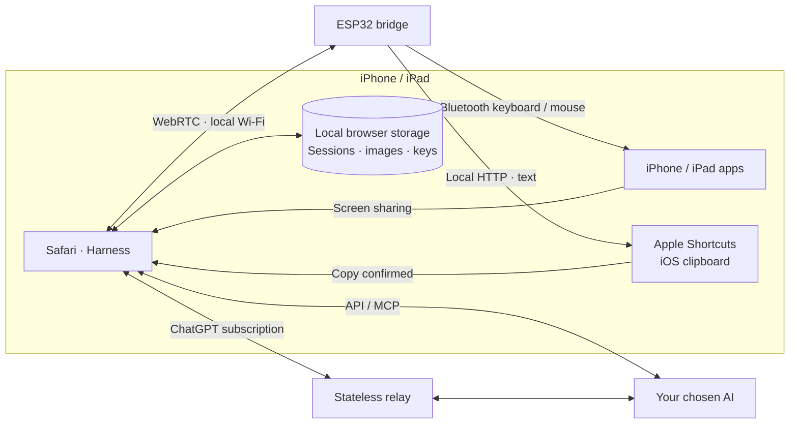

<h1 align="center">iPhone Agent Harness</h1>

<strong>Let AI automate your iPhone.</strong>

  <strong>English</strong> · <a href="docs/readme/zh-Hans.md">简体中文</a> · <a href="docs/readme/zh-Hant.md">繁體中文</a> · <a href="docs/readme/ja.md">日本語</a> · <a href="docs/readme/ru.md">Русский</a> · <a href="docs/readme/de.md">Deutsch</a> · <a href="docs/readme/fr.md">Français</a> · <a href="docs/readme/es.md">Español</a>

  
  
  
  

  <a href="https://igent.cc/">📱 Open Harness</a> ·
  <a href="https://igent.cc/flash">⚡ Browser installer</a> ·
  <a href="docs/guide/README.md">📖 Full guide</a> ·
  <a href="https://igent.cc/skills">🧩 Skill community</a> ·
  <a href="docs/architecture/overview.md">🗺️ Architecture</a>

Give your iPhone a task in plain language: inspect a screen, enter text, adjust a control or follow a short workflow across apps. A small powered ESP32 bridge supplies Bluetooth input while Safari runs the conversation and screen capture.

- **Install in your browser.** Choose your ESP32 and flash its firmware with desktop Chrome or Edge.
- **Keep your phone wireless.** Leave the powered bridge on a shelf or in a room corner within Bluetooth range.
- **Use your normal Wi-Fi.** The phone and bridge share your home or office network. Open Safari to start a task.

<table>
<tr><th>Order takeaway</th><th>Set an alarm</th></tr>
<tr>
<td width="50%" align="center">

https://github.com/user-attachments/assets/7601869f-7cc6-445e-b64d-0073a8bf657d

</td>
<td width="50%" align="center">

https://github.com/user-attachments/assets/d72669a6-e150-40d7-ba2f-1d9586d9c2ea

</td>
</tr>
</table>

**AI orders takeaway on an iPhone.** The agent selects MIXUE drinks, sets ice and sugar, and works through checkout. The video ends with the delivered order.

## ⚙️ How it works

Safari captures the phone screen and sends selected context to your chosen AI. The Harness validates an action plan, sends it directly to the ESP32 over local WebRTC, and the bridge delivers Bluetooth mouse/keyboard input. The next screen observation closes the loop.

[Architecture details](docs/architecture/overview.md)

## 🔌 Choose a board

A basic ESP32-C3 board costs roughly **US$2**. Pick your chip in the [browser installer](https://igent.cc/flash), plug it into your computer with a USB data cable, and flash.

| Chip | Supported models |
|---|---|
| ESP32-C2 | 2 MB minimum · 26/40 MHz crystal detected automatically |
| ESP32-C3 | All models* |
| ESP32-C5 | All models* |
| ESP32-C6 | All models* |
| ESP32-S3 | All models* |
| ESP32 (classic) | All models* |

*The current images for C3, C5, C6, S3 and classic ESP32 use standard SPI flash with at least 4 MB capacity.

## 🚀 Set up and try it

The complete guide covers every step. These links take you to the relevant section:

1. **[Enable accessibility](docs/guide/README.md#accessibility)**

2. **[Flash firmware](docs/guide/README.md#flash)**

3. **[Join Wi-Fi](docs/guide/README.md#wifi)**

4. **[Pair Bluetooth](docs/guide/README.md#bluetooth)**

5. **[Open Harness](docs/guide/README.md#open-harness)**

6. **[Add AI access](docs/guide/README.md#models)**

7. **[Connect and test the bridge](docs/guide/README.md#bridge)**

8. **[Install the clipboard Shortcut](docs/guide/README.md#clipboard)**

9. **[Install a community skill](docs/guide/README.md#install-skills)**

10. **[Create your own skill](docs/guide/README.md#authoring)**

11. **[Publish a skill](docs/guide/README.md#publish)**

## 💬 Conversations, plans and skills

Ask a question, work through a plan or give the agent a task in the same conversation. Conversations support rename, archive, search and file export. Scroll back through the history while a task runs, then jump to the latest reply whenever you want.

Skills teach the agent how to handle common phone tasks and improve its taps, typing and gestures. Add skills from the community or ask Harness to help write your own. You can also connect MCP tools in Settings.

Actual Harness screens with sample content; the conversation below is an example.

<table>
  <tr><th>Your conversations</th><th>Example conversation</th><th>Skills</th></tr>
  <tr>
    <td></td>
    <td></td>
    <td></td>
  </tr>
</table>

One bridge supports two independent Harness connections. When using two phones, select the matching phone on each page and run the optional input test on each to confirm the pairing.

## 📋 Long text, in any language

The bridge handles everyday typing and shortcuts as a Bluetooth keyboard. For long or multilingual text, **iPhone Agent Clipboard** uses Apple Shortcuts to copy the text, then the agent pastes it into the chosen field.

The browser sends the text to the ESP32 in small chunks over local WebRTC. The bridge streams those chunks in one HTTP response to the Shortcut, which puts the complete text on the iPhone clipboard.

[Set up clipboard copy](docs/guide/README.md#clipboard)

## 🔒 Data and privacy

Sessions, screenshots and credentials are saved in your browser; ordinary APIs connect directly to your provider. ChatGPT subscriptions use the project’s Cloudflare relay or your own stateless relay because of browser CORS, forwarding selected context, images, output and a short-lived access token. The relay application does not persist this traffic or log bodies or credentials.

Screenshot reuse sends each selected image once to DeepSeek or Claude and uses its file ID in later requests. These provider files expire after one hour; the option can be changed per API connection.

## 🤝 Contribute

Ideas, bug reports and improvements are welcome: [open an issue](https://github.com/cccat6/iphone-agent-harness/issues) or [send a pull request](https://github.com/cccat6/iphone-agent-harness/pulls). Share your custom skills in the [skill community](https://igent.cc/skills).

[MIT License](LICENSE) · [Third-party notices](THIRD_PARTY_NOTICES.md)

## 💛 Acknowledgements

Thanks to [onehumanbeing/esp32-iphone-agent](https://github.com/onehumanbeing/esp32-iphone-agent) for inspiration.
