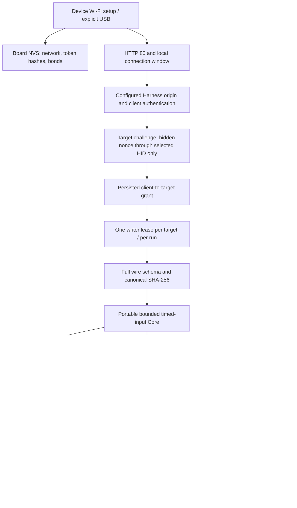
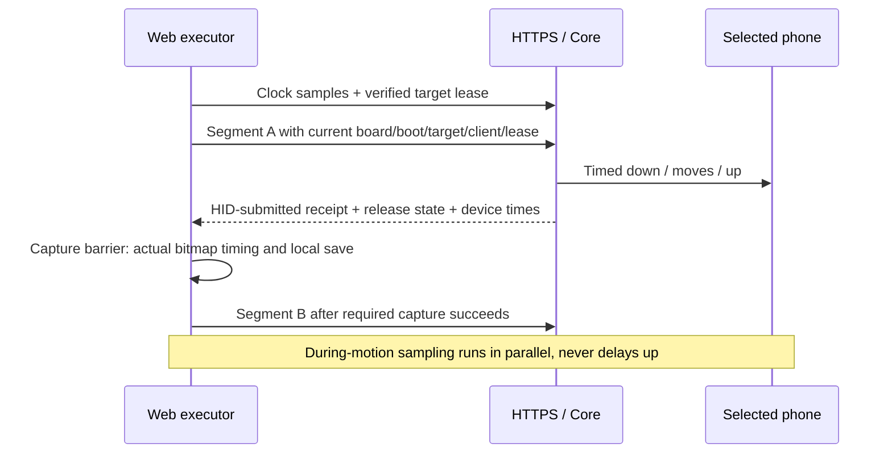

# Firmware implementation

Product: iPhone Agent Harness. Current implementation is direct LAN v0.3; the earlier blanket-503 diagnostic scaffold has been replaced in source. The old physical experiment sketches remain untouched. Compiled artifacts and physical observations are separate evidence; `physicalValidation:false` remains explicit until the relevant hardware acceptance is performed.

Detailed first configuration, local connection windows and exact REST fields: [secure LAN](secure-lan.md). Reproduction and serial commands: [Arduino README](../../firmware/IPhoneAutomationHarness/README.md).

## Runtime components

`src/Admission.h` owns fixed-capacity client authentication/binding challenge state. `src/Pki.h` retains shared random/hash helpers and legacy PKI utilities; normal HTTP setup does not generate a CA. `src/LanBridgePage.h` supplies the static, same-origin local connection page. `src/Wire.h` validates the fixed JSON input format. `src/SecureService.h` supplies Wi-Fi setup and HTTP REST. `src/Core.h` remains portable C++17 for host tests and timed scheduling. `main.cpp` handles Wi-Fi, mDNS, safe peer snapshots and the directed NimBLE sink.

These are fixed source modules, not a runtime plugin/driver registry. LLM, Skill, media and session traffic do not pass through the board.

## Identity and multi-phone isolation

- Stable public boardId is an eFuse-derived label, not a password. BootId changes each boot.
- Persisted targetId maps to the BLE stack-resolved identity address **and address type**, never a rotating over-the-air private address.
- Temporary connHandle selects every HID notification. Connection-handle reuse is checked against the currently resolved identity.
- Each browser has a separate authenticated client grant. Owner proof permits enrollment; target proof additionally requires receiving a nonce through the intended phone's actual keyboard input.
- Each target has an independent input state, encrypted/subscription state, lease, active segment and result receipts. Another target's release or Home is never broadcast.
- An active lease can be renewed only by its same client and same lease ID. Another run under the same client cannot replace it. Cancellation/expiry fences retired IDs within the boot.

NimBLE callbacks never wait on Core's mutex. They publish fixed peer/identity snapshots, including a late identity-resolution event. System Bluetooth pairing is independent of browser registration and has no hidden time window; the two-peer radio limit remains. Failed encryption disconnects promptly so a phone can retry. The main loop reconciles snapshots and persists new identity mappings only while input is idle. When bond storage fills, only an offline peer can be replaced. Missing offline bonds are reconciled with the application target table: durable mapping deletion precedes proof/grant revocation and Core slot reuse, and startup discards grant references to missing targets. New target IDs never inherit the previous phone's input proof. Stable identity/rebond behavior and actual two-phone operation remain hardware tests.

## Timing and frame synchronization

Each network segment is completely validated before admission. The HTTPS admission and board storage limit is 128 reports; portable host Core tests also exercise 512. The independent UTF-8 wire limit is 8192 bytes and advertised report spacing is 40 ms. Segments last at most five seconds, and any held input channel at most three seconds. Reports use 64-bit monotonic milliseconds (`esp_timer_get_time()/1000`) instead of UTC or wrapping 32-bit deadlines.

The browser compiles sampled pointer reports. A swipe's last moving report and up can share one timestamp, so no screenshot wait or endpoint pause removes release velocity. A drag explicitly includes a bounded endpoint hold. The device does not interpret arbitrary loops, JavaScript, image requests or model parameters.

A scheduler lateness over 40 ms stops the segment and requests release rather than emitting a stale backlog. Receipts contain accepted/start/end/last-submit times, submitted count, maximum lateness and release submission state. `hid_submitted` only proves stack submission, not that a phone visibly opened or scrolled.

Screenshots never execute on ESP32. Web retains actual request/ready/media times and alignment uncertainty. A missing receipt is queried by the same ID, and a missing required frame stops dependent input.

## Cancellation, replay and persistent state

Cancel, timeout, BLE disconnect, notify failure and timing misses terminate the current target's segment. Releases use that target's handle. A disconnected link is not recorded as a successfully delivered release. Reconnection sends reset reports before readiness.

Sixteen final receipts are cached. The product’s boot-local 7168-byte (57,344-bit) RTC-backed Bloom tombstones with sixteen probes prevent evicted segment or retired-lease IDs from executing again; possible false-positive refusal is fail-closed, not a reason to blindly use a new ID. The bounded filter is not an unlimited permanent exactly-once ledger. Power loss changes bootId and requires screen/state reconciliation.

Network/Origin configuration commits as one NVS value. A candidate client token/grant persists successfully before becoming active in RAM. Normal HTTP setup does not generate or use private-CA material. Original images, conversations and model keys stay on the phone.

All Core admission/result/cancel/tick access is serialized. `lockedReply` computes a decision and response object under the mutex, leaves the scope, then sends network data. HTTP receive/parse/hash and response writes do not hold the timing mutex. Two socket sessions are accepted and handlers execute sequentially. Completed REST/OPTIONS sessions close explicitly, with bounded waits.

## Validation

- **16 Core scenario groups**: targeted notifications, concurrent independent targets, same-time move/up, complete released sequences, usage/coordinate/time limits, duplicate/conflicting IDs, cache eviction, stale boot, ownership contention, cancellation, transport failure, disconnect reset, deadlines, 64-bit time and retired-lease fencing.
- **7 Admission scenario groups**: token/origin rejection, typed proof required, wrong client/target/challenge rejection, three-attempt lockout, expiry, cooldown, immutable target binding, credential rotation and bounded capacity.
- `tests/firmware/run.sh` passes 79 scenario groups across Core 512/256/128, Admission, external replay storage, setup deadlines/certificate time, and 12 actual production BLE router interleavings. The router cases permanently cover handle/epoch reuse, queued timeout and committed-pointer release positions.
- Six canonical-streaming scenarios run against the real pinned ArduinoJson headers; six build-tool tests cover artifacts and provenance.
- Final C3/S3/C6/classic ESP32 profiles all compiled from the same 16-file source record; `--verify-only` checks their 16 binaries, offsets, partition bounds and current-source provenance.
- The source targets C3/S3/C6/original ESP32; the published manifest lists only profiles that actually compiled. No S2 or H2 profile is offered.

The current source and all four compiled profiles are identified by [the build report](../../apps/web/firmware/build-report.json). The successful Safari local-window experiment used a read-only fixture and does not establish physical firmware/HID behavior. The older 0.2 HTTPS firmware's [device report](../research/device-client-live-verification.json) remains historical evidence.

## Resource-limited product build

Arduino `build_opt.h` globally includes `ResourceLimits.h` after SDK configuration, covering the bundled NimBLE C and C++ units. The board has two host connections/bonds, peripheral-only roles and MTU 23. C3/S3/C6 use MSYS pools 8/8; classic ESP32 preserves its SDK-disabled second pool (8/0). Product event storage is 128 per target, while portable Core tests can retain 512. A separate 8192-byte UTF-8 segment request limit is advertised and returns 413 before allocating the JSON tree. These bounded resource choices remain from earlier C3 memory measurements. Current HTTP mode removes the TLS listener; actual free heap and physical input still require device measurements.

Canonical hashing now streams validated JSON into mbedTLS SHA-256 through a bounded writer. The canonicalizer has a fixed 12-key pointer array instead of heap key vectors and constructs no complete canonical string. Six independent host scenarios use the real pinned ArduinoJson headers; run them with `tests/firmware/run_canonical.sh` and an ArduinoJson include path. Core state-machine scenarios run at 512, 256 and 128 events; external-storage scenarios verify 7168-byte RTC-style clearing and boot/replay fences. This removes duplicate canonical strings, while JSON parsing itself retains an explicit, measured heap requirement.

Product `main.cpp` selects 128 events, a 7168-byte RTC-backed replay filter and an 8 KB normal loop stack; PKI provision runs on a temporary 16 KB setup-only task. The external filter is cleared on every boot before admission and has the same fail-closed saturation behavior, with a slightly smaller bit budget. Boot IDs still separate reboot epochs, and the result cache never authorizes an evicted replay. HTTPD retains its 12 KB stack.

C3/S3/C6 use MSYS pools 8/8. The classic ESP32 SDK omits the second pool size, so that target preserves its disabled second pool (8/0) rather than enabling an undefined allocation; its physical two-phone throughput remains unverified. Effective values are available in USB diagnostics.
