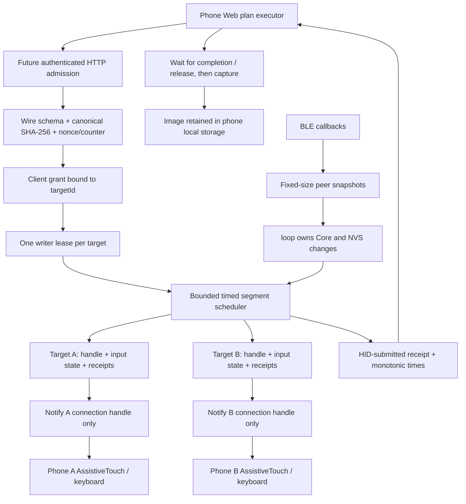
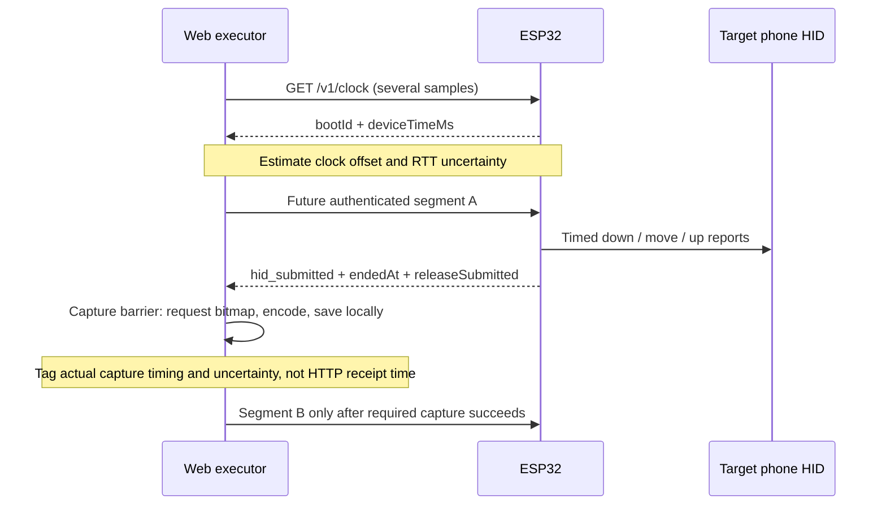

# Arduino product framework

Date: 2026-10-18. Product sketch: `firmware/IPhoneAutomationHarness/`. The previous `phone_chain_c3*` experiments remain untouched. This is a compiled foundation, not a claim that the new product is paired, flashed or physically validated.

## Runtime boundaries

The authenticated admission, wire verifier and browser-to-target binding blocks are **not connected yet**. The sketch returns `503 transport_auth_not_implemented` for all non-GET network requests. It does not expose an unprotected HID endpoint to make the diagram look complete.

## Ownership and identity

- `boardId`: board's stable eFuse-derived identifier; a public label, not a cryptographic proof.
- `bootId`: new random identifier each boot; receipts are valid only for that boot.
- `targetId`: randomly generated registry ID, stored with the BLE stack-resolved identity address and its address type in NVS. Uses `NimBLEConnInfo::getIdAddress()`, requires bonded + encrypted peer, and admits only resolved public/static identities. It does **not** store `getAddress()` as target identity.
- `connHandle`: transient per-connection routing handle, never persisted. Reused handles are checked against the current stable identity before routing.
- `clientId`: future authenticated Web client grant, bound to one target in current Core. Binding cannot be silently reassigned to another target.
- `leaseId`: short-lived writer ownership for one target. Another authorized client may read status but cannot steal an unexpired writer lease or cancel its input.
- `segmentId`: client-scoped idempotency key. `planId` groups the browser's intent; it does not schedule screenshots on the board.

A BLE bond record and Web grant are separate. Phone A's Web needs an explicit onboarding proof that its HID route is target A. This remains an integration gate. No automatic ownership is inferred from IP address, BLE display name or the order phones connect.

The current NimBLE adapter uses bonding with no-input/no-output association as the old experiment did. Physical pairing windows and target-proof challenges must be implemented before enabling control; this is not a completed secure pairing UX. Unresolved or unsupported identity addresses fail closed and need diagnosis rather than an RPA fallback.

## Timed execution

`src/Core.h` is portable C++17, with fixed target/client/event/result counts. It can be executed in host tests without Arduino or Bluetooth. One active segment per target is allowed; there is no unbounded pending queue. Different targets advance independently in the same cooperative tick.

Every segment is fully validated before acceptance: board/boot, target grant, lease, IDs and hash shape, limits, event order, coordinates, usages, per-channel held duration and final released state. A segment cannot be accepted if its scheduled end crosses lease expiry. External admission must additionally verify the full schema and canonical SHA-256; Core is not a substitute for that verifier.

The browser sends final sampled pointer reports with `atMs` values. Core does not interpolate arbitrary curves or execute script. For a swipe, the last held move and up may share a timestamp; they submit consecutively, with no added endpoint delay. For a drag, the compiler inserts a finite endpoint hold before up. The endpoint hold counts toward the 3-second held-channel budget.

`tick()` uses caller-provided **64-bit monotonic milliseconds**. The Arduino adapter uses `esp_timer_get_time()/1000`, so a 32-bit `millis()` rollover does not break deadlines. The elapsed lateness limit is currently 40 ms; missing that limit stops the segment and requests release rather than emitting a backlog of stale moves in a burst. This is a conservative engineering default, not verified BLE precision.

A receipt records accepted/start/end/last-submit timestamps, number of submitted events, maximum observed scheduler lateness, terminal reason and whether the release call succeeded. `hid_submitted` means the BLE stack accepted the reports; it does not mean the phone visibly clicked, scrolled or opened anything.

## Cancellation and uncertain results

- Cancel, timing miss, expiry and transport failure terminate the active segment and attempt release for the **same target handle only**.
- Disconnect is processed after the link has gone, so its result explicitly has `releaseSubmitted:false`; it never pretends an undeliverable release succeeded.
- Reconnect requires reset reports before ready state. A failed release keeps the target unavailable.
- Repeated ID with the same authenticated hash returns the existing active/terminal receipt; same ID with a different hash is rejected.
- The last 16 results are cached. Boot-local Bloom tombstones prevent an evicted ID from executing again. Evicted or colliding IDs return `ReplayUnknown`: false-positive rejection is acceptable, duplicate physical execution is not. Tombstones are bounded and may become saturated in a long boot; future product admission should add durable per-client sequence policy before high-volume use.
- Reset changes `bootId` and loses receipt/tombstone state. Cross-power-loss exactly-once behavior is **not** promised. Web must take a fresh screenshot and reconcile an unknown result, without automatically replaying it.

## Screenshots and synchronization

The board never receives a screenshot event and never generates a screenshot. During-motion observation runs as a bounded Web sampling window in parallel with a complete input segment; the board does not wait on a frame and accidentally turn a swipe into an endpoint hold. Safe capture barriers split segments. On a missing receipt, Web queries the same ID; on a missing required frame, Web stops dependent segments.

The diagnostic clock endpoint provides one server processing time, not measured BLE radio delivery time. Network round-trip bounds and unknown media capture time must remain visible in the Web evidence record. A precise fixed-millisecond alignment between a notification and screen capture has not been demonstrated.

## Network and provisioning modules

Today `main.cpp` supplies:

| Path/module | State |
|---|---|
| `GET /v1/identity` | Public diagnostics: boardId, bootId, hostname, protocolVersion; no verified fingerprint |
| `GET /v1/capabilities` | Limits and peer status; executionEnabled false |
| `GET /v1/clock` | `{bootId, deviceTimeMs}` using monotonic board time |
| Network mutation routes | 503, not authenticated or wired |
| Wi-Fi station configuration | Own NVS namespace, optional ignored local header or USB configuration |
| Unique mDNS host and `_iah._tcp` | Implemented; router/browser interoperability untested |
| Protected provisioning AP | Explicit missing module, not replaced by an open password endpoint |
| CORS | Exact configured origin, diagnostics only; not authentication |
| TLS / Safari HTTPS-to-LAN | Not tested or selected |

`WebServer::handleClient()` is synchronous and suitable only for current diagnostics. Before enabling live control, replace or isolate its handlers so slow clients and JSON/TLS work cannot block the timed executor. NVS/configuration changes must be excluded while any target is executing. Core's current lateness guard is a stop mechanism, not a substitute for this integration.

## Verification performed

Host tests are in `tests/firmware/core_test.cpp`, invoked with `tests/firmware/run.sh`: **15 scenario groups passed**. They cover independent handles, same-timestamp move/up, duplicate/conflicting IDs, stale boot, cross-target rejection, lease contention, cancellation ownership, disconnect/reconnect reset, timing misses, maximum hold, released final state, out-of-range coordinates, unordered events, duplicate key usages, report failure, TTL, lease boundaries, result-cache eviction and 64-bit time.

The final C3 build passed with **1,296,185 bytes flash (41%) and 47,272 bytes static RAM (14%)**. It uses ESP32 core 3.3.11, NimBLE-Arduino 2.5.1, ArduinoJson 7.4.3, USB CDC/DIO/huge_app. See sketch README for reproduction. No serial port was opened, no firmware was uploaded, no HID command was sent, and no new phone pairing was performed in this implementation pass.

Remaining acceptance gates are protected onboarding/authentication, real identity resolution across reboots and rotating addresses, browser-to-phone target proof, two-phone independent reporting, radio coexistence, executor jitter/velocity, release behavior during failures and Safari local-network transport.
