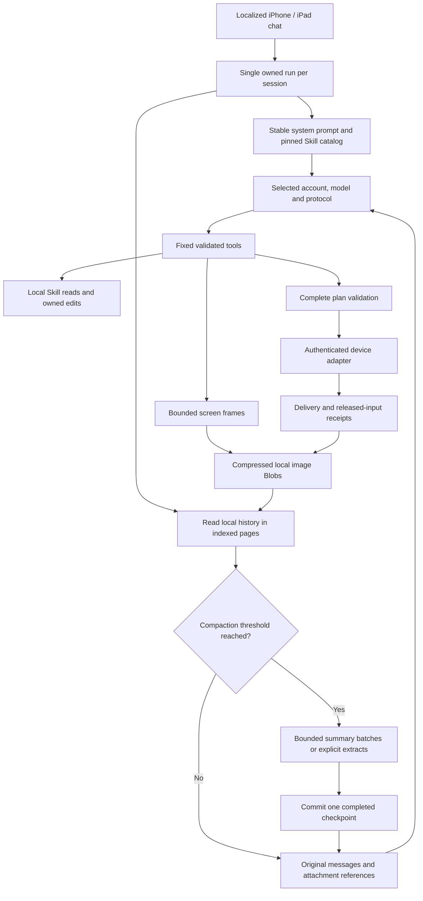

# Harness runtime implementation

The Web runtime uses a fixed tool set, not an executable plugin registry. Skill packages contain Markdown/JSON guidance. Local authoring is available in chat, plan and task modes; phone observation is absent in chat, and phone input requires a verified target, binding, lease, released input state and an injected execution transport. The product UI does not manufacture those prerequisites from a saved URL.

## Ordered execution and cancellation

The runtime reserves its local run lock before the first storage await and claims a persistent session lease to prevent competing tabs. All model calls and trusted state reads are cancellable, including adapters that ignore `AbortSignal`. Late replies cannot start another operation. Assistant tool calls and their durable results remain paired after interruption; uncertain modifying operations are not reported as unexecuted or automatically replayed.

A phone plan is validated in full before the first submitted segment. The executor rechecks the trusted state at asynchronous boundaries, including target, boot, lease and orientation. It accepts synchronous or asynchronous `getState()`. Each gesture is a complete timed input segment: release does not wait for a model call or JPEG encoding. A screenshot barrier waits for a confirmed release; a review screenshot ends the plan. During-motion observations sample alongside a complete motion segment without promising exact synchronization.

Only real frame IDs observed in the current run can substantiate a completed phone task. A HID receipt means submitted input and release; it does not establish the visible app outcome. Budget exhaustion, missing input, failure, cancellation and unknown delivery have distinct states. The authenticated product transport is implemented; injected mock executors are not evidence of a working physical network control path.

## Accounts, protocol state and context cache

The selector identifies an account profile and model separately. API keys remain in memory unless explicitly saved in an encrypted local vault. Codex device-code/refresh and its subscription Responses transport have their own account module; a real Safari sign-in is not inferred from mock login tests. Refreshed credentials can notify the unlocked vault to re-encrypt rotated tokens. The unlock secret remains in page memory.

The request begins with the stable canonical system/mode prompt, selected language instruction, trusted built-in procedures and a sorted version-pinned Skill catalog. The current run's device snapshot is an internal durable row after the real user message, rather than a changing prefix before old history. New messages append to the existing request until a deliberate compaction boundary. Skill or language changes intentionally change the prefix.

Some backends require opaque state to be replayed across tool calls. OpenAI-compatible `reasoning_content`, Anthropic signed thinking blocks and Codex Responses output items are retained as protocol state, scoped to the originating account, model and backend. The UI does not render that state as chat text. It is excluded from search-tool results and summary input; its storage size is included in context estimates. Switching backends does not forward another backend's opaque state. Explicit conversation exports retain protocol state so a later local import can reconstruct the history.

Native Anthropic receives an explicit cache hint on the stable system prefix. Compatible servers do not receive unsupported native-only fields. OpenAI/DeepSeek reported usage, including available cache hit/miss fields, is recorded without inventing a cache hit rate. Prefix stability improves the conditions for reuse; the provider decides actual caching.

## Compaction and images

Settings separate trigger, target, output reserve, image count and strategy. Estimates account for CJK text, tool arguments, opaque state, fixed prefix and image allowance; they are not a provider tokenizer. Unchanged input is not repeatedly compacted. A long history is read in bounded indexed pages. Every newly compressed source range is consumed; multiple model-summary batches feed their previous summary forward. A later batch failure or cancellation leaves the previous checkpoint unchanged. Local extracts are explicitly marked as lossy quotations rather than a semantic summary.

A checkpoint preserves complete tool-call groups, source ranges, the actual recent user goal and retained image references. Normal turns do not slide an image window that would invalidate the prefix every request. Image selection changes at a compaction boundary. Only the final selected references are decoded for a model request; original attachments remain local and available for export.

Captures retain the complete source bitmap dimensions without cropping or resizing. JPEG encoding uses one of three presets: compact (0.65), balanced (0.8, default), or high (0.92). Original dimensions, scale, output dimensions and actual request/readiness times are stored with the image. IndexedDB retains a Blob rather than duplicate base64 plus binary copies. Media recording chunks are discarded instead of accumulating a full session video. Compression limits storage growth; browser eviction, private browsing and user-cleared data still require normal export/persistence controls.

## Verification boundaries

`npm test` exercises mock network and device paths, real local cryptography, indexed-storage contracts and browser-flasher validation. `tools/verify_harness.mjs --live` uses an explicitly supplied ignored local DeepSeek credential for a synthetic Skill-list/load workflow with both compatible protocols; it sends no phone image or HID command. Prior iPhone background and input experiments remain separate evidence. Browser UI localization, build integrity, compilation and physical acceptance must be reported separately.
