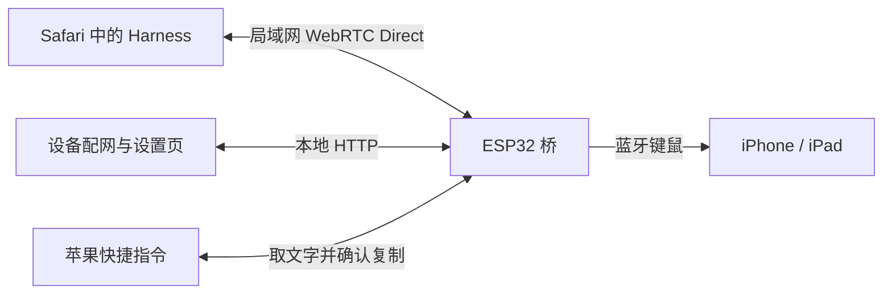

# 手机与 ESP32 的局域网连接

Harness 在一个 Safari 页面里完成对话、屏幕共享和设备控制。页面通过 **WebRTC Direct** 与局域网内的 ESP32 桥通信，再由桥通过蓝牙向手机发送输入。日常控制不需要保留额外的设备标签页，网站服务器不转发操作指令。

## 首次连接

新板子先按烧录页的提示加入常用的 2.4 GHz Wi-Fi。手机与桥在同一局域网后，可以选择以下任一种方式导入连接信息：

- 在手机打开电脑烧录页提供的连接链接。
- 在手机打开 `http://igent.local/settings?import=1`，点“返回设备连接”。页面会在同一标签页返回网站，并带入桥的实际地址。

这里的 `igent.local` 用来打开设备设置页；返回链接会带入实际局域网 IP，不需要手填 IP，也不依赖 Safari 在 WebRTC 里直接解析这个名字。

获取页只读取公开身份信息，不注册管理客户端。连接信息包含桥的地址、端口和 WebRTC 指纹，连接前就保存在当前浏览器。获取后返回设备连接面板；浏览器返回也会恢复这个面板。没有信息时连接按钮禁用，已有信息时隐藏获取步骤。之后直接在 Harness 点“连接 ESP32 桥”即可。桥已经加入 Wi-Fi 时，不用重新配网；改过设备名或网络地址时，再从设备设置页导入一次。

蓝牙配对和网页连接各有作用：网页连接让 Harness 与桥通信；手机与 **iPhone Agent Bridge** 配对并通过八位数字输入测试后，Harness 才能确认操作的是这台手机。辅助触控按教程开启，全键盘控制不作为限制条件。

## 页面、桥与 HTTP 的分工

WebRTC 控制走 UDP 18948，沿用原有的设备、客户端、手机验证、控制权和执行回执。HTTP 80 保留给首次配网、设备管理和快捷指令取件；它不是 HTTPS Harness 页面的主控制通道。

所有板子使用项目提供的同一份长期通信证书和指纹，无需为每块板子签发或维护证书，也不用在手机安装证书。它用于建立通信通道；具体是哪块桥、哪个浏览器和哪台手机，仍由 `boardId`、客户端令牌和手机输入测试分别确认。

## 长文本

[剪贴板快捷指令教程](https://igent.cc/shortcuts/clipboard.html)提供可下载的 **iPhone Agent Clipboard**。Harness 创建临时文字任务，快捷指令通过一个本地 HTTP 流读取完整文字、复制，再确认完成。桥只暂存一个 1 KiB 分块，网页随读取进度继续供给文字，因此没有 8 KiB 的全文上限。Harness 收到确认后才继续检查目标输入框并粘贴。网页直接复制仍作为前台点击选项。

## 验证进度

Safari 的 WebRTC Direct 原型已经有手机前台和录屏后台的短测成功记录，也出现过抖动和超时。它证明了这条通信路线可用，尚不等于正式固件的 BLE、RPC、截图和手机操作闭环已经验收。正式组合固件的实机结果正在单独补齐。

[手机原型记录](../research/rtc-direct-c3-iphone-20261019.json)保留当时的成功和失败情况。此前 HTTP 与连接窗口实验留在历史研究记录中，不再是当前操作步骤。
