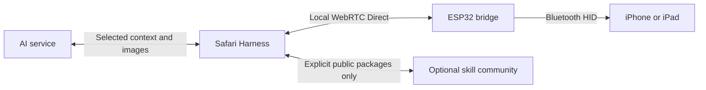

# Project overview

[Phone guide](../acceptance/README.md) · [简体中文](../acceptance/zh-Hans.md) · [Project](../../README.md)

iPhone Agent Harness has two product parts: the static browser application in `apps/web/` and the ESP32 firmware in `firmware/IPhoneAutomationHarness/`. The optional signed public-skill service belongs to the Web part.

The phone browser owns conversations, model requests, screen images and task reasoning. The bridge owns local Bluetooth input and bounded timed execution. The website does not relay phone commands or hold a private conversation database.

The supported phone entry is Safari on iOS/iPadOS 27+. Desktop visitors get the homepage, skill community and firmware installer. Phone screen sharing needs HTTPS. Initial USB or local device setup supplies the bridge connection information; normal use needs neither certificate installation nor a second connection tab.

See [connection](lan-connection.md), [runtime](runtime.md), [actions](actions.md), [models and MCP](auth-and-backends.md), [skills](skills.md) and [deployment](deployment.md). Hardware functionality remains experimental: compilation and desktop tests do not establish phone gestures, background survival or multi-phone reliability. The current bridge has one active WebRTC peer.
