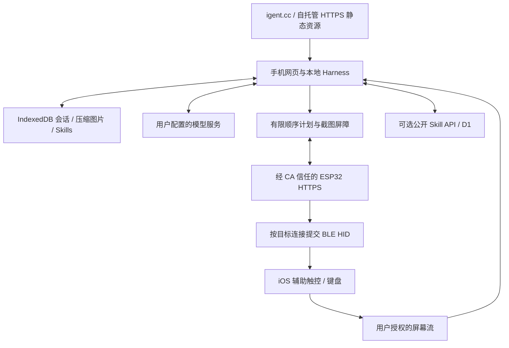

# 整体架构

日期：2026-10-18。本文描述当前实现；最终验收与手机待测项见[验收记录](../research/release-acceptance.md)。

## 产品与数据方向

目标是 iPhone／iPad 上的 Safari 27+。根路径 `/` 为 Harness，电脑访问自动进入 `/main`；`/skills` 为社区，`/flash` 为电脑烧录。低版本手机在 Harness 入口显示不可关闭的兼容提示，只能前往主页。添加到主屏幕不代表已经验收 PWA 的后台行为。



会话、截图、摘要、凭据密文及 Skill 安装状态保存在用户浏览器。选中的上下文与图片会发送到用户配置的模型服务。社区后端只保存用户主动签名发布的公开 Skill，不接收私有会话、模型 Key 或截图。ESP32 不运行模型、不保存截图，也不作为模型流量代理。

暂不做 Android、多指触控、任意手机文件访问或原生触摸 API。HID 不承诺任意 Unicode 输入和剪贴板读写。取屏正在运行也不保证系统永远调度后台网页。

## 固定模块与源码

```text
apps/web/                         UI、路由、八语文案
  core/                           Harness、模型、上下文、取屏、计划、存储、设备、MCP
  ui/                             设备、USB 配置、MCP 面板
  community/                      本地作者身份、签名与社区客户端
  api/                            公开 Skill Worker / D1
  skills/                         十个声明式内置 Skill
  firmware/                       四类预编译固件、哈希与上游许可证
firmware/IPhoneAutomationHarness/  自包含 Arduino 产品 sketch
prompts/                          原创系统、模式与压缩提示词
specs/                            计划 / 结果 / 输入段 / Skill schema 与示例
tests/ · tools/ · docs/            验证、构建、发布与证据
```

浏览器采用原生 JavaScript ES modules；更早浏览器由经典 ES5 bootstrap 显示公共入口和兼容门禁。工具集合固定，模型不能动态安装代码或注册能力。Skill 是可更新的说明内容；自有 Skill 可由 Harness 制作和修改，内置与社区下载项只读。网站不运行 Node CLI、shell 或本地 stdio MCP。

## 初次配置与信任

电脑可用 Chrome／Edge Web Serial 烧录受支持板型，或使用 Arduino。首次 USB 配置以及单客户端、所有者认证的 WPA2 配置热点均可设置 2.4GHz Wi-Fi 和允许的网页 origin。板子生成每板独立 CA 和服务器证书，导出公开 mobileconfig 和 CA 指纹。手机需要自行安装描述文件并手动启用证书完整信任；网页无法代替这一步。

网页保存可信配置来源给出的唯一 `.local` 主机名与预期 CA 指纹，核对身份后才发送所有者密码换取客户端 token。随后用户在系统蓝牙设置配对 HID，关闭全键盘控制、开启辅助触控，并在网页聚焦挑战输入框；板子向选定连接输入八位数字，网页回传实际观察值，成功后才建立客户端到目标的绑定。设备名、IP、蓝牙已连接都不构成目标证明。

当前实现使用 **HTTPS + 精确 Origin/CORS + 独立客户端 bearer token**，不提供 HTTP 控制降级。USB／受保护热点负责配网；更改证书导致 CA 指纹变化时须重新安装信任并更新固定指纹。具体契约见[受保护局域网](secure-lan.md)。

## mDNS 与重连

每板唯一名称用于已知设备重连；网页没有通用 Bonjour 枚举 API，也不穷举内网 IP。用户从初次配置获得名称，浏览器以后请求同一名称并重新验证身份。mDNS 不提供 HTTPS 信任或授权。普通家庭路由器通常无需特殊服务，但访客隔离、不同 VLAN、禁用组播或客户端互访会阻断路径。手机在 5GHz、ESP32 在 2.4GHz 本身不构成障碍。

静态网页必须直接访问允许 CORS 的模型与局域网服务。只填 IP 不能解决证书 SAN；证书包含唯一 `.local` 主机名，使用该名称。自托管改变 origin 时须显式配置板子允许来源，并通过会话／身份导入导出迁移浏览器数据。

## 多目标、租约与时间

实现保留 `boardId / bootId / targetId / clientId / leaseId / planId / segmentId`。稳定 bond 身份与连接代次约束目标；HID 必须定向发送。每目标一个写租约，每次运行使用新 leaseId；其他目标的取消和输入状态互相隔离。单段完整按下与释放，屏障处由网页取图；ESP32 不会伪造截图回执。

当前资源配置为两个 BLE 连接／bond、八个网络客户端登记、一个 TLS 服务槽。HTTP 请求完成后主动关闭连接，为其他客户端留出机会。支持登记或理论连接数量不等于已经验证双手机同时使用的性能。真实 TLS 已在 C3 候选版验证；最终版 BLE 输入、Safari 公网到 LAN 及双目标仍需手机验收。

批次最多 30 步、执行预算不超过 15 秒。产品段最多 128 报告、8192 UTF-8 字节、5 秒，单次按住不超过 3 秒；最终按能力协商进一步约束。每段有规范化哈希、幂等结果查询和未知结果停机路径，网络失败不创建新 ID 盲目重放。见[动作与同步](actions.md)和[设备客户端](device-client.md)。

## 发布与边界

官网在 `igent.cc`，公开页面与 `/api/skills` 同源；没有二级域名依赖。静态构建可自行托管；非官网不会自动启用官网发布 API。当前不注册 Service Worker，不能宣称离线安装或自动更新协调已经实现。常规网站更新不会主动重载正在打开的页面。

项目代码采用 [MIT](../../LICENSE)，第三方组件和固件上游保留其许可证，见[第三方声明](../../THIRD_PARTY_NOTICES.md)。来源研究见[Harness 调研](../research/harnesses.md)。
