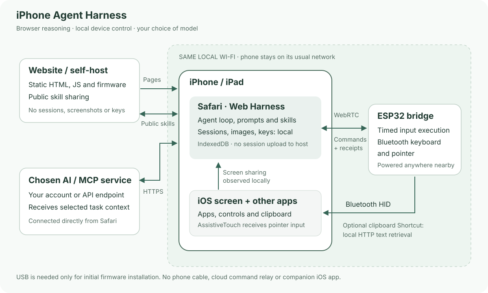
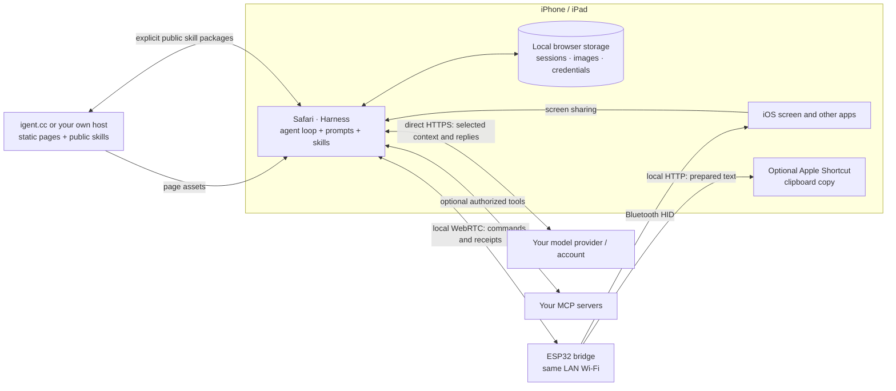

# Architecture

[Project](../../README.md) · [Setup guide](../guide/README.md) · [简体中文教程](../guide/zh-Hans.md)

The phone runs the Harness in Safari. The ESP32 is a small input bridge on the same local Wi-Fi network, powered independently near the phone. It receives timed command batches over WebRTC Direct and sends Bluetooth HID keyboard and pointer input to iOS. Screen capture stays on the phone; video is not streamed through the board or our hosting service.

## What each part does

| Part | Responsibility |
|---|---|
| `apps/web/` | Safari interface, model adapters, session storage, context compaction, skills, capture and execution loop; desktop skill publishing and browser firmware installation |
| `firmware/IPhoneAutomationHarness/` | Wi-Fi setup, device identity, local WebRTC transport, Bluetooth HID, precise timing, receipts and clipboard transfer |
| `prompts/` and `apps/web/skills/` | Fixed runtime instructions and versioned built-in procedures; skill text is not executable plugin code |
| Optional public skill API | Stores deliberately published packages, signatures and revisions |

## A task, end to end

1. The user starts screen sharing from Safari and gives the agent a goal.
2. The Harness reads fresh screen frames and sends the selected context directly to the chosen model.
3. The model can propose a sequence of taps, key presses, drags, swipes, waits and intermediate captures.
4. The browser sends device segments to the local bridge. The bridge executes input against the selected Bluetooth phone and returns receipts.
5. The Harness checks fresh screenshots, adjusts the next action or input method, and continues until the goal is verified.
6. By default the agent returns to the current Harness conversation and confirms it is visible before ending. The user can disable this in task-completion settings.

A receipt proves input submission, not that an app accepted the intended action. Interrupted or uncertain inputs are reconciled from device state and fresh observations rather than blindly replayed. Stopping screen sharing pauses the task, and the user decides when to continue.

## Where data goes

| Data | Location / destination |
|---|---|
| Sessions, stored screenshots, API keys, login credentials | Local browser storage on the user's device |
| Selected messages and images needed by the model | Directly to the user's chosen model backend |
| Authorized MCP arguments | Directly to the configured MCP service |
| Phone actions and execution receipts | Local Wi-Fi between Safari and ESP32; Bluetooth input from ESP32 to phone |
| Home Wi-Fi credentials | ESP32 local storage after setup |
| Published skill package, public author key and signature | Public skill community, only when the user chooses Publish |
| Website assets and precompiled firmware | The chosen page host; self-hosting is supported |

Our hosting service does not receive or store private Harness sessions, screen images, API keys or phone commands. Using an external model or MCP service sends the selected task data to that service. This is the same data flow on the official site and a self-hosted page.

The bridge currently has one active WebRTC control peer. Other phones can read setup information independently; saved browser clients and Bluetooth pairings do not imply simultaneous independent agent control.

[Transport](lan-connection.md) · [Actions](actions.md) · [Runtime](runtime.md) · [Models](auth-and-backends.md) · [Skills](skills.md) · [Self-hosting](deployment.md)
