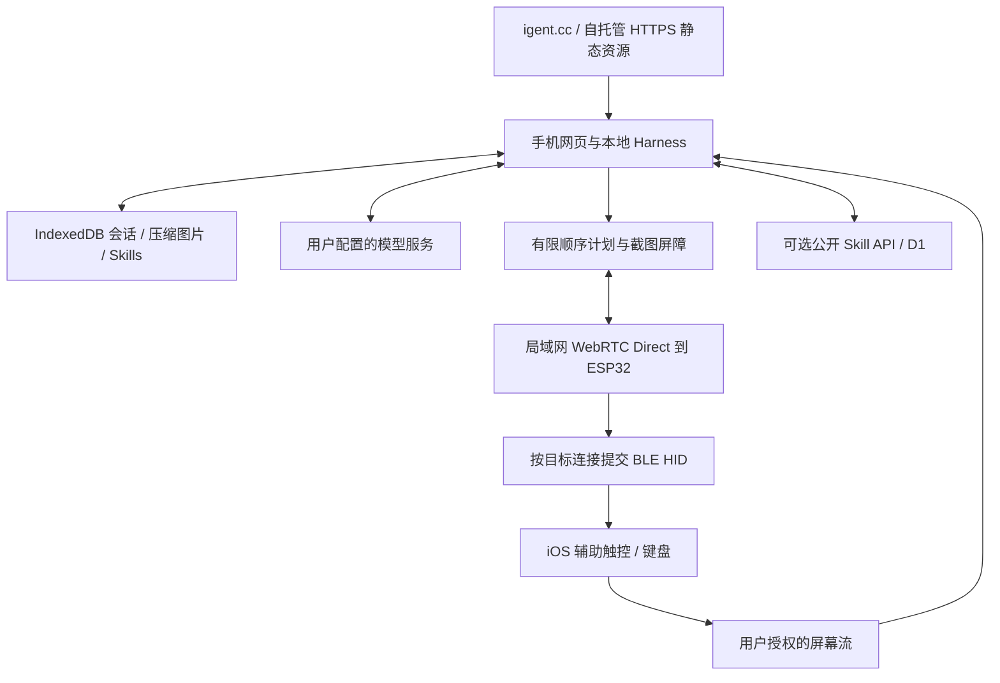

# 整体架构

日期：2026-10-19。本文描述当前实现；手机流程见[使用与验收](../acceptance/zh-Hans.md)，正式 RTC/BLE 组合固件的硬件结果单独记录。

## 产品与数据方向

目标是 iPhone／iPad 上的 Safari 27+。根路径 `/` 为 Harness，电脑访问自动进入 `/main`；`/skills` 为社区，`/flash` 为电脑烧录。低版本手机在 Harness 入口显示不可关闭的兼容提示，只能前往主页。添加到主屏幕不代表已经验收 PWA 的后台行为。



会话、截图、摘要、凭据密文及 Skill 安装状态保存在用户浏览器。选中的上下文与图片会发送到用户配置的模型服务。社区后端只保存用户主动签名发布的公开 Skill，不接收私有会话、模型 Key 或截图。ESP32 不运行模型、不保存截图，也不作为模型流量代理。

暂不做 Android、多指触控、任意手机文件访问或原生触摸 API。长文本与多语言输入通过[剪贴板快捷指令](https://igent.cc/shortcuts/clipboard.html)完成复制，再由 HID 粘贴；普通 HID 键盘报告本身不是 Unicode 文本接口。取屏正在运行也不保证系统永远调度后台网页。

## 固定模块与源码

```text
apps/web/                         UI、路由、八语文案
  core/                           Harness、模型、上下文、取屏、计划、存储、设备、MCP
  ui/                             设备、USB 配置、MCP 面板
  community/                      本地作者身份、签名与社区客户端
  api/                            公开 Skill Worker / D1
  skills/                         十个声明式内置 Skill
  firmware/                       四类预编译固件、哈希与上游许可证
firmware/IPhoneAutomationHarness/  自包含 Arduino 产品 sketch
prompts/                          原创系统、模式与压缩提示词
specs/                            计划 / 结果 / 输入段 / Skill schema 与示例
tests/ · tools/ · docs/            验证、构建、发布与证据
```

浏览器采用原生 JavaScript ES modules；更早浏览器由经典 ES5 bootstrap 显示公共入口和兼容门禁。工具集合固定，模型不能动态安装代码或注册能力。Skill 是可更新的说明内容；自有 Skill 可由 Harness 制作和修改，内置与社区下载项只读。网站不运行 Node CLI、shell 或本地 stdio MCP。

## 初次配置与连接

电脑可用 Chrome／Edge Web Serial 烧录，或使用 Arduino。新板子通过 USB 或设备 Wi-Fi 设置 2.4 GHz 常用网络。之后在手机打开 USB 提供的连接链接，或打开 `http://igent.local/settings` 并点“返回 Harness”，同一标签页带回设备的实际 RTC 地址。

Harness 页面通过 WebRTC Direct 连接桥，不需要常驻设备标签页。项目提供所有板子共用的长期通信证书配置，不要求用户安装证书或维护每板 CA。设备身份、浏览器令牌、选定目标绑定和控制租约分别检查；连接码已经移除。

用户在系统蓝牙设置配对 **iPhone Agent Bridge**、开启辅助触控，在网页选择已连接、可用目标。新固件完成绑定即可就绪；八位数字输入测试为可选检查，旧固件保留旧版测试／更新提示。全键盘控制开或关均可。

## 地址与重连

`igent.local` 是默认管理地址；多块桥可以分别改名。网页不枚举 Bonjour 或扫描内网，首次返回链接提供实际 IP、UDP 端口和通信指纹。已保存的信息可直接复用，设备地址变化后从设置页重新导入。

HTTP 保留用于配网、设备管理和快捷指令取件，日常控制使用 WebRTC Direct。模型 API 仍需允许浏览器访问；自托管网页的数据按自己的 origin 保存在浏览器，迁移时使用会话与身份备份。

## 多目标、租约与时间

实现保留 `boardId / bootId / targetId / clientId / leaseId / planId / segmentId`。稳定 bond 身份与连接代次约束目标；HID 必须定向发送。每目标一个写租约，每次运行使用新 leaseId；其他目标的取消和输入状态互相隔离。单段完整按下与释放，屏障处由网页取图；ESP32 不会伪造截图回执。

当前资源配置为两个 BLE 连接／bond、八个网络客户端登记、一个活动 RTC 对端和单个活动 RPC。新连接不能抢占活动对端或正在执行的控制任务。短时手机 WebRTC 原型已有成功和抖动记录；正式 RTC/BLE 组合固件及多手机使用仍在硬件验收中。

批次最多 30 步、执行预算不超过 15 秒。产品段最多 128 报告、8192 UTF-8 字节、5 秒，单次按住不超过 3 秒；最终按能力协商进一步约束。每段有规范化哈希、幂等结果查询和未知结果停机路径，网络失败不创建新 ID 盲目重放。见[动作与同步](actions.md)和[设备客户端](device-client.md)。

## 发布与边界

官网在 `igent.cc`，公开页面与 `/api/skills` 同源；没有二级域名依赖。静态构建可自行托管；非官网不会自动启用官网发布 API。当前不注册 Service Worker，不能宣称离线安装或自动更新协调已经实现。常规网站更新不会主动重载正在打开的页面。

项目代码采用 [MIT](../../LICENSE)，第三方组件和固件上游保留其许可证，见[第三方声明](../../THIRD_PARTY_NOTICES.md)。来源研究见[Harness 调研](../research/harnesses.md)。
