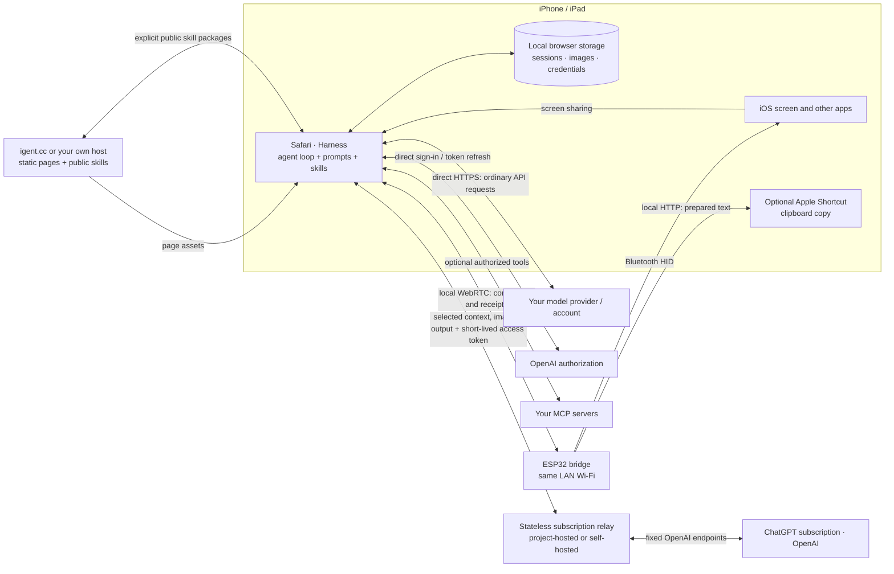

# Architecture

[Project](../../README.md) · [Setup guide](../guide/README.md) · [简体中文教程](../guide/zh-Hans.md)

The phone runs the Harness in Safari. The ESP32 is a small input bridge on the same local Wi-Fi network, powered independently near the phone. It receives timed command batches over WebRTC Direct and sends Bluetooth HID keyboard and pointer input to iOS. Screen capture and frame processing stay on the phone.

## What each part does

| Part | Responsibility |
|---|---|
| `apps/web/` | Safari interface, model adapters, session storage, context compaction, skills, capture and execution loop; desktop skill publishing and browser firmware installation |
| `firmware/IPhoneAutomationHarness/` | Wi-Fi setup, device identity, local WebRTC transport, Bluetooth HID, precise timing, receipts and clipboard transfer |
| `prompts/` and `apps/web/skills/` | Fixed runtime instructions and versioned built-in procedures |
| Optional public skill API | Stores deliberately published packages, signatures and revisions |

## A task, end to end

1. The user starts screen sharing from Safari and gives the agent a goal.
2. The Harness reads fresh screen frames and sends the selected context to the chosen model: ordinary APIs directly, ChatGPT subscriptions through the configured stateless relay.
3. The model can propose a sequence of taps, key presses, drags, swipes, waits and intermediate captures.
4. The browser sends device segments to the local bridge. The bridge executes input against the selected Bluetooth phone and returns receipts.
5. The Harness checks fresh screenshots, adjusts the next action or input method, and continues until the goal is verified.
6. By default the agent returns to the current Harness conversation and confirms it is visible before ending. The user can disable this in task-completion settings.

Input receipts record submitted commands. The runtime checks their effect with fresh observations and reconciles interrupted inputs before continuing. Stopping screen sharing pauses the task, and the user decides when to continue.

## Where data goes

| Data | Location / destination |
|---|---|
| Sessions, stored screenshots, API keys, login credentials | Local browser storage on the user's device |
| Selected messages, images and model outputs | Ordinary APIs directly; ChatGPT subscription traffic through the configured stateless relay to OpenAI |
| Short-lived ChatGPT access token | Sent with subscription requests through the relay; not persisted or logged by the relay application |
| ChatGPT refresh token and ID token | Browser-local; used only with direct browser-to-OpenAI login and refresh, never sent to the relay |
| Authorized MCP arguments | Directly to the configured MCP service |
| Phone actions and execution receipts | Local Wi-Fi between Safari and ESP32; Bluetooth input from ESP32 to phone |
| Home Wi-Fi credentials | ESP32 local storage after setup |
| Published skill package, public author key and signature | Public skill community, only when the user chooses Publish |
| Website assets and precompiled firmware | The chosen page host; self-hosting is supported |

Our hosting service supplies pages, firmware, public skills and the default stateless ChatGPT relay. Sessions, screenshots and credentials are persistently saved in the browser. The relay processes selected task content, images, output and a short-lived access token without persisting them or logging bodies or credentials. Ordinary API and MCP traffic remains direct; phone commands stay on the local network. These application-level storage rules do not describe all metadata handled by hosting or AI providers.

The bridge supports two independent WebRTC control connections. Each browser selects its phone, and each phone has one active writer at a time. With two phones connected, run the optional input test on each to confirm that its Harness page controls the intended phone.

[Transport](lan-connection.md) · [Actions](actions.md) · [Runtime](runtime.md) · [Models](auth-and-backends.md) · [Skills](skills.md) · [Website deployment](deployment.md)
