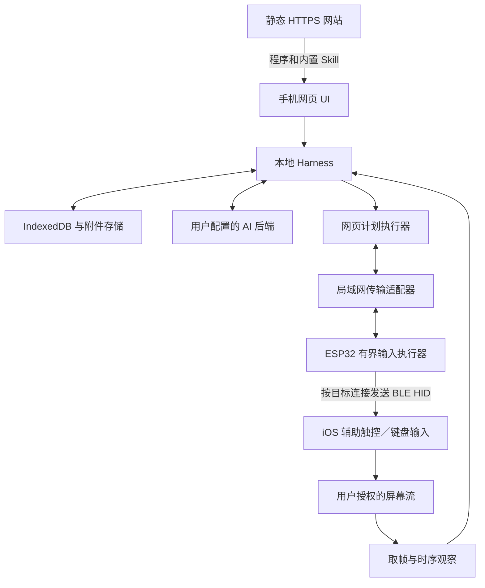

# 整体架构

日期：2026-10-18。状态：接受为设计基线；传输和长期后台运行仍有实测门槛。

## 1. 产品边界

- iPhone/iPad 上使用 Safari 27，添加到主屏幕作为 PWA 是推荐入口。
- 静态网页可以放在 GitHub Pages、Cloudflare 或用户自己的 HTTPS 服务上；运行时不依赖我们的业务服务器。
- 用户配置模型地址、协议、模型标识和凭据。模型必须具备任务所需的图片输入、工具调用或可靠结构化输出能力。
- 会话、截图、摘要、Skill 安装状态留在手机。模型请求中选中的消息和图片会发送到用户选择的 AI 后端；托管平台不接收会话。这不是保证第三方 AI 服务不留存数据。
- 一块 ESP32 是输入执行器：网络收指令、BLE HID 发输入、回报执行状态。屏幕与模型流量不经过 ESP32。
- 暂不做 Android、原生 App、多指触控、任意手机文件访问。普通 HID 不能承诺原生触摸 API、任意 Unicode 输入或剪贴板读写。

## 2. 组件与数据方向



网页不是云端代理：浏览器下载脚本后，从手机直接请求模型后端和局域网设备。静态服务器不负责发现用户设备、保存密钥或转发操作。

## 3. 首次配置和再次连接

1. ESP32 未配置或用户主动重置网络时，启动有设备标识的受保护配置热点。
2. 手机手动加入热点；打开固定配置入口。此入口只配网，不取屏，允许使用 HTTP。
3. 配置页展示设备身份和绑定入口，用户选择 2.4GHz Wi-Fi、输入密码；凭据写入 ESP32 NVS，不上传静态托管平台。
4. 保留配置页的绑定链接。用户切回正常 Wi-Fi 后，点击链接进入固定的 HTTPS Harness。
5. 链接用 fragment 传递设备 ID、唯一 `.local` 主机名和短时一次性配对材料；网页导入本地后清除 fragment。不得放在查询参数、分析日志或错误上报里。
6. 手机系统解析唯一 mDNS 名称；网页进行设备身份验证和配对挑战，换取该手机的独立授权。不要把 mDNS 名字或 IP 当身份凭据。
7. 用户在系统蓝牙设置里配对 HID，按当前已验证配置开启辅助触控、关闭全键盘控制。
8. 通过受控输入框的配对验证把网页身份和实际 HID 目标对应起来；多手机时逐台完成，不能根据 IP 或蓝牙显示名称猜目标。

配网完成后 AP 连接通常会断；页面不能承诺自动切换系统 Wi-Fi。绑定按钮要在切换后仍可用；PWA/Safari 数据容器不同，须明确在哪个容器完成导入。

每台设备有唯一名，例如 `harness-a7c291.local`。统一 `harness.local` 可作单设备便捷入口，但不能作为多设备身份或唯一重连地址。冲突处理、访客隔离、组播受限、不同 VLAN 都要有诊断。

正常连接按“已绑定唯一名称 → 已缓存地址（仍需验证身份）→ 重新绑定／排障输入地址”尝试。不给网页做全网 IP 穷举，也不假设存在通用 Bonjour 枚举 API。手机在 5GHz、板子在 2.4GHz 并不天然阻碍通信，取决于路由器是否桥接并允许组播和客户端互访。

## 4. 局域网传输决策

抽象统一为 `DeviceTransport`：发现已知端点、认证、读取能力、提交分段命令、查询结果、继续截图屏障、取消、释放输入。

优先实测 Safari 27 是否允许 HTTPS 页面经过所需授权访问本地 HTTP。若通过，可选择此适配器；CORS 要精确允许 Harness 来源，并处理方法和头部的预检。HTTP 路径不提供链路加密；采用每客户端密钥和 nonce/计数器签名，必要时在应用层加密配置载荷，不能把长期 bearer 密钥明文反复发送。

如果该浏览器策略不允许，则使用 ESP32 HTTPS。自签服务器证书不会因为填写 CORS 就被信任；自建 CA 需要用户安装并启用信任。公开域名证书需要额外证书签发、续期和 DNS 设计，不能当成零运维的纯静态方案。选择以实测和首次配置负担为依据。

WebSocket 不绕过安全规则。第一版可以使用短 HTTP 请求＋结果查询，之后再比较 WebSocket 的连接、内存和恢复成本。不会默认回退到云端指令中转；现有实验中的临时中转是证据工具，不是本方案的默认基础设施。

## 5. 多手机共用一块 ESP32

网络服务多客户端、保存多个蓝牙 bond、同时保持多条 BLE 连接，是三项不同能力。当前实验固件按单目标处理，尚未实现多手机隔离。

设计中始终保留 `boardId / targetId / clientId / sessionId / planId`：

- `targetId` 对应 ESP32 上一个经过配对验证的稳定 bond 身份；不依赖会变化的 BLE 私有地址。
- 按目标维护连接句柄、加密状态、报告订阅、键盘修饰键、按住的键、指针坐标、按钮状态、队列、租约和结果缓存。
- HID notification 必须指定目标连接；不能用广播 notification 同时按下所有手机的 Home。
- 同一目标只允许一个有效写租约；不同目标可独立排队。网络和读取状态可并发，同一目标的手势严格顺序。
- 配网、升级、重启等整板操作与所有目标的执行互斥；查看状态不会抢控制权。
- 一个网页没有另一台手机的屏幕。每台被自动化手机运行自己的网页与取屏会话，各自保存历史；板子不汇总用户截图。

先验证一个目标的完整产品闭环，再验证两部手机同时独立运行。支持数量从实际 RAM、TLS 连接和 BLE/Wi-Fi 共存测试得出；不直接宣传协议栈理论最大值。

## 6. 仓库目标结构

以下是后续实现的目标目录，不表示模块已经实现。保留现有实验固件直到新实现通过验收。

```text
apps/web/                    UI、PWA、设置、设备页、会话页、停止入口
packages/harness/            turn 循环、事件、调度、压缩、预算、恢复
packages/providers/          固定内置的模型协议实现、流解析、多图映射
packages/phone/              取屏、坐标变换、计划编译、观察组、目标租约
packages/device-client/      LAN 请求、认证、能力、回执、重连
packages/storage/            IndexedDB、附件、迁移、导出、凭据库
packages/skills/             线上目录、本地清单与内容缓存、按需加载、更新
packages/protocol/           共享格式、校验器、版本和错误码
firmware/PhoneHarness/       可用 Arduino IDE 打开的产品 sketch
  PhoneHarness.ino
  src/                      网络、配网、mDNS、认证、调度、BLE、目标状态
  config.example.h          非秘密构建配置；用户 Wi-Fi 在首次运行配网
  README.md                 板型、依赖版本、分区、烧录、重置方法
prompts/                    原创基础提示词与压缩指令
skills/                     内置声明式 Skill 包
specs/                      协议、示例、能力字典
tests/                      模拟后端、协议失败路径、重启与恢复测试
research/                   实验和固定提交的源码研究
docs/                       设计与验收
```

推荐 TypeScript 的浏览器核心，网页 UI 可用 React/Vite；驱动和计时执行在 Arduino C++。不是把 Node CLI 打包进 Safari。参考项目的流程和边界可以借鉴，Node 文件系统、shell、原生 CUA、Python graph 不直接搬入手机网页。

这些目录是普通源码分工，不代表运行时可插拔架构。核心工具固定，不做能力注册框架、插件发现或自动依赖装配；只有 Skill 内容可以从线上拉取、缓存和更新。

Arduino 产品 sketch 要完整自包含或带明确相对路径，不依赖开发者电脑中的绝对路径；锁定板核心和依赖，提供已验证的 C3 分区选择。网络凭据和设备密钥不放进公开头文件。默认 BLE 身份使用自己的厂商标识，不伪装成 Apple 设备。

## 7. 发布分工

- 静态网站发布版本包含 UI、核心、内置 prompt、schema、Skill 目录和内容哈希；GitHub Pages 用 hash 路由避免服务端回退要求。
- 离线缓存只缓存程序与公开资源；会话、凭据、局域网返回、模型请求不写入 Service Worker 缓存。
- 有运行中的任务时不自动激活新 SW；在安全边界提示版本更新，必要时先导出。旧固件按能力协商拒绝不支持的计划。
- 自托管只需静态文件，但用户 AI 后端必须可被浏览器访问。改变 origin 不会自动搬迁历史，通过导出／导入迁移。
- Skill 目录和包可与站点一起静态托管。社区发布先支持导出、共享链接和仓库提交；若要在网页里直接上传至公共目录，则另加只负责公开 Skill 的上传服务，不把 Harness 会话迁到云端。
- 产品许可证尚未选择；本轮不替用户给整个项目加开源许可证。参考快照保留上游许可，后续复制任何实现前按组件检查 notice 与许可。

## 8. 来源和限制

来源详见 [源码调研](../research/harnesses.md)。mDNS、跨域和证书分别参照 [Espressif](https://docs.espressif.com/projects/esp-protocols/mdns/docs/latest/en/index.html)、[Fetch](https://fetch.spec.whatwg.org/#http-cors-protocol)、[LNA 草案](https://wicg.github.io/local-network-access/)、[Apple 证书信任](https://support.apple.com/en-us/102390)。WebKit 主分支的实现不能替代目标 Safari 的测试。
