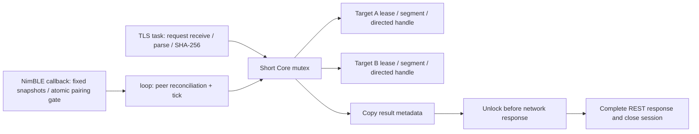

# Protected LAN transport v0.2

Status: implemented source, host-tested admission/state invariants; compiled/hardware acceptance reported separately in build artifacts. `physicalValidation:false` remains deliberate. No model, screenshot or session data is stored on ESP32.

## Ownership and initial trust

```mermaid
sequenceDiagram
  participant U as User / local USB browser
  participant E as ESP32
  participant I as iPhone settings
  participant W as Trusted Web origin
  U->>E: Explicit setup-info
  E-->>U: Private owner/AP material, CA state
  U->>E: Physical setup-config or protected WPA2 AP configuration
  E->>E: Generate per-board CA and 365-day leaf; commit PKI
  E-->>U: Public mobileconfig + CA fingerprint
  U->>I: Install matching profile; manually enable trust
  U->>E: setup-finish
  E->>E: Stop AP HTTP; start HTTPS 443
  W->>E: Verify HTTPS and manually pinned fingerprint
  W->>E: pair(clientId, setupPassword)
  E-->>W: Per-client token; BLE pairing window
  W->>I: Focus challenge field, then pair BLE
  W->>E: Start selected-target challenge
  E->>I: Eight digits via directed HID only
  I->>W: Trusted keydown observations
  W->>E: confirm(challengeId, observedNonce)
  E-->>W: Durable target-bound client grant
```

The owner/AP codes are random per board and printed only by explicit USB `setup-info`. CSPRNG generation happens after the BLE controller is enabled. Configuration is owner-authenticated inside the one-client WPA2 AP; HTTP control does not exist. Certificates are generated only with an authenticated current clock. The user installs and trusts the CA; JavaScript cannot automate or bypass that platform decision.

The server certificate SAN contains its unique `.local` name and AP IP, not arbitrary future DHCP addresses. Use the hostname. Private-CA trust and mDNS routing must still be validated on the target Safari. A fingerprint read from an untrusted discovery response is not an authenticated fingerprint.

## REST contract

All paths below use HTTPS port 443. Except public GET identity/clock/capabilities, requests require `Origin` exactly matching the owner-configured origin and `Authorization: Bearer <token>`. Tokens are random 256-bit values, returned once by pair; only their SHA-256 hashes are persisted. Default origin is `https://igent.cc`.

| Method / path | Request | Successful response |
|---|---|---|
| GET `/v1/identity` | none | boardId, bootId, hostname, protocolVersion, publicKeyFingerprint (CA DER SHA-256 lower hex), firmwareVersion, tls, requiresManualTrust |
| GET `/v1/clock` | none | boardId, bootId, deviceTimeMs |
| GET `/v1/capabilities` | none | executionEnabled, operations, maxEvents=128, maxRequestBytes=8192, reportIntervalMs=40, pointerSettleMs=20, maxSegmentMs=5000, maxHoldMs=3000, maxLeaseMs=15000, maxTargets=2, maxClients=8, maxConcurrentTls=1, physicalValidation=false, heap metrics |
| POST `/v1/pair` | `{clientId,setupPassword}` | 200 `{clientId,token,boardId,bootId,hostname,publicKeyFingerprint}` |
| GET `/v1/binding` | none | boardId, bootId, clientId, targetId or null, bindingVerified, targets[] with connected/encrypted/hidSubscribed/inputState/running |
| POST `/v1/targets/:id/challenge/start` | `{}` | 202 `{challengeId,targetId,length:8,expiresInMs:30000,expiresAtDeviceMs,status:"typing",boardId,bootId}` |
| POST `/v1/targets/:id/challenge/confirm` | `{challengeId,observedNonce}` | 200 `{boardId,bootId,clientId,targetId,bindingVerified:true}` |
| POST `/v1/targets/:id/leases/claim` | `{leaseId,ttlMs}` | 200 `{boardId,bootId,targetId,clientId,leaseId,expiresAtDeviceMs,inputState:"released"}` |
| POST `/v1/targets/:id/leases/renew` | same exact fields | same fields; inputState can be unknown while segment is running |
| POST `/v1/targets/:id/segments` | existing device-segment v1 wire object | 202 receipt, including running or terminal status |
| GET `/v1/targets/:id/results/:segmentId` | none | 200 receipt |
| POST `/v1/targets/:id/release` | `{leaseId,cancelPending:true,invalidateLease:true}` | 200 `{boardId,bootId,targetId,status:"released",leaseInvalidated:true,releaseSubmitted:true}` |

A receipt contains boardId/bootId/targetId/clientId/segmentId/planId/payloadHash/status/releaseSubmitted and device accepted/start/end times, submitted count and observed lateness. Successful HID submission does not assert any UI outcome. A missing receipt is 404 `result_unknown`; cached-ID conflicts/stale boot/lease conflicts are 409. The client queries the same ID and never blindly resends unknown input as a new ID.

Challenge responses never expose the secret nonce. The Web input listener must be installed and focused **before** POST start; HID digits can arrive before the HTTP response. Only normal digit usages are submitted, with directed down/up reports and a final release. A challenge is limited to three observed-nonce attempts, a 30-second expiry, and one per client per 30 seconds. Grant/client/target/challenge IDs must all match. Ordinary input remains inaccessible until proof succeeds. During initial binding, target input is held unavailable rather than interleaving another user's plan with the proof.

Claim requires idle, known released input. Renew accepts only the same authenticated client and same unexpired lease ID, including during a running segment. New runs must use a fresh random ID; cancelled/expired IDs cannot be revived in the same boot. Same-client tabs do not gain permission to replace another run's active writer. Result idempotency and retired-lease tombstones are boot-local and bounded; power loss changes bootId and requires reconciliation.

## Scheduling and socket fairness



TLS uses priority 1, equal to the Arduino loop, instead of monopolizing the single-core C3 at a higher priority. Parsing, canonical hashing and TLS handshake do not hold Core's mutex. NimBLE callbacks never acquire it, preventing lock inversion with directed notify. Main loop stack is 8 KB; PKI generation uses a temporary 16 KB task during protected setup, and the TLS handler keeps 12 KB. RSA RNG callbacks yield so initial generation does not starve the idle watchdog.

One client TLS slot is a conservative memory choice. Every completed REST/OPTIONS request closes the socket explicitly, preventing a Safari keep-alive connection from permanently owning the slot. A two-second receive/send limit and LRU remain enabled. This is sequential service for multiple clients, not verified simultaneous HTTPS capacity.

ESP-IDF allocates `max_open_sockets` client sessions and additionally reserves three internal sockets. A setting of one is not internally reduced to zero; start still can fail for allocation, LWIP budget or task reasons. The firmware marks ready only after successful TLS start and handler registration. Sources: [IDF main implementation](https://github.com/espressif/esp-idf/blob/v5.5.2/components/esp_http_server/src/httpd_main.c), [session implementation](https://github.com/espressif/esp-idf/blob/v5.5.2/components/esp_http_server/src/httpd_sess.c). Actual available heap and two-phone fairness must be measured on hardware.

## Durable configuration and failures

Wi-Fi and permitted origin commit as one NVS JSON value, with readback before success. Client grants use a candidate copy: persist successfully before replacing the active RAM token/binding. Failures do not acknowledge a new credential whose token was never returned.

PKI updates first commit an invalid marker. CA, private keys, leaf and expiry are then written/read back and cryptographically checked; the final valid marker is set only afterward. Boot refuses mixed/unfinished materials. Load checks leaf/private matching, CA signature and expiry consistency. No shared key is compiled into the sketch. A failed update is a visible setup failure, not a usable leaf with an unverified private key.

Cancelling, expired leases, disconnected BLE, notify failure and missed timing request releases for the same target only. TLS queue/handshake delays do not turn into fabricated precise gestures; Core records a timing miss and stops. Screenshots remain Web barriers after released input, or a separate parallel sampling window during a complete gesture. ESP32 never fabricates a screenshot acknowledgment.

The API does not provide unattended discovery trust, a cloud relay, stdio MCP, shell commands, arbitrary JSON-to-HID forwarding or executable plugin loading. Device management and private Web sessions remain distinct.

## Remaining physical gates

- Read-only setup info and NVS reset/reboot persistence using only the authorized board.
- Real CA generation duration, memory and power-interruption recovery.
- iOS profile installation/full trust and exact hostname/SAN validation.
- Two authorized phones alternating HTTPS requests without starvation; CA/hostname-verified C3 HTTPS and owner enrollment already passed on the final build.
- Stable bond identity with rotated private addresses and reconnects.
- HID challenge on the intended phone, wrong-target rejection and bounded failed proof.
- End-to-end gestures, release during cancellation/lease expiry, timing under TLS load and screen barriers.

The earlier source-only implementation/host-test pass used no serial port or physical board. Root later flashed the authorized C3 without erasing NVS and passed six production DeviceClient checks on final 13-source SHA-256 `4b4ebc2e65b3a7b1ebac4b4463c67ae2cb805f3ef85c1eece9e23bb1b435f8f0`, including CA/hostname-verified HTTPS, owner enrollment and refusal of unverified-phone control. No HID challenge, lease or phone input was sent. The final source/application hashes and exact scope are in `docs/research/device-client-live-verification.json`; the earlier TLS report remains historical evidence.

### USB radio diagnostics

Read-only `wifi-diagnostic` reports status, disconnect reason, event counters, configured credential byte lengths and SSID equality only; it never prints credentials. The SSID equality field uses `WiFi.SSID()` and may be false simply because the disconnected driver reports an empty SSID; it does not establish which credentials were actually transmitted. Optional `wifi-power` and `wifi-reconnect` are physical USB maintenance operations and are refused while HTTPS or a segment is running. A saved power limit is applied at boot, and reconnect reuses the existing network/CA. They permit a measured low-power comparison without assuming that signal strength or board type caused an authentication failure. See the firmware README for exact JSON.

The current product Core has 128 events per target. Its 7168-byte, 16-probe boot-local replay filter lives in RTC RAM and is explicitly cleared on each new Core/boot ID; it remains fail-closed and can falsely reject new IDs when saturated. Host tests include retained storage and stale-boot replay. The ordinary heap is reserved for BLE/TLS/JSON rather than an always-resident replay bitmap.

### Setup reopening and trusted-time repair

The portable SetupDeadline state is used by the actual service: repeated finish does not extend the deadline, already-finished requests leave no pending deadline, and opening a new AP window clears every previous finish deadline. Provision reuse checks CA and leaf validity against the authenticated configuration time. A future/expired leaf is reissued; a conflicting CA validity interval reissues CA+leaf and changes the CA DER fingerprint. USB/AP configuration reports `trustProfileChanged` and `manualTrustRequired`; users must reinstall/enable trust for the new profile and explicitly update the expected fingerprint. Boot-time load still tolerates absent wall-clock time and does not claim real TLS acceptance.

### BLE connection-generation fence

All actual HID notifications execute as bounded jobs on NimBLE's default host event queue. The same host context owns connect/disconnect/authentication/subscription updates, so it validates the Core-pinned stable identity and connection generation immediately before notification without another host callback interleaving. A numeric connection handle alone is never sufficient. No portMUX is held across notify, and host callbacks never take the Core mutex. A fixed job slot is not reused until a cancelled/abandoned job is consumed; late queued jobs never deliver their requested action; a same-identity/generation safety release may still follow. Releases retain the same identity/generation fence and can release an available report channel even if another channel unsubscribed. Core disconnect/reconnect invalidates the old generation/lease. Receipts record actual host submission time; late/expired work stops.

Pointer cleanup uses host-owned last-submitted coordinates scoped to the same peer generation. Coordinates change only after a pointer notify succeeds; enqueueing an unsubmitted move does not change them. A cancelled move releases at the previous submitted position. An already committed move releases at its committed position, including an abandoned caller; later releases cannot jump back to stale Core coordinates. Pose writes and reads use the short Peer lock, while Route bindings remain Core-thread-owned.

C3/S3/C6 use MSYS pools 8/8. The classic ESP32 SDK omits the second pool size, so that target preserves its disabled second pool (8/0) rather than enabling an undefined allocation; its physical two-phone throughput remains unverified. Effective values are available in USB diagnostics.
