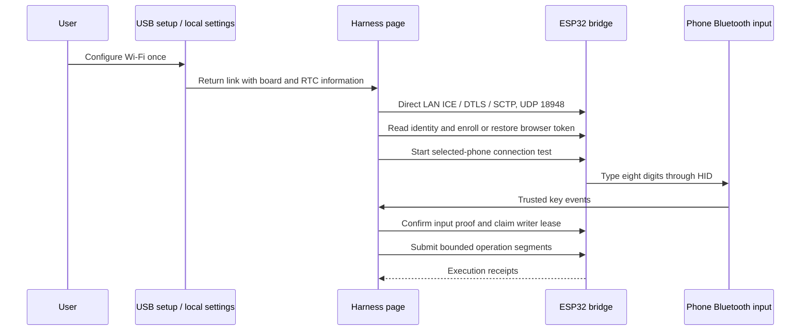

# WebRTC Direct LAN transport

The Harness controls the bridge from one HTTPS page over WebRTC Direct. HTTP remains the bridge's setup, management and Shortcut interface. The website does not relay phone commands, and ESP32 does not store model credentials, screenshots or conversations.

## Connection and identity



`RtcIdentity.h` provides the same long-lived ECDSA transport certificate for all boards, matching `/firmware/rtc-defaults.json`. This is the project's shared communication configuration, not a per-board CA or user credential. The user maintains neither certificates nor connection codes. Authorization remains separate: board/boot identity, per-browser token, phone input proof, writer lease and segment identity must agree.

The default management address is `http://igent.local/settings`. USB setup output and the local manager's same-tab return link carry `rtc:{ip,port,fingerprint}` with the actual LAN IP. New links omit owner credentials. Legacy connection-code fields are ignored; saved bridge settings contain the hostname.

## Transport and RPC

The bridge is an ICE-lite DTLS server on UDP 18948. Direct v2 derives the client's credentials from the authenticated STUN USERNAME, so the browser keeps its generated local offer unchanged and needs no external signaling or TURN service.

There is one reliable, ordered, externally negotiated data channel, ID 0. The bounded SCTP implementation checks CRC, verification tag and state cookie; reorders up to eight receive slots; suppresses duplicate TSNs; sends cumulative/gap SACKs; and retains one outbound frame for acknowledgement and finite retransmission. It handles heartbeat and closing. Ordered SCTP DATA fragments are reassembled within the 512-byte application message limit; only a completed message advances the stream sequence number. A single additional 512-byte buffer holds partial assembly. The receive packet limit is 2048 bytes and the outbound packet limit remains 1200 bytes. It does not advertise additional streams, partial reliability or message interleaving.

Each text frame is at most 512 UTF-8 bytes:

```text
{v:1,type:"req"|"res",id:UUID,n:requestNumber,seq:chunkNumber,end:boolean,data:base64}
```

Decoded chunks are 256 bytes except the final chunk, which is 1–256 bytes. Request envelopes are at most 12,288 bytes; responses at most 16,384 bytes. `n` starts at 1 for each connection and advances once per complete request. It is consumed before dispatch, so an old number cannot execute a mutation again. `seq` starts at 0 per RPC. The application request is `{method,path,headers,body:string}`; the response is `{status,body:string}`.

When SCTP owns the final response frame, RPC releases its assembly buffer and may accept the next request even before that frame's SACK. The next response waits for the outstanding SCTP frame. This supports normal browser request chaining without sleeps or duplicate execution.

An active cancellation, timeout or broken connection rejects pending browser requests. It does not resend mutations. New ICE traffic cannot replace a live connection or evict an active writer; stale-peer replacement also requires the application's idle gate.

## Application authorization and execution

Public identity/capability/clock reads and code-free client enrollment retain their existing semantics. Authenticated `/v1` operations use the same route handler for RTC and HTTP, including Bearer tokens and request IDs. The RTC task supplies the selected socket peer IP; a client frame cannot replace that address.

Phone binding uses an eight-digit HID challenge whose value is not included in the start response. The browser installs the trusted-key listener before starting the request and confirms only observed digits. Proof is scoped to the exact board, boot, browser and target. A pairing record alone does not authorize phone input.

A writer can renew its own unexpired lease while a segment is running. A replacement lease cannot resume an old segment. Execution receipts identify the board, boot, target, browser, lease, segment and payload hash. They record HID submission and release, not the visible app outcome; screenshots remain browser-side barriers. Unknown delivery is queried by its existing segment ID.

## HTTP, Shortcuts and persistence

HTTP port 80 serves Wi-Fi setup, `/settings`, status and the clipboard handoff. The signed **iPhone Agent Clipboard** Shortcut obtains a prepared text job, copies it to the system clipboard and acknowledges completion. Text arrives through one HTTP stream backed by a single 1 KiB bridge slot, with browser-produced chunks and no 8 KiB total text limit. Fetching a job alone is not copy confirmation. The mailbox binds jobs to their browser/phone context, expires them and clears consumed or cancelled content. Clipboard jobs are transient, not conversation storage.

Wi-Fi settings and client grants are saved with NVS readback before becoming active. Failed Wi-Fi joins preserve the previous network and leave setup available. Normal updates do not require a full-chip erase. HTTP compatibility code does not make certificate installation part of setup.

## Scheduling and verification

The RTC network task runs on core 0 at priority 1 with an 8 KiB stack. The Arduino loop and HTTP management each use a separate 6 KiB stack. Receive, JSON and network work stay outside the short Core mutex; the shared application handler takes the existing execution locks. NimBLE callbacks publish bounded state, and actual HID jobs retain the stable identity/connection-generation fence.

Core cancellation, lease expiry, BLE loss and timing misses release the affected input and stop dependent work. RTC disconnection cancels its coordinator through the application's disconnect callback. The existing 128-event segment capacity, request limits and boot-local segment replay protection remain in effect; the transport does not loosen them.

Host protocol tests and independent review cover the transport boundaries. [Phone prototype evidence](../research/rtc-direct-c3-iphone-20261019.json) includes short successes and intermittent failures. Full production RTC plus BLE, Shortcut behavior and multi-phone use require their own hardware results; they are not inferred from protocol tests or the earlier HTTP/window experiments.

The complete SDK-matched TLS source family is built in the project with 2048-byte record content limits. Its two record buffers use 28,672 fewer bytes by calculation. The build checks linked TLS owners to prevent mixing project and SDK TLS implementations; this does not substitute for device handshake and BLE coexistence checks.
