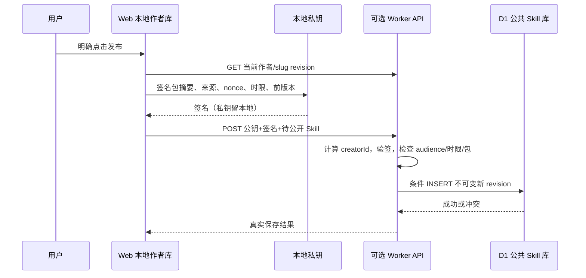

# Skill 创作、作者身份与可选社区

2026-10-18。社区归入 Web 产品，不是第三个终端或会话后端。静态页面能浏览、导入、创作本地 Skill；多人公共上传需要可选 Worker API。官网已部署同源 Worker/D1 API：`https://igent.cc/api/skills`。真实签名发布、下载和不可变版本测试已通过；验收创建的临时包已清理。自托管仍可关闭或替换社区服务。

## 归属与用户操作

| provenance/source | 可本地更新 | 可直接发布 |
|---|---|---|
| builtin | 否，随项目发布更新 | 否 |
| authored，creatorId 等于当前身份 | 是，固定 authoring helper | 是，必须显式 UI 动作 |
| community 下载项 | 只读，可启用／删除／更新下载版本 | 否 |
| 无明确来源的旧导入项 | 不视为自有 authored | 否 |

`source` 与 `provenance.kind` 必须共同匹配；自制条目 ID 为 `<creatorId>/<slug>`，下载条目为 `community:<creatorId>/<slug>`，避免下载覆盖本地作者副本。每次更新只接受 name、description、content、resources，自动增加语义版本 patch；模型没有改变归属或直接发布的工具。

签名证明“控制发布公钥的人发布了这个包”，不证明真实姓名、版权或原创性。用户可以复制文字重新写成自己的条目，系统不能声称能识别强行洗稿。下载项禁止原地改造为作者项，但不以 UI 标记代替服务端验签。

## 本地作者身份

`community/identity.js` 使用 WebCrypto ECDSA P-256。creatorId 是规范化公钥 `{kty,crv,x,y}` 的 SHA-256，私钥以 CryptoKey 保存到独立 IndexedDB `iah-creator-identity`，不写会话、设置、Skill 或网络。首次生成采用 readwrite 事务内的 put-if-absent，避免两个页面同时初始化造成覆盖。

默认身份不是实名账号；手机、桌面若要作为同一作者，用户显式加密导出并在另一设备导入。备份采用 PBKDF2-SHA256 210000 轮、随机盐与 AES-GCM IV；导入校验 creatorId 及公私钥实际签名配对。口令不保存在备份里；丢失身份和备份就无法继续以原公钥发布。

私钥在当前来源的 IDB 中保留以支持本地创作和签名，仍受浏览器删除、同源恶意脚本与备份泄露风险影响；它不是硬件不可导出密钥。导入不同身份会替换当前本地身份，UI 应明确选择；已有 Skill 的归属不会随之改写。

## helper 合同

```js
const identity = await openCreatorIdentity();
const backup = await identity.exportEncrypted(passphrase);
const restored = await importCreatorIdentity(backup, passphrase);

const skill = await createAuthoredSkill({store,identity,input:{
  slug:'my-skill', name:'用户语言的名称', description:'说明',
  content:'完整 SKILL.md', resources:{'notes/example.md':'可选正文'}
}});
const edited = await updateAuthoredSkill({store,identity,id:skill.id,
  patch:{content:'修改后的完整正文'}});
```

模型调用固定 skills_create／skills_update 工具，由调用方传入当前 store 和 identity，不能让模型提供身份、creatorId、source 或版本。技能内容按用户当前语言生成。`apps/web/skills/skill-authoring` 是相应内置指导包，包含入口哈希；它不创建可插拔能力注册系统。

```js
const community = new CommunityClient({baseUrl:'https://igent.cc/api',identity});
const {items,cursor} = await community.list({limit:30});
const installed = await community.download(creatorId,slug);
await store.saveSkill(installed); // 已验签，保持 community 来源与只读属性
// 只绑定到用户明确点击发布的按钮，不暴露为模型工具：
await community.publish(authoredSkill,{explicit:true});
```

客户端上传前检查自有 authored；下载验证签名、creatorId、包哈希和 revision。所有 helper 失败返回 Error.code 稳定标识，展示文本交 UI i18n，不输出硬编码中文。

## 通信与服务端



服务端不接受前端 ownerId 自报。签名载荷含固定协议／动作、API origin、creatorId、nonce、签发和过期时间、expectedRevision、previousDigest、完整包。最长有效五分钟、允许少量客户端时钟偏差。D1 使用主键、作者范围 nonce 唯一约束、版本唯一约束与条件 INSERT，防止并发覆盖／重放；旧 revision 永久保持不可变。旧版本不能覆盖新版本。

端点：

- `GET /api/skills?limit=30&cursor=…`：公共目录，最大50条；稳定作者／slug游标。
- `GET /api/skills/:creatorId/:slug`：最新签名包和 revision。
- `POST /api/skills`：签名发布；不接收 session、账号密钥或任意附件。
- `OPTIONS`：只为明确配置的 Web origins 开启 CORS。

包仅允许 SKILL.md 与相对路径的 `.md`／`.json` 文本，禁止绝对路径、反斜杠、`..`、重复规范路径、超量文件与未知字段。包上限400000 bytes，单文件100000 bytes，最多40个文件；入站和客户端下载都用流式计数限制，不先无界读正文。公钥字段严格受限，不允许夹带私钥字段。

Worker 只保存用户明确公开上传的包、公钥、签名与版本元数据。没有会话数据库、模型 token、手机图像上传或设备指令接口。源码没有打印请求正文。公开平台仍需运营者配置额度、速率限制与内容治理；公钥身份本身不防垃圾账号。当前没有审核、举报、删除及密钥迁移服务，不能称已生产就绪。

## 可选部署边界

源码 `apps/web/api/worker.js`，迁移 `schema.sql`，示例 `wrangler.jsonc`。数据库绑定和主站路由必须由站点运营者真实配置并迁移，随后把部署后的 `https://igent.cc/api` 配给 Web。所有官方入口统一使用 igent.cc 的路径。客户端保留 /api 前缀，签名 audience 仍为 `https://igent.cc`；主站路由剥离 /api 后交给内部 Skill API。未配置时 UI 提供本地创作、导出和明确“社区未配置”，不能伪造上传成功。

本轮按 [Workers 最佳实践](https://developers.cloudflare.com/workers/best-practices/workers-best-practices/)、[D1 prepare/bind](https://developers.cloudflare.com/d1/worker-api/prepared-statements/)、[WebCrypto](https://developers.cloudflare.com/workers/runtime-apis/web-crypto/) 实现，读取最新版 `@cloudflare/workers-types@5.20261016.1` 的 D1 API 定义。没有运行 Wrangler、部署或修改 Cloudflare 账户。数据库采用 binding，不从 Worker 调 Cloudflare 管理 REST API。

## 稳定错误码

| 类别 | code |
|---|---|
| 身份 | IDENTITY_REQUIRED、IDENTITY_STORAGE_UNAVAILABLE、INVALID_IDENTITY、INVALID_IDENTITY_BACKUP、IDENTITY_DECRYPT_FAILED、PASSPHRASE_REQUIRED |
| 本地创作 | SKILL_EXISTS、SKILL_NOT_FOUND、SKILL_READ_ONLY、SKILL_NOT_OWNED |
| 包校验 | INVALID_PAYLOAD、INVALID_PACKAGE、INVALID_SLUG、INVALID_FILES、INVALID_PATH、PACKAGE_TOO_LARGE |
| 发布 | PUBLISH_REQUIRES_USER_ACTION、INVALID_PUBLICATION、AUDIENCE_MISMATCH、PUBLICATION_EXPIRED、BAD_SIGNATURE、STALE_REVISION、VERSION_EXISTS、REPLAY_OR_CONFLICT |
| 网络配置 | COMMUNITY_NOT_CONFIGURED、COMMUNITY_UNREACHABLE、COMMUNITY_BAD_RESPONSE、COMMUNITY_REQUEST_FAILED、REQUEST_CANCELLED、ORIGIN_NOT_ALLOWED、INVALID_CURSOR、NOT_FOUND、COMMUNITY_INTERNAL_ERROR |

## 验证

`node --test tests/web/community.test.mjs`：19/19 通过。使用真实 P-256 签名、AES-GCM 加密、Node 内置 SQLite 执行实际 schema 和 SQL，而不是只用 Map 模拟数据库。覆盖加密跨设备恢复、归属／只读限制、签名篡改、过期、audience、原子 revision、nonce 重放、并发首次发布、client 下载验签、请求大小、缺配置状态、作者条目原子创建／CAS 更新，以及同域 /api 路径与 origin-only audience。

这不替代 Safari IndexedDB CryptoKey 持久化验收、真实 Worker/D1 部署、跨站 CORS 和 UI 八语言验收；这些未运行的检查应保留明确边界。
