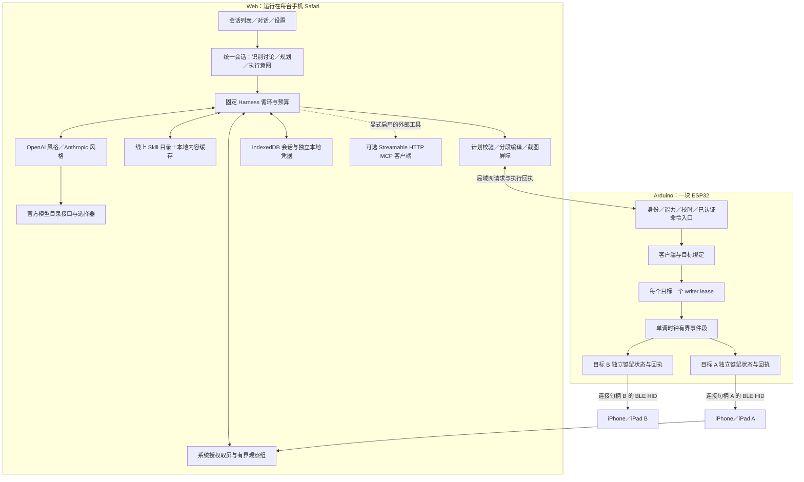
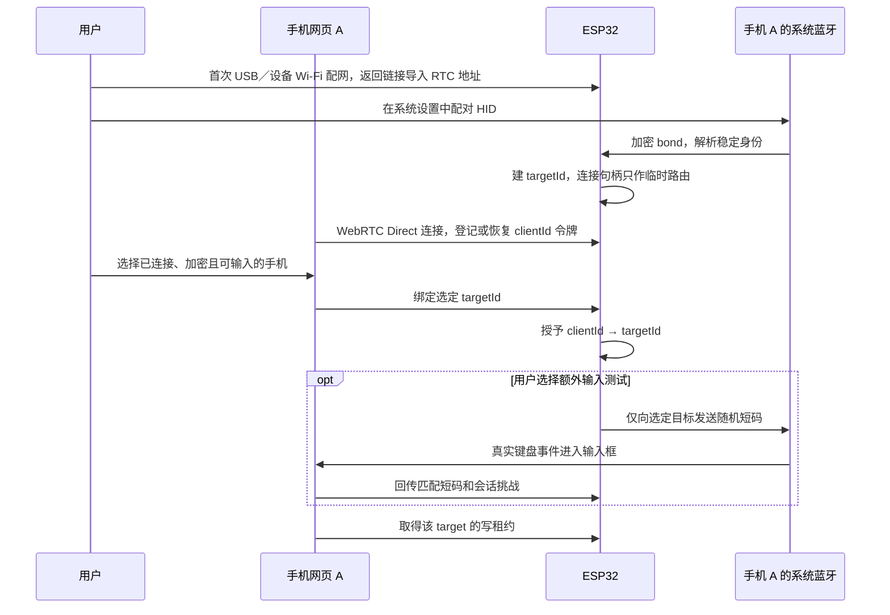
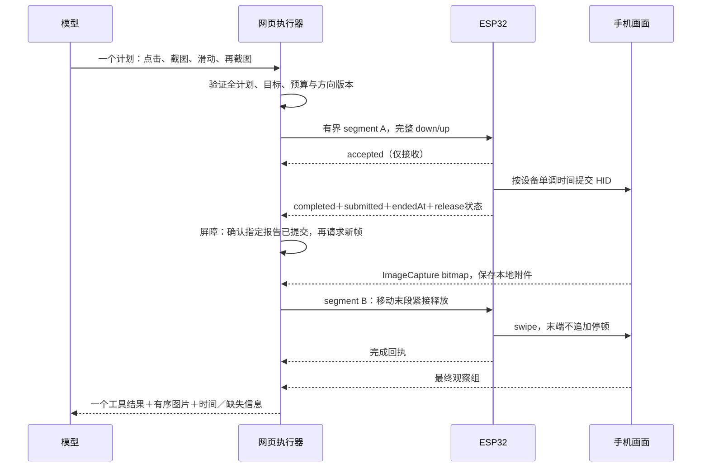
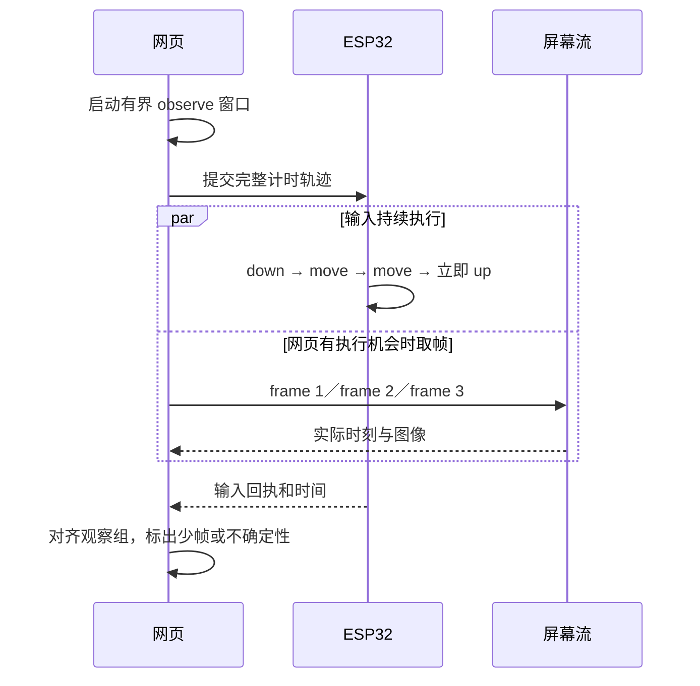

# iPhone Agent Harness：执行架构蓝图

本轮基线：2026-10-19。产品分成 **Web 与 Arduino** 两部分；Skill 社区入口属于 Web。图中接口均有当前代码；实际设备与手机验收状态见末尾表。

## 1. 模块总图



每台手机独立拥有屏幕流、模型连接和本地会话。ESP32 不汇总各手机屏幕，也不承载模型请求。多人共用板子不等于共享聊天记录。

## 2. 谁是谁

| 标识 | 生命周期 | 说明 |
|---|---|---|
| boardId | 板子长期 | 稳定公开标签；不是认证密钥 |
| bootId | 每次板子启动 | 失效旧回执、输入段和校时关系 |
| targetId | BLE bond 生命周期 | 板子保存的随机 ID，映射到协议栈解析后的稳定身份 |
| connHandle／connEpoch | 本次 BLE 连接 | 临时句柄和连接代次；提交时仍须匹配稳定 bond 身份，不能跨重连复用 |
| clientId | 浏览器本地身份 | 每个 origin／存储容器的随机身份，与配对授权分开 |
| sessionId | 一条对话 | 属于某浏览器，不当作手机身份 |
| leaseId | 短期写授权 | 某客户端在某目标上的排他输入权 |
| planId／segmentId | 一次意图／执行段 | 用于回执、幂等与恢复，不能重用为另一份输入 |

绑定过程不使用“这个 IP 应该就是那台手机”或“第一个连接的就是我”。iOS 的私有蓝牙地址也不能直接当长期 ID。



这一步已实现；仅能连接 BLE 不会打开网络控制，仍须客户端认证、可用目标绑定和写租约。新固件不强制数字挑战；旧固件缺少绑定接口时保留旧版测试／更新提示。多部手机逐个绑定；重连后由已保存的 bond 身份恢复 target 映射，句柄重新获取。相同客户端可以有多条会话，但同一目标一次只运行一个输入任务。

## 3. 网络延迟、设备计时和截图

**输入采样留在 ESP32，画面采集留在网页。** 不通过几十个网络请求分别发送 down、move、up。网页先把一个完整手势编译成带相对时间的段，固件在本地执行。



网络迟到只影响段的开始，不应改变已接受段内部的相对时序。若设备 tick 迟到超过限额，则停止并释放，而不是把积压轨迹瞬间倾倒出去。网页挂起期间也不能让按键永久按住。

`accepted` 不是点击成功；`hid_submitted` 也不是 App 已响应。App 结果由之后的画面验证。截图关联步骤／输入段与方向、实际时间及释放状态；当前 submitted 是提交数量，不伪装成独立全局报告序号。

## 4. 校时是带误差的估计

网页记录请求前 `H0` 和返回后 `H3` 的 performance 单调时间，板子返回处理时刻 `D`：

```text
RTT = H3 - H0
offsetEstimate = D - (H0 + H3) / 2
uncertainty >= RTT / 2
estimatedHostTime(deviceEvent) = deviceEvent - offsetEstimate
```

校时从有限样本取最小 RTT；bootId 改变使旧估计失效，不能把一次估计当永久精确同步。双向时延不对称意味着估计有误差，不能拿设备时钟硬对齐帧到 1ms。

每条观察至少区分：取图请求时刻、bitmap 就绪时刻、编码完成时刻，以及可得到的源媒体时间。ImageCapture 没给出真实采集时刻时记录 unknown。**请求发生在回执之后，不等于截图内容已反映 HID**：系统画面处理和视频管线仍有延迟。

安全截图先等待已完成段，再按标定的最小 settle 时间取图，并通过可用媒体时间／多帧／目标状态变化核对。若没有准确源时刻，只能报告软件屏障和观察内容，不能宣称严格物理同步。

## 5. 移动中截屏不暂停手势



截图是网页计划节点，不是发给固件的 HID 事件。若板子发出“已到截图屏障”事件，它只能通知网页，不可能强行唤醒被系统暂停的 Safari。

必须停下来观察的位置切成两个输入段，前段释放输入后等待网页继续；不能在需要惯性的最后 move 与 up 之间塞网络截图请求。快速场景可评估短录屏后抽帧，但无足够时间密度则返回证据不足。

## 6. 统一会话与 UI 范围

用户不需要选择“对话／计划／任务”模式。当前界面以 `auto` 运行同一条会话，根据当前请求区分讨论、规划和执行；历史存档的旧模式仍能被运行时读取，但不是新的界面入口。

| 用户意图 | 当前行为 | 后续动作 |
|---|---|---|
| “你能帮我设闹钟吗？” | 回答能力与必要条件 | 不因能力询问直接操作手机 |
| “如果要设闹钟，你会怎么做？” | 通过 `task_plan` 保存目标和有序步骤，显示计划 | 用户可点执行或继续讨论；计划本身不提交输入 |
| “设置明早 7 点的闹钟”／确认执行计划 | 获取新画面，执行有界操作，再验证结果 | 已知失败后重新观察和调整；不盲目重复结果未知的操作 |

屏幕共享状态由网页采集生命周期维护。发送消息或继续任务时，界面可直接请求共享；共享停止会中断当前运行并保存暂停状态。用户点继续后，先恢复共享并核对当前画面，再重新规划，不重放中断批次。该交互的真实手机持续执行情况仍需手机验收，不能由桌面测试推断。

会话页面只保留输入、当前账号／模型、支持模型的推理强度、设备状态和运行控制。技能统一从会话外的设置管理，不再列入会话操作菜单。计划可展开阅读并执行；历史截图显示缩略图，点击查看大图。普通视图显示面向用户的回复、计划和简要操作状态；设置里的开发者模式额外显示工具请求、结果和诊断。历史内容按页读取，界面保留有界的消息和图片窗口。

新会话根据第一条请求自动命名：首次主模型回复成功后，以有界的独立短请求生成标题，期间先显示临时名称。标题请求不载入完整历史，不阻塞执行，失败也不使任务失败；手动改名、已有名称和导入名称不会被覆盖。

站内导航由同一个文档维护会话、设置、账号编辑和技能等视图的历史。系统前进／返回和界面返回按钮恢复各自的上一层，路由切换不重新加载文档；关闭面板只清理该面板的临时请求，不关闭屏幕采集或 ESP32 连接。当前会话和输入草稿也独立于面板保存。此连续性针对同一文档中的站内操作；刷新、关闭标签页或真正离开文档仍受浏览器生命周期限制。原生 Chrome 的模拟共享导航检查与真实 iPhone RTC／取屏连续性验收分别记录，前者不替代后者。

## 7. 模型连接、凭据和 MCP

设置中提供 OpenAI 风格 API、Anthropic 风格 API 和独立的 Codex／ChatGPT 订阅接入。普通 API 编辑器说明端点应填到哪一级：可以使用基础前缀，也可以填写完整的 `/chat/completions` 或 `/v1/messages`，常见的 `/chat`、`/completions` 后缀自动规范化。合法查询参数保留在目录和推理请求中。

“获取模型”由产品直接调用服务商模型目录接口；获取到的所有模型都进入该连接的模型列表。默认模型是同一个可输入、可选择的字段，仅决定新会话的初始模型，不是模型授权白名单。目录失败时显示错误并保留手动填写。发现模型 ID 不等于验证它支持视觉、工具或特定额度。

推理强度按账号／API 配置和模型分别选择、保存，会话可使用自己的覆盖值。模型目录的能力元数据优先，已知模型按协议映射可用档位；不支持或未知的模型不显示猜测出的档位，也不发送未经确认的强度参数。

API 密钥和 ChatGPT 登录信息直接存入当前浏览器的独立本地凭据记录，账号配置及普通会话导出不包含这些秘密。重新打开页面会恢复凭据；订阅刷新成功后保存新的令牌。新记录不使用解锁密码。旧版加密存档不删除，仅对已有存档保留折叠的恢复入口；重新输入 API 密钥或重新登录也可建立新记录。清除网站数据会删除本地凭据。

OpenAI Platform API Key 与 ChatGPT/Codex 登录使用不同的授权、计费和请求协议。订阅适配器实现设备码、轮询、兑换、刷新和独立账号登记，不能把订阅令牌作为任意 OpenAI 风格地址的 API Key。真实 Safari 订阅登录、推理和刷新仍待验收，界面显示实际结果，不把离线模块测试记作真实登录。

MCP 支持多个浏览器可访问的 Streamable HTTP 服务器。端点、令牌、工具选择和启用状态保存在本地，刷新后尝试恢复连接；连接状态与工具列表在每个服务器下分别显示。固定工具 `mcp_list_tools` 和 `mcp_call` 只访问用户启用的目录和工具；统一会话的执行请求可调用外部工具，历史 chat／plan 运行仍保留只读目录限制。撤销立即失效，发送后结果未知时不自动重试。浏览器不启动 stdio 进程，服务器需允许相应网页来源。详见[账号与后端](auth-and-backends.md)。

## 8. 实现状态

| 范围 | 本轮状态 |
|---|---|
| Web 本地会话、设置、统一意图、Skill、独立本地凭据 | 当前源码已实现；测试、桌面浏览器与手机结果分别记录 |
| 两类模型请求、模型发现、SSE、截断拒绝 | 已实现与模拟测试；DeepSeek 真 API 另有实测记录 |
| 页面取屏 | 真实 API 路径已接，需用户手动授权 |
| MCP HTTP | 轻量客户端与连接诊断；不是全功能 MCP 宿主 |
| Codex 设备码与刷新 | 有可测试流程模块；第三方网页登录未验证，UI不冒充可用 |
| Arduino 目标隔离与计时核心 | 主机／独立交错测试；编译与源码以产物记录为准，正式 RTC/BLE 手机闭环正在验收 |
| 热点配网、客户端认证与网络写控制 | 单页 WebRTC Direct、共享通信证书、无连接码；客户端令牌、目标绑定与可选 HID 输入测试独立，实机结果另记 |
| 手机后台模拟／真实模型测试 | 见独立报告，分开记录；不由桌面测试推断 |

详细证据：[后台测试](../research/background-api.md)、[固件实现](firmware-implementation.md)、[UI实现](web-ui.md)。

最终逐功能状态以[验收清单](../acceptance/zh-Hans.md)与[发布证据](../research/release-acceptance.md)为准，旧候选报告不会自动证明后续源码和二进制。
