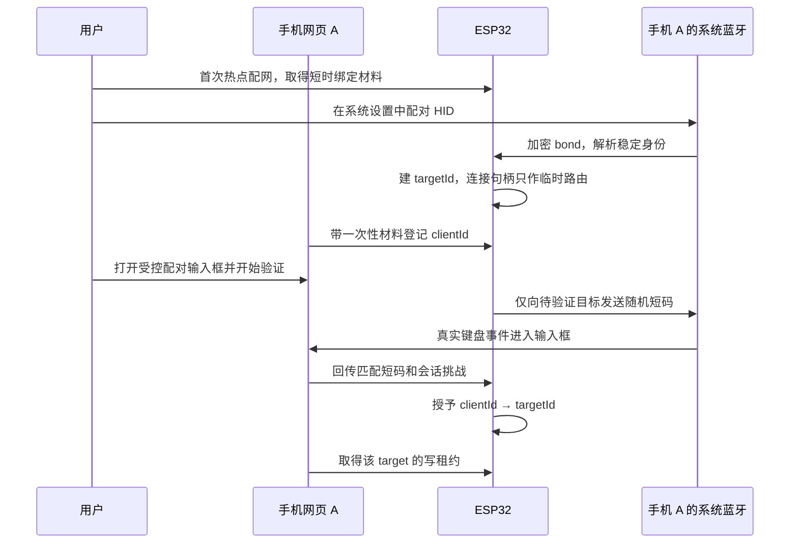
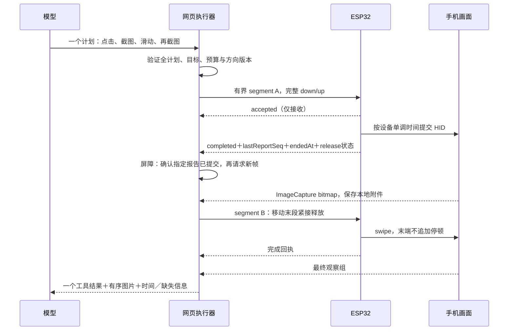
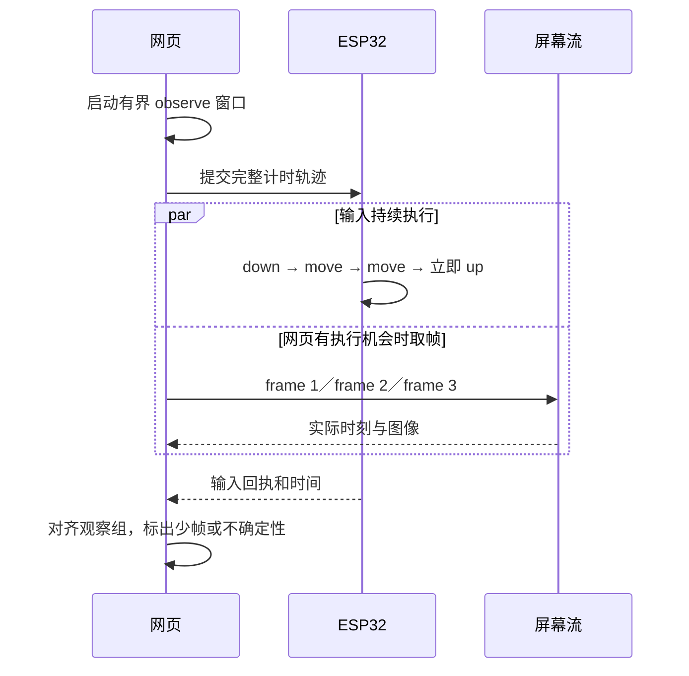

# iPhone Automation Harness：执行架构蓝图

本轮基线：2026-10-18。产品分成 **Web 与 Arduino** 两部分；Skill 社区入口属于 Web。图中部分连接是已限定的接口，实际接线状态见末尾验收表。

## 1. 模块总图


每台手机独立拥有屏幕流、模型连接和本地会话。ESP32 不汇总各手机屏幕，也不承载模型请求。多人共用板子不等于共享聊天记录。

## 2. 谁是谁

| 标识 | 生命周期 | 说明 |
|---|---|---|
| boardId | 板子长期 | 稳定公开标签；不是认证密钥 |
| bootId | 每次板子启动 | 失效旧回执、输入段和校时关系 |
| targetId | BLE bond 生命周期 | 板子保存的随机 ID，映射到协议栈解析后的稳定身份 |
| connHandle | 本次 BLE 连接 | 真正发送 HID 的地址；不能跨重连持久使用 |
| clientId | 浏览器本地身份 | 每个 origin／存储容器的随机身份，与配对授权分开 |
| sessionId | 一条对话 | 属于某浏览器，不当作手机身份 |
| leaseId | 短期写授权 | 某客户端在某目标上的排他输入权 |
| planId／segmentId | 一次意图／执行段 | 用于回执、幂等与恢复，不能重用为另一份输入 |

绑定过程不使用“这个 IP 应该就是那台手机”或“第一个连接的就是我”。iOS 的私有蓝牙地址也不能直接当长期 ID。



这一步是产品的待接线模块，当前固件不会仅凭能连接 BLE 就打开网络控制。多部手机逐个绑定；重连后由已保存的 bond 身份恢复 target 映射，句柄重新获取。相同客户端可以有多条会话，但同一目标一次只运行一个输入任务。

## 3. 网络延迟、设备计时和截图

**输入采样留在 ESP32，画面采集留在网页。** 不通过几十个 HTTP 请求分别发送 down、move、up。网页先把一个完整手势编译成带相对时间的段，固件在本地执行。



网络迟到只影响段的开始，不应改变已接受段内部的相对时序。若设备 tick 迟到超过限额，则停止并释放，而不是把积压轨迹瞬间倾倒出去。网页挂起期间也不能让按键永久按住。

`accepted` 不是点击成功；`hid_submitted` 也不是 App 已响应。App 结果由之后的画面验证。截图必须声明它基于哪个 segment、哪个报告序号以及是否已经释放输入。

## 4. 校时是带误差的估计

网页记录请求前 `H0` 和返回后 `H3` 的 performance 单调时间，板子返回处理时刻 `D`：

```text
RTT = H3 - H0
offsetEstimate = D - (H0 + H3) / 2
uncertainty >= RTT / 2
estimatedHostTime(deviceEvent) = deviceEvent - offsetEstimate
```

连续采样多次取最小 RTT，保留全部样本；重连、页面重载或 bootId 改变后重做，长任务按漂移需要更新。双向时延不对称意味着估计有误差，不能拿设备时钟硬对齐帧到 1ms。

每条观察至少区分：取图请求时刻、bitmap 就绪时刻、编码完成时刻，以及可得到的源媒体时间。ImageCapture 没给出真实采集时刻时记录 unknown。**请求发生在回执之后，不等于截图内容已反映 HID**：系统画面处理和视频管线仍有延迟。

安全截图先等待已完成段，再按标定的最小 settle 时间取图，并通过可用媒体时间／多帧／目标状态变化核对。若没有准确源时刻，只能报告软件屏障和观察内容，不能宣称严格物理同步。

## 5. 移动中截屏不暂停手势



截图是网页计划节点，不是发给固件的 HID 事件。若板子发出“已到截图屏障”事件，它只能通知网页，不可能强行唤醒被系统暂停的 Safari。

必须停下来观察的位置切成两个输入段，前段释放输入后等待网页继续；不能在需要惯性的最后 move 与 up 之间塞网络截图请求。快速场景可评估短录屏后抽帧，但无足够时间密度则返回证据不足。

## 6. 模式与 UI 范围

| 模式 | 允许行为 | 完成条件 |
|---|---|---|
| 对话 chat | 文字／用户附件讨论，不操作手机 | 当前回复结束 |
| 计划 plan | 可用已授权画面和只读上下文，输出步骤 | 给出计划；不执行修改 |
| 执行 task | 观察、Skill、经过验证的输入计划 | 目标已观察到／用户停止／预算或条件阻塞 |

“目标模式”归入执行模式的目标说明和停止条件。它不意味着无限后台运行、定时唤醒或没有预算的自动重试。

必要 UI：会话搜索、新建、置顶、改名、复制 ID、归档、导入导出；底部输入、模式和模型、停止；设置里的后端／设备／Skill／可选 MCP。暂不加入工作目录切换、代码 diff、终端、Git 分支、运行容器等与手机任务无关的菜单。

Web 默认三种模型连接配置以两类协议处理：OpenAI、DeepSeek 的 OpenAI 兼容接口；Claude／DeepSeek 的 Anthropic 兼容接口。用户填地址与 key 后由产品的“获取模型”调用模型目录接口，失败保留手填，不把内置候选当接口识别结果。模型支持图片与工具须按实际能力再验证。

## 7. OpenAI 登录和 MCP 的边界

OpenAI Platform API Key 与 ChatGPT/Codex 登录是不同授权、计费和请求协议。已提取设备码流程的结构与自动刷新／加密本地保存模块；当前没有把未验证的登录入口接成“成功登录”。Codex 订阅凭据不能直接当任意 OpenAI 风格 endpoint 的 API Key。

复用设备码还需要确认：授权客户端的可用范围、浏览器 CORS、代码兑换、token audience、实际 Codex 模型传输、过期与刷新。当前接口 OPTIONS 检查对 deviceauth 返回网络 HTTP530，没有足够证据判定浏览器流程能否使用；这既不是已通过，也不是断言平台永久禁止。

MCP 可选：实现浏览器可访问的 Streamable HTTP 初始化、JSON/SSE 返回、session/version header、tools/list 与显式 allowlist 的 tools/call。没有 stdio、服务器进程启动、任意插件安装或完整 OAuth 自动发现。UI 当前只做连接和工具目录诊断；未自动接入模型工具执行。

## 8. 实现状态

| 范围 | 本轮状态 |
|---|---|
| Web 本地会话、设置、模式、Skill、本地凭据加密 | 可运行初版，桌面浏览器手机断点已验收 |
| 两类模型请求、模型发现、SSE、截断拒绝 | 已实现与模拟测试；DeepSeek 真 API 另有实测记录 |
| 页面取屏 | 真实 API 路径已接，需用户手动授权 |
| MCP HTTP | 轻量客户端与连接诊断；不是全功能 MCP 宿主 |
| Codex 设备码与刷新 | 有可测试流程模块；第三方网页登录未验证，UI不冒充可用 |
| Arduino 目标隔离与计时核心 | 主机测试与C3构建通过；未刷写 |
| 热点配网、客户端认证与网络写控制 | 未完成接线，写请求返回503 |
| 手机后台模拟／真实模型测试 | 见独立报告，分开记录；不由桌面测试推断 |

详细证据：[后台测试](../research/background-api.md)、[固件实现](firmware-implementation.md)、[UI实现](web-ui.md)。
