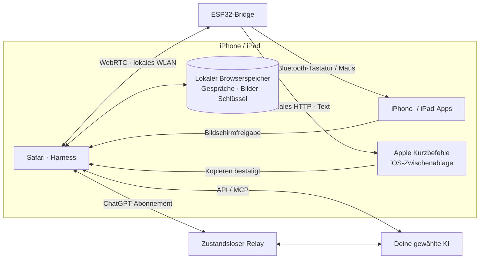

<h1 align="center">iPhone Agent Harness</h1>

<strong>Lass KI dein iPhone bedienen.</strong>

  <a href="../../README.md">English</a> · <a href="zh-Hans.md">简体中文</a> · <a href="zh-Hant.md">繁體中文</a> · <a href="ja.md">日本語</a> · <a href="ru.md">Русский</a> · <strong>Deutsch</strong> · <a href="fr.md">Français</a> · <a href="es.md">Español</a>

  
  
  
  

  <a href="https://igent.cc/">📱 Harness</a> ·
  <a href="https://igent.cc/flash">⚡ Browser-Installer</a> ·
  <a href="../guide/de.md">📖 Anleitung</a> ·
  <a href="https://igent.cc/skills">🧩 Skills</a> ·
  <a href="../architecture/overview.md">🗺️ Architektur</a>

Dem iPhone eine Aufgabe in Alltagssprache geben: Bildschirm prüfen, Text eingeben, Regler einstellen oder einen kurzen Ablauf über Apps hinweg erledigen. Eine kleine versorgte ESP32-Bridge liefert Bluetooth-Eingaben, Safari übernimmt Gespräch und Bildschirmaufnahme.

- **Im Browser installieren.** Wähle deinen ESP32 und installiere die Firmware mit Chrome oder Edge am Computer.
- **Das Telefon bleibt kabellos.** Lass die Bridge mit Strom versorgt im Regal oder einer Zimmerecke in Bluetooth-Reichweite stehen.
- **Dein gewohntes WLAN.** Verbinde Telefon und Bridge mit demselben Heim- oder Büronetz und starte die Aufgabe in Safari.

<table>
<tr><th>Essen bestellen</th><th>Wecker stellen</th></tr>
<tr>
<td width="50%" align="center">

https://github.com/user-attachments/assets/7601869f-7cc6-445e-b64d-0073a8bf657d

</td>
<td width="50%" align="center">

https://github.com/user-attachments/assets/d72669a6-e150-40d7-ba2f-1d9586d9c2ea

</td>
</tr>
</table>

**KI bestellt Essen auf dem iPhone.** Der Agent wählt MIXUE-Getränke aus, stellt Eis und Zucker ein und geht zur Kasse. Am Ende ist die gelieferte Bestellung zu sehen.

## ⚙️ So funktioniert es

Safari sendet Bildschirm und gewählten Kontext an die KI. Harness prüft den Plan, übergibt ihn lokal per WebRTC an ESP32, und Bluetooth-Maus/Tastatur bedient das Telefon. Eine neue Aufnahme prüft das Ergebnis.

[Architektur](../architecture/overview.md)

## 🔌 Board auswählen

Beim Neukauf empfehlen wir **C6, S3 oder C3**. Nimm ein fertiges Entwicklungsboard mit USB und integrierter Antenne; Löten und externe Peripherie sind für dieses Projekt nicht nötig. Einmal per USB-Datenkabel mit dem [Browser-Installer](https://igent.cc/flash) flashen, WLAN einrichten und Bluetooth koppeln. Danach genügt USB-Strom.

| Chip | Modellnamen / Suchbegriffe | Amazon US: je Board im Mehrfachpack¹ | Taobao: Budget je Board¹ |
|---|---|---|---|
| **ESP32-C6** | `ESP32-C6 SuperMini` · `ESP32-C6-Zero` · `ESP32-C6-DevKitM-1` · `ESP32-C6-DevKitC-1` · `ESP32-C6-WROOM-1 N8` | US$4–8 | ¥25–45 |
| **ESP32-S3** | `ESP32-S3-DevKitC-1 N8R2 / N8R8 / N16R8` · `ESP32-S3 SuperMini` · `ESP32-S3-Zero` · `ESP32-S3-WROOM-1 N16R8` | US$6–9 | ¥15–40 |
| **ESP32-C3** | `ESP32-C3 SuperMini` · `ESP32-C3-MINI` · `ESP32-C3-Zero` · `ESP32-C3-DevKitM-1` · `ESP32-C3-MINI-1 N4` | US$3–5 | ¥6–20 |

Ergänze auf Amazon **`development board USB-C`**, auf Taobao **`开发板 Type-C 板载天线`**. Bei WROOM-/MINI-Modulnamen immer „development board“ hinzufügen, damit du kein einzelnes Modul, Adapter- oder Erweiterungsboard kaufst.

¹ Richtwerte für einfache Boards, Oktober 2026. Amazon: Stückpreis im 3–5er-Pack; bezahlt wird das ganze Pack. Einzelboards häufig US$9–13. Taobao: indexierte Schätzwerte, keine geprüften SKU-Endpreise. Variante, Versand und Steuern beachten; offizielle Kits können teurer sein.

**Keine Beschränkung auf diese Marken oder Produktnamen.** Andere Boards mit demselben Chip können die passende Firmware nutzen, wenn sie Standard-SPI-Flash (DIO) mit **mindestens 4 MB** und USB zum Flashen haben. PSRAM ist optional; spezielle Antennen-/Stromsteuerungen können Anpassungen benötigen. **C2** (ab 2 MB, automatische 26/40-MHz-Auswahl), **C5 und klassischer ESP32** werden ebenfalls unterstützt. S2, H2, P4 und C61 sind von der aktuellen Firmware nicht abgedeckt. Die Namen sind Suchhilfen, keine Liste vollständig getesteter Boardvarianten.

## 🚀 Einrichten und ausprobieren

Die vollständige Anleitung beschreibt alle Schritte:

1. **[Bedienungshilfen](../guide/de.md#accessibility)**

2. **[Flashen](../guide/de.md#flash)**

3. **[WLAN](../guide/de.md#wifi)**

4. **[Bluetooth](../guide/de.md#bluetooth)**

5. **[Harness öffnen](../guide/de.md#open-harness)**

6. **[KI einrichten](../guide/de.md#models)**

7. **[Bridge verbinden/testen](../guide/de.md#bridge)**

8. **[Zwischenablage-Kurzbefehl](../guide/de.md#clipboard)**

9. **[Community-Skill](../guide/de.md#install-skills)**

10. **[Eigener Skill](../guide/de.md#authoring)**

11. **[Veröffentlichen](../guide/de.md#publish)**

## 💬 Gespräche, Pläne und Skills

Stelle Fragen, bespreche einen Plan oder beauftrage den Agenten im selben Gespräch. Gespräche lassen sich umbenennen, archivieren, durchsuchen und exportieren. Lies während einer laufenden Aufgabe im Verlauf und kehre jederzeit zur neuesten Antwort zurück.

Skills helfen bei alltäglichen Telefonaufgaben und verbessern Tippen, Texteingabe und Gesten. Füge sie aus der Community hinzu oder lass Harness beim Schreiben eigener Skills helfen. MCP-Werkzeuge verbindest du in den Einstellungen.

Echte Harness-Oberflächen mit Beispieldaten.

<table>
  <tr><th>Gesprächsliste</th><th>Beispielgespräch</th><th>Skills</th></tr>
  <tr>
    <td></td>
    <td></td>
    <td></td>
  </tr>
</table>

Eine Bridge unterstützt zwei unabhängige Harness-Verbindungen. Wähle bei zwei Telefonen auf jeder Seite das zugehörige Telefon und prüfe die Zuordnung jeweils mit dem optionalen Eingabetest.

## 📋 Lange Texte in vielen Sprachen

Normale Texteingabe und Tastenkombinationen laufen über die Bluetooth-Tastatur der Bridge. Bei langen oder mehrsprachigen Texten kopiert **iPhone Agent Clipboard** den Inhalt mit Apple Kurzbefehle; anschließend fügt der Agent ihn ins gewünschte Feld ein.

Der Browser sendet den Text in kleinen Teilen per lokalem WebRTC an den ESP32. Die Bridge leitet sie als eine HTTP-Antwort an den Kurzbefehl weiter, der den vollständigen Text in die iPhone-Zwischenablage kopiert.

[Zwischenablage einrichten](../guide/de.md#clipboard)

## 🔒 Daten und Datenschutz

Sitzungen, Screenshots und Zugangsdaten werden im Browser gespeichert; normale APIs verbinden sich direkt. ChatGPT-Abonnements nutzen wegen CORS den Cloudflare-Relay des Projekts oder deinen eigenen zustandslosen Relay für ausgewählten Kontext, Bilder, Ausgaben und ein kurzlebiges Zugriffstoken. Die Relay-Anwendung speichert diese Daten nicht und protokolliert keine Inhalte oder Zugangsdaten.

Bei aktivierter Screenshot-Wiederverwendung wird jedes ausgewählte Bild einmal zu DeepSeek oder Claude hochgeladen. Weitere Anfragen verwenden die Datei-ID. Die Dateien beim Anbieter laufen nach einer Stunde ab; die Option gilt pro API-Verbindung.

## 🤝 Mitwirken

Ideen und Fehler bitte als [Issue](https://github.com/cccat6/iphone-agent-harness/issues) melden, Verbesserungen als [Pull Request](https://github.com/cccat6/iphone-agent-harness/pulls) einreichen. Eigene Skills kannst du in der [Skill-Community](https://igent.cc/skills) teilen.

[MIT License](../../LICENSE) · [Third-party notices](../../THIRD_PARTY_NOTICES.md)

## 💛 Danksagung

Danke an [onehumanbeing/esp32-iphone-agent](https://github.com/onehumanbeing/esp32-iphone-agent) für die Inspiration.
