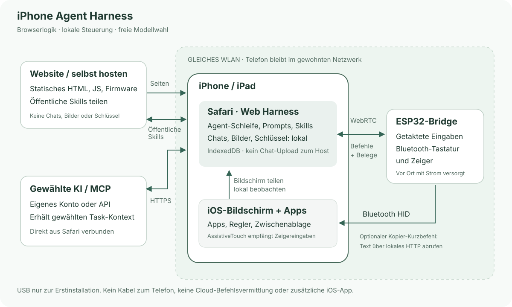

# iPhone Agent Harness

[English](../../README.md) · [简体中文](zh-Hans.md) · [繁體中文](zh-Hant.md) · [日本語](ja.md) · [Русский](ru.md) · **Deutsch** · [Français](fr.md) · [Español](es.md)

**Ein KI-Helfer fürs iPhone: Browser und ein ESP32-C3 für ungefähr 2 US-Dollar.**

Dem iPhone eine Aufgabe in Alltagssprache geben: Bildschirm prüfen, Text eingeben, Regler einstellen oder einen kurzen Ablauf über Apps hinweg erledigen. Eine kleine versorgte ESP32-Bridge liefert Bluetooth-Eingaben, Safari übernimmt Gespräch und Bildschirmaufnahme.

[Harness](https://igent.cc/) · [Browser-Installer](https://igent.cc/flash) · [Anleitung](../guide/de.md) · [Skills](https://igent.cc/skills) · [Architektur](../architecture/overview.md)

- **Im Browser flashen.** Fertige Images mit Chrome/Edge am Computer installieren, ohne Compiler, Arduino-Umgebung oder App-Build.

- **Das Telefon bleibt kabellos.** Die eingerichtete Bridge kann versorgt im Regal oder in einer Zimmerecke innerhalb der Funkreichweite stehen. Kein USB-Kabel zum Telefon.

- **Das gewohnte Netzwerk nutzen.** Telefon und Bridge nutzen dasselbe LAN-WLAN; der ESP-Hotspot dient nur zur Einrichtung. Keine native App, Zertifikatsinstallation, Hilfstabs oder eigener LAN-Relaydienst. Beim Teilen die normale Bildschirmfreigabe bestätigen.


Demovideo / GIF folgt.

## So funktioniert es

Safari sendet Bildschirm und gewählten Kontext an die KI. Harness prüft den Plan, übergibt ihn lokal per WebRTC an ESP32, und Bluetooth-Maus/Tastatur bedient das Telefon. Eine neue Aufnahme prüft das Ergebnis.



[Architektur](../architecture/overview.md)

## Board auswählen

Ein einfaches ESP32-C3-Board für ungefähr **2 US-Dollar** ist ein Kostenbeispiel, kein Angebot oder Preisversprechen. Händler, Versand und Ausführung variieren. Tatsächliches Chipprofil und USB-Datenkabel verwenden.

| Chip | Firmware | Hinweis |
|---|---|---|
| ESP32-C2 | Fertiges Image | Mindestens 2 MB; 26/40 MHz automatisch; USB-UART; eine App, kein OTA |
| ESP32-C3 | Fertiges Image | 4 MB Flash; Browserinstallation |
| ESP32-C5 | Fertiges Image | 4 MB Flash; 80-MHz-Flashprofil; natives USB CDC |
| ESP32-C6 | Fertiges Image | 4 MB Flash; Browserinstallation |
| ESP32-S3 | Fertiges Image | 4 MB Flash; Browserinstallation |
| ESP32 (classic) | Fertiges Image | 4 MB Flash; Browserinstallation |

## Einrichten und ausprobieren

Die vollständige Anleitung beschreibt alle Schritte:

1. **[Bedienungshilfen](../guide/de.md#accessibility).** AssistiveTouch aktivieren; voller Tastaturzugriff ist optional.

2. **[Flashen](../guide/de.md#flash).** Chip und Image im Desktop-Installer auswählen.

3. **[WLAN](../guide/de.md#wifi).** Normales 2,4-GHz-Netz speichern, Telefon in dasselbe LAN zurückbringen.

4. **[Bluetooth](../guide/de.md#bluetooth).** iPhone Agent Bridge in iOS koppeln.

5. **[Harness öffnen](../guide/de.md#open-harness).** Safari iOS/iPadOS 27+, Telefon entsperrt lassen.

6. **[KI einrichten](../guide/de.md#models).** OpenAI/Anthropic-kompatible API oder ChatGPT-Anmeldung; Modelle laden.

7. **[Bridge verbinden/testen](../guide/de.md#bridge).** Link importieren, bereites Telefon wählen, Zifferntest optional.

8. **[Zwischenablage-Kurzbefehl](../guide/de.md#clipboard).** iPhone Agent Clipboard hinzufügen und Kopierbestätigung abwarten.

9. **[Community-Skill](../guide/de.md#install-skills).** Gewünschtes Paket aus dem Katalog installieren.

10. **[Eigener Skill](../guide/de.md#authoring).** Am PC/Telefon erstellen; Eigentum über Browser-Kryptoidentität.

11. **[Veröffentlichen](../guide/de.md#publish).** Gewähltes öffentliches Paket explizit senden und Identität sichern.

## Gespräche mit beständiger Leseposition

Fragen, prüfbare Pläne und Aktionen teilen einen Chat. Der Listentitel wechselt zum Archiv; Wischen bietet Umbenennen/Archivieren bzw. Wiederherstellen/Löschen. Neue Antworten bewahren alte Lesepositionen; „Neueste“ führt zurück. Export enthält Bilder. Die KI prüft vor Abschluss und kehrt standardmäßig zu Harness zurück; unter Aufgabenabschluss abschaltbar.

12 integrierte Skills unterstützen Beobachtung, Planung, Eingabe, Wiederherstellung, Uhrzeit und Gestenkorrektur. Integrierte/geladene sind schreibgeschützt; Aktualisierung erhält Aktivierungsstatus. Eigene sind bearbeitbar und gehören zur Browseridentität statt iOS-UID. Optionales MCP nutzt gewählte Werkzeuge von CORS-fähigen Streamable-HTTP-Servern.

## Eigene Daten und eigenes Hosting

Chats, Schlüssel, Tokens und Bilder bleiben im Browser. Unser Host erhält keine Gespräche, Bildschirmbilder oder Modellschlüssel: Er liefert statische Seiten und öffentliche Skills; gewählte Inhalte gehen direkt zum Modell, erlaubte MCP-Aufrufe zum konfigurierten Server. Veröffentlichung sendet nur das gewählte Paket. Vor Löschen oder Browserwechsel Chats und Autorenidentität separat sichern.

Hardwarefunktionen sind experimentell: Gesten, Hintergrund, Kurzbefehle und mehrere Telefone am Gerät prüfen. Safari kann pausieren, die Bridge hat einen aktiven WebRTC-Peer. ChatGPT-Abonnementanmeldung in Safari auf Kompatibilität prüfen. Stop bleibt verfügbar, Aktionspläne behalten Sicherheitsgrenzen.

## Entwickeln und mitwirken

Website selbst hosten, eigene Modelle und optional Skill-API betreiben. Issues und PR sind willkommen. Wiederverwendbare Skills über die Website-Community teilen.

Für lokale Entwicklung Node.js 22.13 oder neuer verwenden.

```sh
npm ci
npm test
npm run build
npm run preview
```

[Arduino](../../firmware/IPhoneAutomationHarness/README.md) · [Selbsthosting](../architecture/deployment.md) · [Manuelle Releases](../architecture/manual-release.md)

[MIT License](../../LICENSE) · [Third-party notices](../../THIRD_PARTY_NOTICES.md)

## Danksagung

Danke an [onehumanbeing/esp32-iphone-agent](https://github.com/onehumanbeing/esp32-iphone-agent) für die Inspiration. Dieses Projekt nutzt eine eigene Browser-, Aufnahme- und Bluetooth-Architektur.
