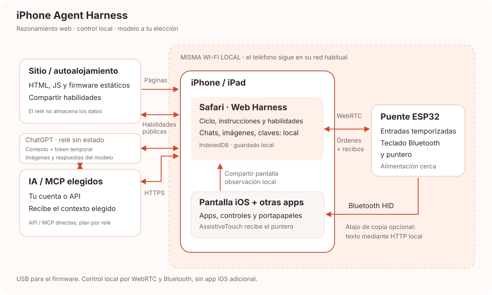

# iPhone Agent Harness

[English](../../README.md) · [简体中文](zh-Hans.md) · [繁體中文](zh-Hant.md) · [日本語](ja.md) · [Русский](ru.md) · [Deutsch](de.md) · [Français](fr.md) · **Español**

**Un asistente de IA para iPhone con navegador y un ESP32-C3 de unos 2 USD.**

Pide al iPhone que lea una pantalla, escriba texto, ajuste un control o siga un flujo breve entre aplicaciones. Un pequeño ESP32 alimentado aporta la entrada Bluetooth; Safari gestiona la conversación y captura.

[Harness](https://igent.cc/) · [Instalador web](https://igent.cc/flash) · [Guía completa](../guide/es.md) · [Comunidad](https://igent.cc/skills) · [Arquitectura](../architecture/overview.md)

- **Instala desde el navegador.** Imágenes preparadas con Chrome/Edge en ordenador, sin compilador, entorno Arduino ni compilar una app.

- **El teléfono sigue inalámbrico.** Tras configurar, el puente puede quedar alimentado en una estantería dentro del alcance Bluetooth/Wi-Fi. Sin USB al teléfono.

- **Usa tu red habitual.** Teléfono y puente comparten LAN Wi-Fi; el punto de acceso ESP solo se usa al configurar. Sin app nativa, certificados, pestaña auxiliar ni relé LAN separado. Al compartir, confirma el aviso habitual de pantalla.


Vídeo / GIF de demostración próximamente.

## Cómo funciona

Safari envía la pantalla y contexto elegido a tu IA. Harness valida el plan, lo transmite al ESP32 por WebRTC local y el puente actúa como ratón/teclado Bluetooth. La siguiente observación confirma el resultado.



[Arquitectura](../architecture/overview.md)

## Elige una placa

Una ESP32-C3 básica de aproximadamente **2 USD** es un ejemplo de coste inicial, no una oferta ni precio garantizado. Tienda, envío y diseño cambian el importe. Elige el perfil real del chip y cable USB de datos.

| Chip | Firmware | Notas |
|---|---|---|
| ESP32-C2 | Imagen precompilada | Mínimo 2 MB; 26/40 MHz automático; USB–UART; aplicación única sin OTA |
| ESP32-C3 | Imagen precompilada | 4 MB de flash; instalación web |
| ESP32-C5 | Imagen precompilada | 4 MB de flash; perfil 80 MHz; USB CDC nativo |
| ESP32-C6 | Imagen precompilada | 4 MB de flash; instalación web |
| ESP32-S3 | Imagen precompilada | 4 MB de flash; instalación web |
| ESP32 (classic) | Imagen precompilada | 4 MB de flash; instalación web |

## Configura y prueba

La guía completa cubre cada paso:

1. **[Accesibilidad](../guide/es.md#accessibility).** Activa AssistiveTouch; acceso total por teclado opcional.

2. **[Instalar firmware](../guide/es.md#flash).** Selecciona chip e imagen en el instalador del ordenador.

3. **[Wi-Fi](../guide/es.md#wifi).** Guarda la red habitual de 2,4 GHz y devuelve el teléfono a esa LAN.

4. **[Bluetooth](../guide/es.md#bluetooth).** Empareja iPhone Agent Bridge en iOS.

5. **[Abrir Harness](../guide/es.md#open-harness).** Safari iOS/iPadOS 27+, teléfono desbloqueado.

6. **[Configurar IA](../guide/es.md#models).** API compatible OpenAI/Anthropic o acceso ChatGPT; carga modelos.

7. **[Conectar/probar puente](../guide/es.md#bridge).** Importa enlace y selecciona teléfono listo; prueba de dígitos opcional.

8. **[Atajo del portapapeles](../guide/es.md#clipboard).** Añade iPhone Agent Clipboard y espera confirmación de copia.

9. **[Habilidad comunitaria](../guide/es.md#install-skills).** Instala un paquete del catálogo público.

10. **[Crear habilidad](../guide/es.md#authoring).** Edita en ordenador/teléfono con identidad criptográfica del navegador.

11. **[Publicar](../guide/es.md#publish).** Envía explícitamente un paquete público y respalda tu identidad.

## Conversaciones que conservan tu lugar

Preguntas, planes revisables y acciones comparten conversación. El título de la lista cambia al archivo; desliza para renombrar/archivar o restaurar/eliminar. Las respuestas conservan la lectura; «Últimos» vuelve al final. Exportar incluye imágenes. La IA verifica antes de terminar y vuelve a Harness por defecto; cámbialo en Finalización de tarea.

12 habilidades integradas cubren observación, planificación, entrada, recuperación, reloj y corrección de gestos. Integradas/descargadas son de solo lectura; actualizar conserva su activación. Las propias son editables y pertenecen a la identidad del navegador, no un UID iOS. MCP opcional conecta herramientas elegidas de servidores Streamable HTTP compatibles con CORS.

## Tus datos y tu alojamiento

Conversaciones, claves, tokens e imágenes se guardan en el navegador. Nuestro host no recibe conversaciones, capturas ni claves de modelos: sirve páginas estáticas y habilidades públicas; contenido elegido va directo al modelo, llamadas MCP autorizadas al servidor configurado. Publicar solo envía el paquete elegido. Exporta conversaciones y respalda la identidad por separado antes de limpiar o cambiar navegador.

El hardware es experimental: gestos, fondo, Atajos y varios teléfonos requieren pruebas reales. Safari puede pausar tareas; solo un par WebRTC está activo. Comprueba la compatibilidad de acceso ChatGPT en Safari. Detener sigue disponible y cada plan mantiene límites de seguridad.

## Desarrollar y contribuir

Puedes alojar el sitio, elegir tus modelos y una API de habilidades opcional. Se agradecen Issues y PR. Comparte habilidades reutilizables en la comunidad web.

Para desarrollo local usa Node.js 22.13 o posterior.

```sh
npm ci
npm test
npm run build
npm run preview
```

[Arduino](../../firmware/IPhoneAutomationHarness/README.md) · [Alojamiento propio](../architecture/deployment.md) · [Publicación manual](../architecture/manual-release.md)

[MIT License](../../LICENSE) · [Third-party notices](../../THIRD_PARTY_NOTICES.md)

## Agradecimientos

Gracias a [onehumanbeing/esp32-iphone-agent](https://github.com/onehumanbeing/esp32-iphone-agent) por la inspiración. Este proyecto usa su propio diseño de navegador, captura y puente Bluetooth.
