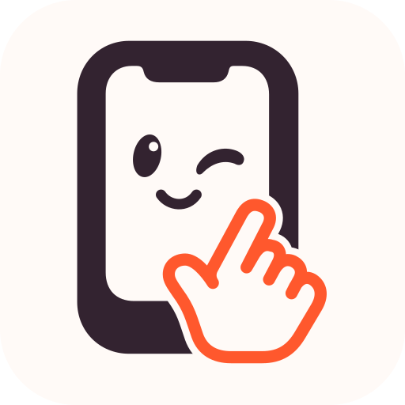
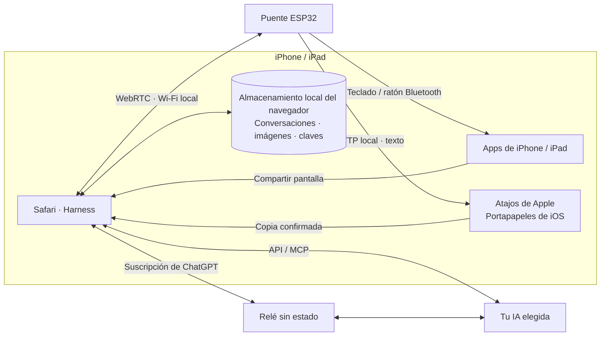
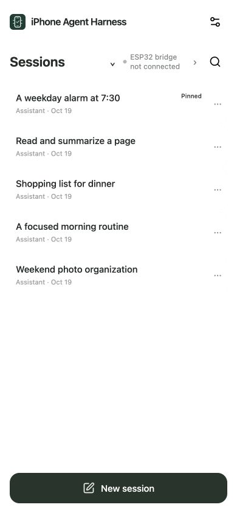
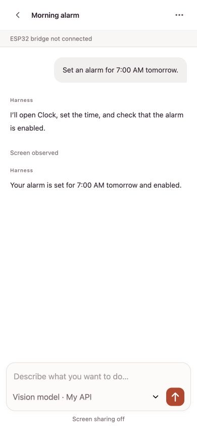
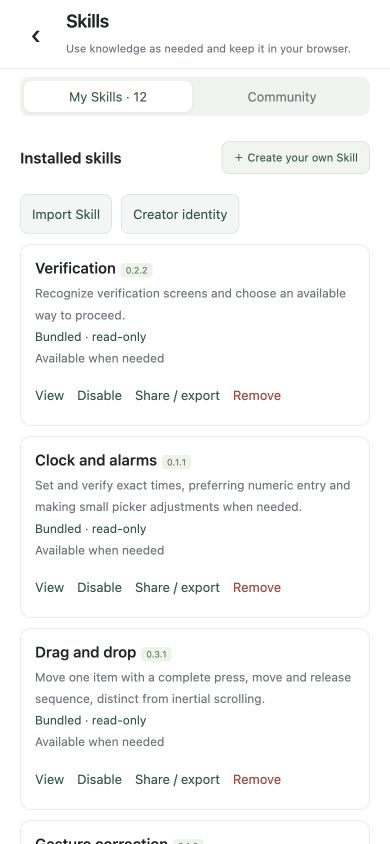

<h1 align="center">iPhone Agent Harness</h1>

<strong>Deja que la IA maneje tu iPhone.</strong>

  <a href="../../README.md">English</a> · <a href="zh-Hans.md">简体中文</a> · <a href="zh-Hant.md">繁體中文</a> · <a href="ja.md">日本語</a> · <a href="ru.md">Русский</a> · <a href="de.md">Deutsch</a> · <a href="fr.md">Français</a> · <strong>Español</strong>

  
  
  
  

  <a href="https://igent.cc/">📱 Harness</a> ·
  <a href="https://igent.cc/flash">⚡ Instalador web</a> ·
  <a href="../guide/es.md">📖 Guía completa</a> ·
  <a href="https://igent.cc/skills">🧩 Comunidad</a> ·
  <a href="../architecture/overview.md">🗺️ Arquitectura</a>

Pide al iPhone que lea una pantalla, escriba texto, ajuste un control o siga un flujo breve entre aplicaciones. Un pequeño ESP32 alimentado aporta la entrada Bluetooth; Safari gestiona la conversación y captura.

- **Instala desde el navegador.** Elige tu ESP32 e instala el firmware con Chrome o Edge en el ordenador.
- **El teléfono sigue inalámbrico.** Deja el puente alimentado en una estantería dentro del alcance de Bluetooth.
- **Tu Wi-Fi habitual.** Conecta el teléfono y el puente a la misma red de casa u oficina y empieza una tarea en Safari.

https://github.com/user-attachments/assets/d72669a6-e150-40d7-ba2f-1d9586d9c2ea

Un agente configura una alarma en un iPhone real.

## ⚙️ Cómo funciona

Safari envía la pantalla y contexto elegido a tu IA. Harness valida el plan, lo transmite al ESP32 por WebRTC local y el puente actúa como ratón/teclado Bluetooth. La siguiente observación confirma el resultado.

[Arquitectura](../architecture/overview.md)

## 🔌 Elige una placa

Una ESP32-C3 básica cuesta unos **2 USD**. Selecciona el chip en el [instalador web](https://igent.cc/flash) y conecta la placa al ordenador con un cable USB de datos.

| Chip | Modelos compatibles |
|---|---|
| ESP32-C2 | Mínimo 2 MB · detección automática del cristal de 26/40 MHz |
| ESP32-C3 | Todos los modelos* |
| ESP32-C5 | Todos los modelos* |
| ESP32-C6 | Todos los modelos* |
| ESP32-S3 | Todos los modelos* |
| ESP32 (classic) | Todos los modelos* |

*Las imágenes actuales para C3, C5, C6, S3 y ESP32 clásico usan flash SPI estándar de al menos 4 MB.

## 🚀 Configura y prueba

La guía completa cubre cada paso:

1. **[Accesibilidad](../guide/es.md#accessibility)**

2. **[Instalar firmware](../guide/es.md#flash)**

3. **[Wi-Fi](../guide/es.md#wifi)**

4. **[Bluetooth](../guide/es.md#bluetooth)**

5. **[Abrir Harness](../guide/es.md#open-harness)**

6. **[Configurar IA](../guide/es.md#models)**

7. **[Conectar/probar puente](../guide/es.md#bridge)**

8. **[Atajo del portapapeles](../guide/es.md#clipboard)**

9. **[Habilidad comunitaria](../guide/es.md#install-skills)**

10. **[Crear habilidad](../guide/es.md#authoring)**

11. **[Publicar](../guide/es.md#publish)**

## 💬 Conversaciones, planes y habilidades

Haz preguntas, prepara planes o encarga una tarea al agente en la misma conversación. Puedes renombrar, archivar, buscar y exportar conversaciones. Lee el historial mientras se ejecuta una tarea y vuelve a la última respuesta cuando quieras.

Las habilidades ayudan con las tareas habituales del teléfono y mejoran los toques, la escritura y los gestos. Añádelas desde la comunidad o pide a Harness que te ayude a crear las tuyas. También puedes conectar herramientas MCP en Ajustes.

Pantallas reales de Harness con datos de ejemplo.

<table>
  <tr><th>Tus conversaciones</th><th>Conversación de ejemplo</th><th>Habilidades</th></tr>
  <tr>
    <td></td>
    <td></td>
    <td></td>
  </tr>
</table>

Un puente admite dos conexiones independientes de Harness. Si usas dos teléfonos, selecciona el correspondiente en cada página y realiza la prueba de entrada opcional en cada uno para confirmar la vinculación.

## 📋 Textos largos en varios idiomas

La escritura habitual y los atajos de teclado usan el teclado Bluetooth del puente. Para textos largos o multilingües, **iPhone Agent Clipboard** copia el contenido con Atajos de Apple y el agente lo pega en el campo elegido.

El navegador envía el texto al ESP32 en pequeños bloques por WebRTC local. El puente los transmite en una única respuesta HTTP al atajo, que coloca el texto completo en el portapapeles del iPhone.

[Configurar el portapapeles](../guide/es.md#clipboard)

## 🔒 Datos y privacidad

Las sesiones, capturas y credenciales se guardan en el navegador; las API normales se conectan directamente. Por CORS, ChatGPT usa el relé Cloudflare del proyecto o uno propio sin estado para el contexto seleccionado, imágenes, respuestas y un token temporal. La aplicación de relé no guarda estos datos ni registra contenidos o credenciales.

## 🤝 Contribuye

Comparte ideas y problemas en [Issues](https://github.com/cccat6/iphone-agent-harness/issues) o mejoras mediante un [pull request](https://github.com/cccat6/iphone-agent-harness/pulls). Publica tus propias habilidades en la [comunidad](https://igent.cc/skills).

[MIT License](../../LICENSE) · [Third-party notices](../../THIRD_PARTY_NOTICES.md)

## 💛 Agradecimientos

Gracias a [onehumanbeing/esp32-iphone-agent](https://github.com/onehumanbeing/esp32-iphone-agent) por la inspiración.
