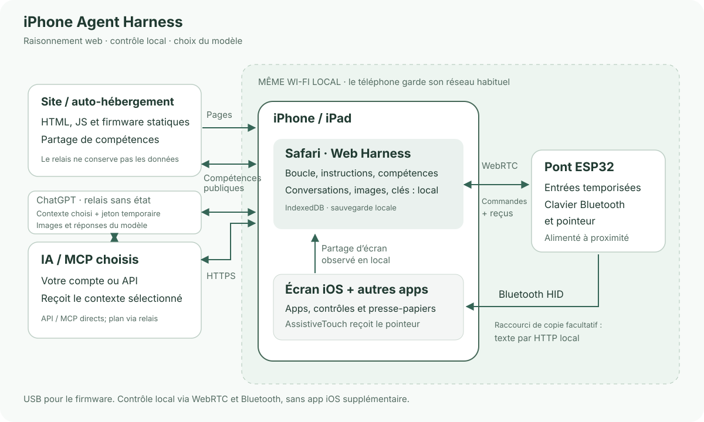

# iPhone Agent Harness

[English](../../README.md) · [简体中文](zh-Hans.md) · [繁體中文](zh-Hant.md) · [日本語](ja.md) · [Русский](ru.md) · [Deutsch](de.md) · **Français** · [Español](es.md)

**Un assistant IA pour iPhone avec un navigateur et un ESP32-C3 autour de 2 dollars US.**

Demandez à l’iPhone de lire un écran, saisir du texte, ajuster un contrôle ou suivre un court parcours entre applications. Un petit ESP32 alimenté fournit les entrées Bluetooth ; Safari gère la conversation et la capture.

[Harness](https://igent.cc/) · [Installateur web](https://igent.cc/flash) · [Guide complet](../guide/fr.md) · [Compétences](https://igent.cc/skills) · [Architecture](../architecture/overview.md)

- **Flasher dans le navigateur.** Les images prêtes s’installent avec Chrome/Edge sur ordinateur, sans compilateur, Arduino ni construction d’application.

- **Le téléphone reste sans fil.** Une fois configuré, le pont peut rester alimenté sur une étagère à portée Bluetooth/Wi-Fi. Pas de câble USB au téléphone.

- **Garder le réseau habituel.** Téléphone et pont partagent le LAN Wi-Fi ; le point d’accès ESP sert seulement à la configuration initiale. Sans application native, certificat, onglet auxiliaire ou relais LAN séparé. Confirmez la demande habituelle lorsque vous partagez l’écran.


Vidéo / GIF de démonstration à venir.

## Fonctionnement

Safari envoie l’écran et le contexte choisi à l’IA. Harness vérifie le plan, le transmet localement par WebRTC à l’ESP32, puis le pont utilise souris/clavier Bluetooth. Une nouvelle observation vérifie le résultat.



[Architecture](../architecture/overview.md)

## Choisir une carte

Une carte ESP32-C3 simple à environ **2 dollars US** est un exemple de budget, pas un devis ni une garantie. Vendeur, transport et modèle influencent le prix. Choisissez la vraie puce et un câble USB de données.

| Puce | Firmware | Remarque |
|---|---|---|
| ESP32-C2 | Image précompilée | 2 Mo minimum ; 26/40 MHz auto ; USB–UART ; application unique sans OTA |
| ESP32-C3 | Image précompilée | 4 Mo de flash ; installation web |
| ESP32-C5 | Image précompilée | 4 Mo de flash ; profil 80 MHz ; USB CDC natif |
| ESP32-C6 | Image précompilée | 4 Mo de flash ; installation web |
| ESP32-S3 | Image précompilée | 4 Mo de flash ; installation web |
| ESP32 (classic) | Image précompilée | 4 Mo de flash ; installation web |

## Installer et essayer

Le guide complet décrit les onze étapes :

1. **[Accessibilité](../guide/fr.md#accessibility).** Activer AssistiveTouch ; accès complet au clavier facultatif.

2. **[Flasher](../guide/fr.md#flash).** Choisir puce et image dans l’installateur sur ordinateur.

3. **[Wi-Fi](../guide/fr.md#wifi).** Enregistrer le réseau 2,4 GHz habituel et y reconnecter le téléphone.

4. **[Bluetooth](../guide/fr.md#bluetooth).** Associer iPhone Agent Bridge dans iOS.

5. **[Ouvrir Harness](../guide/fr.md#open-harness).** Safari iOS/iPadOS 27+, téléphone déverrouillé.

6. **[Configurer l’IA](../guide/fr.md#models).** API OpenAI/Anthropic compatible ou connexion ChatGPT ; charger les modèles.

7. **[Connecter/tester le pont](../guide/fr.md#bridge).** Importer le lien, choisir le téléphone prêt ; test de chiffres facultatif.

8. **[Raccourci presse-papiers](../guide/fr.md#clipboard).** Ajouter iPhone Agent Clipboard et attendre la confirmation de copie.

9. **[Compétence communautaire](../guide/fr.md#install-skills).** Installer le paquet voulu depuis le catalogue.

10. **[Créer une compétence](../guide/fr.md#authoring).** Éditer sur ordinateur/téléphone ; identité cryptographique du navigateur.

11. **[Publier](../guide/fr.md#publish).** Envoyer explicitement un paquet public et sauvegarder son identité.

## Des conversations qui gardent votre place

Questions, plans vérifiables et actions partagent la même conversation. Le titre de liste ouvre les archives ; balayer permet renommer/archiver ou restaurer/supprimer. Les réponses préservent la lecture ; « Derniers » ramène aux récents. L’export inclut les images. L’IA vérifie avant de finir et revient normalement dans Harness, désactivable dans Fin de tâche.

12 compétences intégrées couvrent observation, planification, saisie, reprise, horloge et correction des gestes. Intégrées/téléchargées en lecture seule, actualisées sans perdre l’activation. Vos créations sont modifiables et liées à l’identité du navigateur, pas à un UID iOS. MCP facultatif utilise des outils choisis sur des serveurs Streamable HTTP compatibles CORS.

## Vos données et votre hébergement

Conversations, clés, jetons et images sont enregistrés dans le navigateur. Notre hôte ne reçoit ni conversations, ni captures, ni clés de modèle : il sert les pages statiques et compétences publiques ; les contenus choisis vont directement au modèle, les appels MCP autorisés au serveur configuré. Publier envoie seulement le paquet choisi. Exportez conversations et identité d’auteur séparément avant nettoyage ou changement de navigateur.

Le matériel reste expérimental : gestes, arrière-plan, Raccourcis et plusieurs téléphones demandent une vérification réelle. Safari peut suspendre les tâches ; un seul pair WebRTC est actif. Vérifiez la compatibilité de l’abonnement ChatGPT dans Safari. Arrêt reste disponible et chaque plan garde ses limites.

## Développer et contribuer

Auto-hébergez le site, choisissez vos modèles et éventuellement l’API de compétences. Issues et PR sont bienvenus. Partagez les compétences réutilisables via la communauté du site.

Pour développer localement, utiliser Node.js 22.13 ou ultérieur.

```sh
npm ci
npm test
npm run build
npm run preview
```

[Arduino](../../firmware/IPhoneAutomationHarness/README.md) · [Auto-hébergement](../architecture/deployment.md) · [Publications manuelles](../architecture/manual-release.md)

[MIT License](../../LICENSE) · [Third-party notices](../../THIRD_PARTY_NOTICES.md)

## Remerciements

Merci à [onehumanbeing/esp32-iphone-agent](https://github.com/onehumanbeing/esp32-iphone-agent) pour l’inspiration. Ce projet suit sa propre architecture de navigateur, capture et pont Bluetooth.
