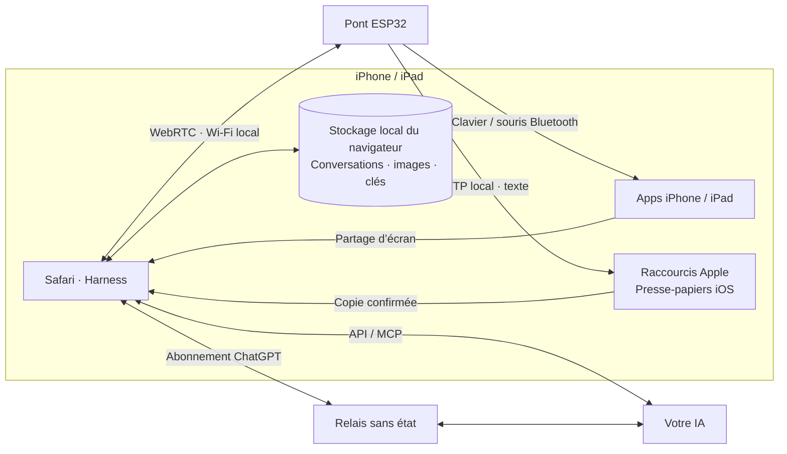

<h1 align="center">iPhone Agent Harness</h1>

<strong>Confiez les commandes de votre iPhone à une IA.</strong>

  <a href="../../README.md">English</a> · <a href="zh-Hans.md">简体中文</a> · <a href="zh-Hant.md">繁體中文</a> · <a href="ja.md">日本語</a> · <a href="ru.md">Русский</a> · <a href="de.md">Deutsch</a> · <strong>Français</strong> · <a href="es.md">Español</a>

  
  
  
  

  <a href="https://igent.cc/">📱 Harness</a> ·
  <a href="https://igent.cc/flash">⚡ Installateur web</a> ·
  <a href="../guide/fr.md">📖 Guide complet</a> ·
  <a href="https://igent.cc/skills">🧩 Compétences</a> ·
  <a href="../architecture/overview.md">🗺️ Architecture</a>

Demandez à l’iPhone de lire un écran, saisir du texte, ajuster un contrôle ou suivre un court parcours entre applications. Un petit ESP32 alimenté fournit les entrées Bluetooth ; Safari gère la conversation et la capture.

- **Installer dans le navigateur.** Choisissez votre ESP32 et installez son firmware avec Chrome ou Edge sur ordinateur.
- **Le téléphone reste sans fil.** Laissez le pont alimenté sur une étagère à portée Bluetooth.
- **Votre Wi-Fi habituel.** Connectez téléphone et pont au même réseau domestique ou professionnel et démarrez une tâche dans Safari.

<table>
<tr><th>Commander un repas</th><th>Régler une alarme</th></tr>
<tr>
<td width="50%" align="center">

https://github.com/user-attachments/assets/7601869f-7cc6-445e-b64d-0073a8bf657d

</td>
<td width="50%" align="center">

https://github.com/user-attachments/assets/d72669a6-e150-40d7-ba2f-1d9586d9c2ea

</td>
</tr>
</table>

**L’IA commande une livraison sur iPhone.** L’agent choisit les boissons MIXUE, règle les glaçons et le sucre, puis passe au récapitulatif. La vidéo se termine par la commande livrée.

## ⚙️ Fonctionnement

Safari envoie l’écran et le contexte choisi à l’IA. Harness vérifie le plan, le transmet localement par WebRTC à l’ESP32, puis le pont utilise souris/clavier Bluetooth. Une nouvelle observation vérifie le résultat.

[Architecture](../architecture/overview.md)

## 🔌 Choisir une carte

Pour un nouvel achat, privilégiez **C6, S3 ou C3**. Choisissez une carte de développement complète avec USB et antenne intégrée : ce projet ne nécessite ni soudure ni périphérique externe. Flashez-la une fois avec un câble USB de données et l’[installateur web](https://igent.cc/flash), configurez le Wi-Fi et l’appairage Bluetooth. Ensuite, une alimentation USB suffit.

| Puce | Modèles / mots-clés | Amazon US : par carte en lot¹ | Taobao : budget par carte¹ |
|---|---|---|---|
| **ESP32-C6** | `ESP32-C6 SuperMini` · `ESP32-C6-Zero` · `ESP32-C6-DevKitM-1` · `ESP32-C6-DevKitC-1` · `ESP32-C6-WROOM-1 N8` | US$4–8 | ¥25–45 |
| **ESP32-S3** | `ESP32-S3-DevKitC-1 N8R2 / N8R8 / N16R8` · `ESP32-S3 SuperMini` · `ESP32-S3-Zero` · `ESP32-S3-WROOM-1 N16R8` | US$6–9 | ¥15–40 |
| **ESP32-C3** | `ESP32-C3 SuperMini` · `ESP32-C3-MINI` · `ESP32-C3-Zero` · `ESP32-C3-DevKitM-1` · `ESP32-C3-MINI-1 N4` | US$3–5 | ¥6–20 |

Ajoutez **`development board USB-C`** sur Amazon ou **`开发板 Type-C 板载天线`** sur Taobao. Avec les noms de modules WROOM/MINI, précisez « carte de développement » pour éviter les modules nus, adaptateurs et cartes d’extension.

¹ Budgets indicatifs de cartes simples, octobre 2026. Amazon : prix unitaire en lot de 3–5, à acheter en entier ; à l’unité, souvent US$9–13. Taobao : estimations indexées, prix final par référence non vérifié. Variante, livraison et taxes à vérifier ; les kits officiels peuvent coûter plus cher.

**Aucune marque ni référence commerciale imposée.** D’autres cartes équipées de la même puce peuvent utiliser le firmware correspondant avec une mémoire SPI Flash standard (DIO) de **4 Mo minimum** et le flashage USB. La PSRAM est facultative ; une commande particulière de l’antenne ou de l’alimentation peut demander une adaptation. **C2** (2 Mo minimum, sélection automatique 26/40 MHz), **C5 et ESP32 classique** sont aussi pris en charge. S2, H2, P4 et C61 ne sont pas couverts par le firmware actuel. Ces noms sont des pistes de recherche, pas une liste de toutes les variantes testées.

## 🚀 Installer et essayer

Le guide complet décrit les onze étapes :

1. **[Accessibilité](../guide/fr.md#accessibility)**

2. **[Flasher](../guide/fr.md#flash)**

3. **[Wi-Fi](../guide/fr.md#wifi)**

4. **[Bluetooth](../guide/fr.md#bluetooth)**

5. **[Ouvrir Harness](../guide/fr.md#open-harness)**

6. **[Configurer l’IA](../guide/fr.md#models)**

7. **[Connecter/tester le pont](../guide/fr.md#bridge)**

8. **[Raccourci presse-papiers](../guide/fr.md#clipboard)**

9. **[Compétence communautaire](../guide/fr.md#install-skills)**

10. **[Créer une compétence](../guide/fr.md#authoring)**

11. **[Publier](../guide/fr.md#publish)**

## 💬 Conversations, plans et compétences

Posez une question, préparez un plan ou confiez une tâche à l’agent dans la même conversation. Renommez, archivez, recherchez et exportez vos conversations. Consultez l’historique pendant une tâche et revenez à la dernière réponse quand vous le souhaitez.

Les compétences aident l’agent dans les tâches courantes et améliorent ses gestes et sa saisie. Ajoutez-en depuis la communauté ou demandez à Harness de vous aider à créer les vôtres. Les réglages permettent aussi de connecter des outils MCP.

Véritables écrans de Harness avec des données de démonstration.

<table>
  <tr><th>Vos conversations</th><th>Exemple de conversation</th><th>Compétences</th></tr>
  <tr>
    <td></td>
    <td></td>
    <td></td>
  </tr>
</table>

Un pont prend en charge deux connexions Harness indépendantes. Avec deux téléphones, sélectionnez celui qui correspond à chaque page et faites le test de saisie facultatif sur chacun pour confirmer l’association.

## 📋 Des textes longs, dans plusieurs langues

La saisie courante et les raccourcis clavier passent par le clavier Bluetooth du pont. Pour les textes longs ou multilingues, **iPhone Agent Clipboard** copie le contenu avec Raccourcis d’Apple, puis l’agent le colle dans le champ choisi.

Le navigateur envoie le texte à l’ESP32 par petits blocs via le WebRTC local. Le pont transmet ces blocs dans une seule réponse HTTP au raccourci, qui place le texte complet dans le presse-papiers de l’iPhone.

[Configurer le presse-papiers](../guide/fr.md#clipboard)

## 🔒 Données et confidentialité

Sessions, captures et identifiants sont enregistrés dans le navigateur ; les API ordinaires sont directes. En raison de CORS, ChatGPT utilise le relais Cloudflare du projet ou votre relais sans état pour le contexte choisi, les images, les réponses et un jeton d’accès temporaire. L’application relais ne conserve pas ces données et ne journalise ni contenus ni identifiants.

La réutilisation des captures envoie chaque image choisie une seule fois à DeepSeek ou Claude, puis utilise son identifiant. Les fichiers chez le fournisseur expirent après une heure. Cette option se règle pour chaque connexion API.

## 🤝 Contribuer

Vos idées et signalements sont les bienvenus dans les [Issues](https://github.com/cccat6/iphone-agent-harness/issues), tout comme vos améliorations par [pull request](https://github.com/cccat6/iphone-agent-harness/pulls). Partagez vos propres compétences dans la [communauté](https://igent.cc/skills).

[MIT License](../../LICENSE) · [Third-party notices](../../THIRD_PARTY_NOTICES.md)

## 💛 Remerciements

Merci à [onehumanbeing/esp32-iphone-agent](https://github.com/onehumanbeing/esp32-iphone-agent) pour l’inspiration.
