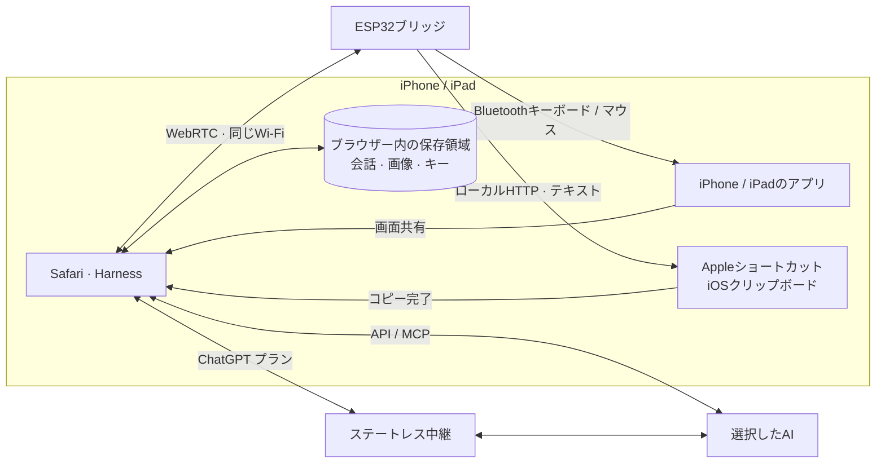

<h1 align="center">iPhone Agent Harness</h1>

<strong>AIに、あなたのiPhoneの操作を任せよう。</strong>

  <a href="../../README.md">English</a> · <a href="zh-Hans.md">简体中文</a> · <a href="zh-Hant.md">繁體中文</a> · <strong>日本語</strong> · <a href="ru.md">Русский</a> · <a href="de.md">Deutsch</a> · <a href="fr.md">Français</a> · <a href="es.md">Español</a>

  
  
  
  

  <a href="https://igent.cc/">📱 Harness</a> ·
  <a href="https://igent.cc/flash">⚡ ブラウザー書き込み</a> ·
  <a href="../guide/ja.md">📖 ガイド</a> ·
  <a href="https://igent.cc/skills">🧩 スキル</a> ·
  <a href="../architecture/overview.md">🗺️ 構成図</a>

画面の確認、文字入力、細かい設定、アプリをまたぐ短い作業を自然な言葉で依頼できます。電源につないだ小さなESP32がBluetooth入力を担い、Safariが会話と画面取得を実行します。

- **ブラウザーで書き込み。** PCのChromeまたはEdgeでESP32を選び、ファームウェアをインストール。
- **iPhoneはワイヤレス。** ブリッジはBluetoothの届く棚や部屋の隅で給電しておくだけ。
- **普段のWi-Fiで利用。** iPhoneとブリッジを家やオフィスの同じネットワークにつなぎ、Safariでタスクを開始。

<table>
<tr><th>デリバリーを注文</th><th>アラームを設定</th></tr>
<tr>
<td width="50%" align="center">

https://github.com/user-attachments/assets/7601869f-7cc6-445e-b64d-0073a8bf657d

</td>
<td width="50%" align="center">

https://github.com/user-attachments/assets/d72669a6-e150-40d7-ba2f-1d9586d9c2ea

</td>
</tr>
</table>

**AI が iPhone でデリバリーを注文。** MIXUE の商品を選び、氷と甘さを設定して会計画面まで操作します。最後に届いた商品を紹介します。

## ⚙️ 仕組み

Safariが取得した画面と選択内容をAIへ送ります。Harnessが計画を検証し、LAN WebRTCでESP32に届け、Bluetoothマウス・キーボードで操作。新しい画面で結果を確認します。

[構成図](../architecture/overview.md)

## 🔌 ボードを選ぶ

新しく買うなら **C6・S3・C3** から選んでください。USB 端子と基板上アンテナを備えた完成済み開発ボードなら、このプロジェクトに配線やはんだ付けは不要です。初回は USB データケーブルで PC につなぎ、[ブラウザー書き込みツール](https://igent.cc/flash)で書き込み、Wi-Fi 設定と Bluetooth ペアリングを行います。その後は USB 給電だけで使えます。

| チップ | 型番・検索キーワード | Amazon US：複数個セットの1個あたり¹ | 淘宝：1個の予算目安¹ |
|---|---|---|---|
| **ESP32-C6** | `ESP32-C6 SuperMini` · `ESP32-C6-Zero` · `ESP32-C6-DevKitM-1` · `ESP32-C6-DevKitC-1` · `ESP32-C6-WROOM-1 N8` | US$4–8 | ¥25–45 |
| **ESP32-S3** | `ESP32-S3-DevKitC-1 N8R2 / N8R8 / N16R8` · `ESP32-S3 SuperMini` · `ESP32-S3-Zero` · `ESP32-S3-WROOM-1 N16R8` | US$6–9 | ¥15–40 |
| **ESP32-C3** | `ESP32-C3 SuperMini` · `ESP32-C3-MINI` · `ESP32-C3-Zero` · `ESP32-C3-DevKitM-1` · `ESP32-C3-MINI-1 N4` | US$3–5 | ¥6–20 |

Amazon では **`development board USB-C`**、淘宝では **`开发板 Type-C 板载天线`** を追加して検索します。WROOM／MINI のモジュール名にも「開発ボード」を添え、単体モジュールや変換・拡張基板を買わないようにしてください。

¹ 2026年10月の基本ボードの目安。Amazon は3～5個セットの単価で、セット全体の購入が必要です。単品は US$9–13 程度。淘宝は公開検索情報の概算で、SKU ごとの決済価格は未確認です。仕様・送料・税で変わり、公式キットは高くなる場合があります。

**ブランドや商品名を限定するリストではありません。** 同じチップで標準 SPI Flash（DIO）が **4 MB 以上**あり、USB で書き込めるボードなら対応ファームウェアを利用できます。PSRAM は不要です。独自のアンテナ・電源制御には調整が必要な場合があります。**C2**（2 MB 以上、26/40 MHz 自動選択）、**C5・従来の ESP32** も対応。S2・H2・P4・C61 は現在のファームウェア対象外です。掲載名は検索例で、全機種の実機検証済みリストではありません。

## 🚀 セットアップ

詳細ガイドの各項目へ進めます：

1. **[アクセシビリティ](../guide/ja.md#accessibility)**

2. **[書き込み](../guide/ja.md#flash)**

3. **[Wi-Fi](../guide/ja.md#wifi)**

4. **[Bluetooth](../guide/ja.md#bluetooth)**

5. **[Harnessを開く](../guide/ja.md#open-harness)**

6. **[AI設定](../guide/ja.md#models)**

7. **[接続とテスト](../guide/ja.md#bridge)**

8. **[コピー用ショートカット](../guide/ja.md#clipboard)**

9. **[スキル追加](../guide/ja.md#install-skills)**

10. **[自作スキル](../guide/ja.md#authoring)**

11. **[公開](../guide/ja.md#publish)**

## 💬 会話・計画・スキル

質問、計画の相談、タスクの実行を一つの会話で行えます。会話の名前変更、アーカイブ、検索、ファイルへの書き出しに対応。実行中も履歴を読み、好きなタイミングで最新の返信へ戻れます。

スキルはよく使う操作を教え、タップ、文字入力、スワイプを助けます。コミュニティから追加したり、Harnessに自作スキルを書いてもらったりできます。設定からMCPツールも接続できます。

実際のHarness画面にサンプルデータを表示しています。

<table>
  <tr><th>会話一覧</th><th>会話の例</th><th>スキル</th></tr>
  <tr>
    <td></td>
    <td></td>
    <td></td>
  </tr>
</table>

一つのブリッジに二つのHarnessを独立して接続できます。二台の電話で使う場合は、それぞれの画面で対応する電話を選び、任意の入力テストで組み合わせを確認してください。

## 📋 長文も、さまざまな言語も

普段の文字入力やキー操作は、ブリッジのBluetoothキーボードを使います。長文や多言語テキストには **iPhone Agent Clipboard**。Appleのショートカットでコピーし、エージェントが目的の欄に貼り付けます。

ブラウザーからESP32へ、ローカルWebRTCでテキストを小分けに送信します。ブリッジは一つのHTTP応答としてショートカットに順次渡し、全文をiPhoneのクリップボードにコピーします。

[クリップボードの設定](../guide/ja.md#clipboard)

## 🔒 データとプライバシー

会話・スクリーンショット・認証情報はブラウザーに保存し、通常のAPIは提供元に直接接続します。ChatGPTサブスクリプションはCORS制約のため、プロジェクトのCloudflare中継または自分のステートレス中継を使い、選択情報・画像・出力・短期アクセストークンを転送します。中継アプリはこれらを保存せず、本文や認証情報も記録しません。

スクリーンショットの再利用を有効にすると、選択した画像を DeepSeek または Claude に一度アップロードし、以降はファイル ID を送信します。提供元のファイルは1時間後に期限切れになります。API 接続ごとに設定できます。

## 🤝 貢献する

不具合やアイデアは[Issue](https://github.com/cccat6/iphone-agent-harness/issues)へ、改善は[プルリクエスト](https://github.com/cccat6/iphone-agent-harness/pulls)へ。自作スキルは[スキルコミュニティ](https://igent.cc/skills)で共有できます。

[MIT License](../../LICENSE) · [Third-party notices](../../THIRD_PARTY_NOTICES.md)

## 💛 謝辞

着想を与えてくれた [onehumanbeing/esp32-iphone-agent](https://github.com/onehumanbeing/esp32-iphone-agent) に感謝します。
