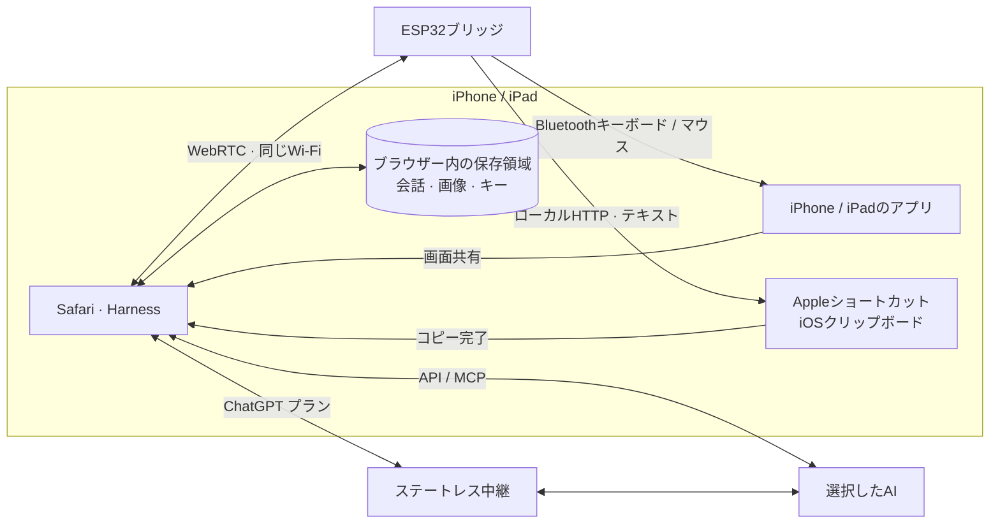

<h1 align="center">iPhone Agent Harness</h1>

<strong>AIに、あなたのiPhoneの操作を任せよう。</strong>

  <a href="../../README.md">English</a> · <a href="zh-Hans.md">简体中文</a> · <a href="zh-Hant.md">繁體中文</a> · <strong>日本語</strong> · <a href="ru.md">Русский</a> · <a href="de.md">Deutsch</a> · <a href="fr.md">Français</a> · <a href="es.md">Español</a>

  
  
  
  

  <a href="https://igent.cc/">📱 Harness</a> ·
  <a href="https://igent.cc/flash">⚡ ブラウザー書き込み</a> ·
  <a href="../guide/ja.md">📖 ガイド</a> ·
  <a href="https://igent.cc/skills">🧩 スキル</a> ·
  <a href="../architecture/overview.md">🗺️ 構成図</a>

画面の確認、文字入力、細かい設定、アプリをまたぐ短い作業を自然な言葉で依頼できます。電源につないだ小さなESP32がBluetooth入力を担い、Safariが会話と画面取得を実行します。

- **ブラウザーで書き込み。** PCのChromeまたはEdgeでESP32を選び、ファームウェアをインストール。
- **iPhoneはワイヤレス。** ブリッジはBluetoothの届く棚や部屋の隅で給電しておくだけ。
- **普段のWi-Fiで利用。** iPhoneとブリッジを家やオフィスの同じネットワークにつなぎ、Safariでタスクを開始。

https://github.com/user-attachments/assets/d72669a6-e150-40d7-ba2f-1d9586d9c2ea

エージェントが実際のiPhoneでアラームを設定します。

## ⚙️ 仕組み

Safariが取得した画面と選択内容をAIへ送ります。Harnessが計画を検証し、LAN WebRTCでESP32に届け、Bluetoothマウス・キーボードで操作。新しい画面で結果を確認します。

[構成図](../architecture/overview.md)

## 🔌 ボードを選ぶ

基本的なESP32-C3ボードなら約 **2米ドル**から始められます。[ブラウザー書き込み](https://igent.cc/flash)でチップを選び、USBデータケーブルでPCにつなぐだけ。

| チップ | 対応モデル |
|---|---|
| ESP32-C2 | 最低2 MB · 26/40 MHz水晶を自動判別 |
| ESP32-C3 | 全モデル* |
| ESP32-C5 | 全モデル* |
| ESP32-C6 | 全モデル* |
| ESP32-S3 | 全モデル* |
| ESP32 (classic) | 全モデル* |

*C3・C5・C6・S3・従来のESP32向けの配布イメージは、4 MB以上の標準SPIフラッシュに対応します。

## 🚀 セットアップ

詳細ガイドの各項目へ進めます：

1. **[アクセシビリティ](../guide/ja.md#accessibility)**

2. **[書き込み](../guide/ja.md#flash)**

3. **[Wi-Fi](../guide/ja.md#wifi)**

4. **[Bluetooth](../guide/ja.md#bluetooth)**

5. **[Harnessを開く](../guide/ja.md#open-harness)**

6. **[AI設定](../guide/ja.md#models)**

7. **[接続とテスト](../guide/ja.md#bridge)**

8. **[コピー用ショートカット](../guide/ja.md#clipboard)**

9. **[スキル追加](../guide/ja.md#install-skills)**

10. **[自作スキル](../guide/ja.md#authoring)**

11. **[公開](../guide/ja.md#publish)**

## 💬 会話・計画・スキル

質問、計画の相談、タスクの実行を一つの会話で行えます。会話の名前変更、アーカイブ、検索、ファイルへの書き出しに対応。実行中も履歴を読み、好きなタイミングで最新の返信へ戻れます。

スキルはよく使う操作を教え、タップ、文字入力、スワイプを助けます。コミュニティから追加したり、Harnessに自作スキルを書いてもらったりできます。設定からMCPツールも接続できます。

実際のHarness画面にサンプルデータを表示しています。

<table>
  <tr><th>会話一覧</th><th>会話の例</th><th>スキル</th></tr>
  <tr>
    <td></td>
    <td></td>
    <td></td>
  </tr>
</table>

一つのブリッジに二つのHarnessを独立して接続できます。二台の電話で使う場合は、それぞれの画面で対応する電話を選び、任意の入力テストで組み合わせを確認してください。

## 📋 長文も、さまざまな言語も

普段の文字入力やキー操作は、ブリッジのBluetoothキーボードを使います。長文や多言語テキストには **iPhone Agent Clipboard**。Appleのショートカットでコピーし、エージェントが目的の欄に貼り付けます。

ブラウザーからESP32へ、ローカルWebRTCでテキストを小分けに送信します。ブリッジは一つのHTTP応答としてショートカットに順次渡し、全文をiPhoneのクリップボードにコピーします。

[クリップボードの設定](../guide/ja.md#clipboard)

## 🔒 データとプライバシー

会話・スクリーンショット・認証情報はブラウザーに保存し、通常のAPIは提供元に直接接続します。ChatGPTサブスクリプションはCORS制約のため、プロジェクトのCloudflare中継または自分のステートレス中継を使い、選択情報・画像・出力・短期アクセストークンを転送します。中継アプリはこれらを保存せず、本文や認証情報も記録しません。

## 🤝 貢献する

不具合やアイデアは[Issue](https://github.com/cccat6/iphone-agent-harness/issues)へ、改善は[プルリクエスト](https://github.com/cccat6/iphone-agent-harness/pulls)へ。自作スキルは[スキルコミュニティ](https://igent.cc/skills)で共有できます。

[MIT License](../../LICENSE) · [Third-party notices](../../THIRD_PARTY_NOTICES.md)

## 💛 謝辞

着想を与えてくれた [onehumanbeing/esp32-iphone-agent](https://github.com/onehumanbeing/esp32-iphone-agent) に感謝します。
