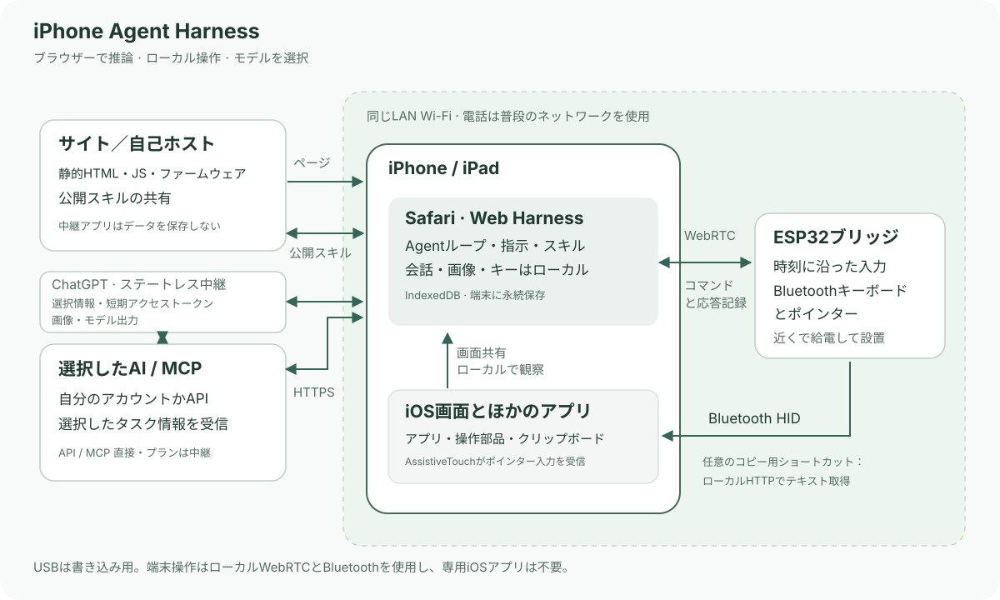

# iPhone Agent Harness

[English](../../README.md) · [简体中文](zh-Hans.md) · [繁體中文](zh-Hant.md) · **日本語** · [Русский](ru.md) · [Deutsch](de.md) · [Français](fr.md) · [Español](es.md)

**ブラウザーと約 2米ドルのESP32-C3で、iPhoneにAIアシスタントを。**

画面の確認、文字入力、細かい設定、アプリをまたぐ短い作業を自然な言葉で依頼できます。電源につないだ小さなESP32がBluetooth入力を担い、Safariが会話と画面取得を実行します。

[Harness](https://igent.cc/) · [ブラウザー書き込み](https://igent.cc/flash) · [ガイド](../guide/ja.md) · [スキル](https://igent.cc/skills) · [構成図](../architecture/overview.md)

- **ブラウザーで書き込み。** PCのChrome/Edgeと配布済みバイナリーを使い、コンパイラー、Arduino環境、アプリのビルドは不要です。

- **電話はワイヤレス。** 設定後の基板は通信範囲内の棚や部屋の隅で給電するだけ。電話とのUSB接続は不要です。

- **普段のネットワークで。** 電話と基板は同じLAN Wi-Fiを使用し、基板のAPは初期設定のみ。ネイティブアプリ、証明書、補助タブ、別のLAN中継は不要。共有するときは通常の画面共有の確認に応じます。


デモ動画／GIF は準備中です。

## 仕組み

Safariが取得した画面と選択内容をAIへ送ります。Harnessが計画を検証し、LAN WebRTCでESP32に届け、Bluetoothマウス・キーボードで操作。新しい画面で結果を確認します。



[構成図](../architecture/overview.md)

## ボードを選ぶ

基本的なESP32-C3は約 **2米ドル**を出発点の例にできますが、見積もりや価格保証ではありません。販売店、送料、基板仕様で異なります。実際のチップに合うプロファイルとデータUSBケーブルを使います。

| チップ | 配布状態 | 補足 |
|---|---|---|
| ESP32-C2 | ビルド済み配布あり | 最低2 MB・26/40 MHz自動選択・USB-UART・単一アプリ/OTAなし |
| ESP32-C3 | ビルド済み配布あり | 4 MBフラッシュ、ブラウザー導入 |
| ESP32-C5 | ビルド済み配布あり | 4 MBフラッシュ・80 MHz設定・ネイティブUSB CDC |
| ESP32-C6 | ビルド済み配布あり | 4 MBフラッシュ、ブラウザー導入 |
| ESP32-S3 | ビルド済み配布あり | 4 MBフラッシュ、ブラウザー導入 |
| ESP32 (classic) | ビルド済み配布あり | 4 MBフラッシュ、ブラウザー導入 |

## セットアップ

詳細ガイドの各項目へ進めます：

1. **[アクセシビリティ](../guide/ja.md#accessibility).** AssistiveTouchを有効に。フルキーボードアクセスは任意。

2. **[書き込み](../guide/ja.md#flash).** PCのインストーラーでチップとイメージを選択。

3. **[Wi-Fi](../guide/ja.md#wifi).** 通常の2.4 GHzネットワークを保存し電話も同じLANへ。

4. **[Bluetooth](../guide/ja.md#bluetooth).** iPhone Agent BridgeをiOSでペアリング。

5. **[Harnessを開く](../guide/ja.md#open-harness).** iOS/iPadOS 27+ Safariを使い作業中はロック解除。

6. **[AI設定](../guide/ja.md#models).** OpenAI/Anthropic互換APIまたはChatGPTログインでモデルを選択。

7. **[接続とテスト](../guide/ja.md#bridge).** 情報を読み込み、準備済み電話を選択。数字テストは任意。

8. **[コピー用ショートカット](../guide/ja.md#clipboard).** iPhone Agent Clipboardを追加し、コピー確認後に貼り付け。

9. **[スキル追加](../guide/ja.md#install-skills).** 公開カタログからこのブラウザーにインストール。

10. **[自作スキル](../guide/ja.md#authoring).** PC/電話で編集。所有者はブラウザーの暗号ID。

11. **[公開](../guide/ja.md#publish).** 公開したいパッケージを明示的に送信しIDをバックアップ。

## 読みたい位置を保つ会話

質問、確認可能な計画、実行を同じ会話で扱います。見出しで会話/アーカイブを切り替え、スワイプで名前変更や移動・削除。過去を読んでいる間は位置を保ち、「最新」で戻ります。画像込みで入出力可能です。AIは確認後に終了し、既定ではHarnessに戻ります。設定のタスク完了で変更できます。

12の内蔵スキルが観察、計画、入力、復旧、時計、ジェスチャー修正を支援。内蔵・取得済みは読み取り専用、更新しても有効状態を保持します。自作は編集可能で公開IDはiOS UIDではありません。任意のMCPはブラウザーCORS対応Streamable HTTPに接続します。

## データと自己ホスト

会話、キー、ログイントークン、画像はブラウザーに保存。公式ホストは会話・画像・モデルキーを受け取らず、静的アプリと公開スキルを配信し、選択内容はモデルへ、許可したMCP呼び出しは設定先へ直接送ります。公開は選んだパッケージだけ。移動・削除前に会話と別の作者IDを保存してください。

ハードウェアは実験段階です。操作、背景キャプチャー、ショートカット、複数電話は実機で確認が必要。Safariは背景を止める場合があり、活動中WebRTC接続は1つです。ChatGPT購読ログインもSafariで確認が必要です。停止可能で各計画に安全制限があります。

## 開発と貢献

自己ホスト、独自モデル、任意の公開スキルAPIを利用できます。IssuesとPRを歓迎します。再利用可能なスキルはサイトのコミュニティへ。

ローカル開発にはNode.js 22.13以降を使用します。

```sh
npm ci
npm test
npm run build
npm run preview
```

[Arduinoガイド](../../firmware/IPhoneAutomationHarness/README.md) · [自己ホスト](../architecture/deployment.md) · [手動リリース](../architecture/manual-release.md)

[MIT License](../../LICENSE) · [Third-party notices](../../THIRD_PARTY_NOTICES.md)

## 謝辞

着想を与えてくれた [onehumanbeing/esp32-iphone-agent](https://github.com/onehumanbeing/esp32-iphone-agent) に感謝します。本プロジェクトは独自のブラウザー・画面取得・Bluetooth構成です。
