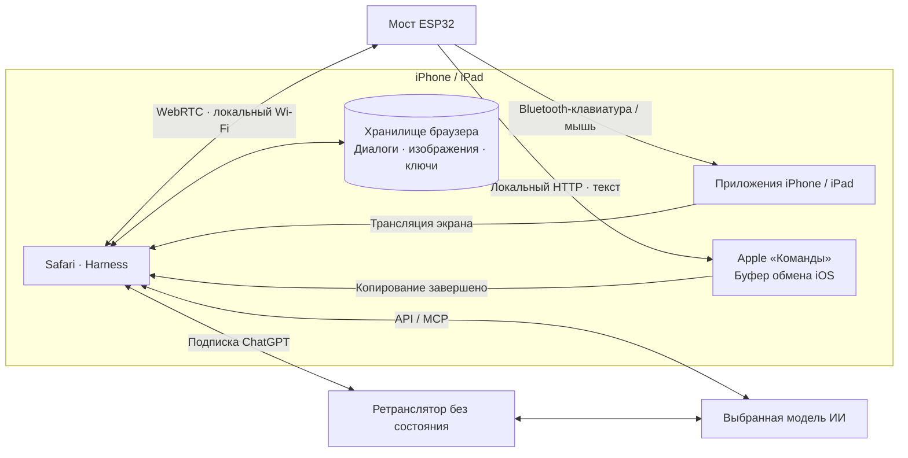

<h1 align="center">iPhone Agent Harness</h1>

<strong>Поручите ИИ управлять вашим iPhone.</strong>

  <a href="../../README.md">English</a> · <a href="zh-Hans.md">简体中文</a> · <a href="zh-Hant.md">繁體中文</a> · <a href="ja.md">日本語</a> · <strong>Русский</strong> · <a href="de.md">Deutsch</a> · <a href="fr.md">Français</a> · <a href="es.md">Español</a>

  
  
  
  

  <a href="https://igent.cc/">📱 Harness</a> ·
  <a href="https://igent.cc/flash">⚡ Веб-прошивка</a> ·
  <a href="../guide/ru.md">📖 Руководство</a> ·
  <a href="https://igent.cc/skills">🧩 Навыки</a> ·
  <a href="../architecture/overview.md">🗺️ Архитектура</a>

Попросите iPhone прочитать экран, ввести текст, настроить элемент или выполнить короткий сценарий между приложениями. Небольшой ESP32 с питанием обеспечивает Bluetooth-ввод, Safari — диалог и захват экрана.

- **Установка из браузера.** Выберите ESP32 и установите прошивку через Chrome или Edge на компьютере.
- **Телефон остаётся беспроводным.** Оставьте мост с питанием на полке в пределах Bluetooth-связи.
- **Привычный Wi-Fi.** Подключите телефон и мост к одной домашней или рабочей сети и начните задачу в Safari.

https://github.com/user-attachments/assets/d72669a6-e150-40d7-ba2f-1d9586d9c2ea

Агент устанавливает будильник на настоящем iPhone.

## ⚙️ Как это работает

Safari передаёт выбранный контекст и экран вашей модели. Harness проверяет план, отправляет его ESP32 через локальный WebRTC, а мост выполняет Bluetooth-ввод. Новое наблюдение подтверждает результат.

[Архитектура](../architecture/overview.md)

## 🔌 Выберите плату

Для начала достаточно простой ESP32-C3 примерно за **2 доллара США**. Выберите чип в [веб-установщике](https://igent.cc/flash) и подключите плату к компьютеру USB-кабелем для данных.

| Чип | Поддерживаемые модели |
|---|---|
| ESP32-C2 | От 2 МБ · автоматическое определение кварца 26/40 МГц |
| ESP32-C3 | Все модели* |
| ESP32-C5 | Все модели* |
| ESP32-C6 | Все модели* |
| ESP32-S3 | Все модели* |
| ESP32 (classic) | Все модели* |

*Текущие образы для C3, C5, C6, S3 и классического ESP32 рассчитаны на стандартную SPI flash-память объёмом от 4 МБ.

## 🚀 Настройте и попробуйте

Ссылки на все разделы подробного руководства:

1. **[Специальные возможности](../guide/ru.md#accessibility)**

2. **[Прошивка](../guide/ru.md#flash)**

3. **[Wi-Fi](../guide/ru.md#wifi)**

4. **[Bluetooth](../guide/ru.md#bluetooth)**

5. **[Открыть Harness](../guide/ru.md#open-harness)**

6. **[Настроить ИИ](../guide/ru.md#models)**

7. **[Подключить и проверить](../guide/ru.md#bridge)**

8. **[Shortcut буфера](../guide/ru.md#clipboard)**

9. **[Навык из сообщества](../guide/ru.md#install-skills)**

10. **[Свой навык](../guide/ru.md#authoring)**

11. **[Публикация](../guide/ru.md#publish)**

## 💬 Диалоги, планы и навыки

Задавайте вопросы, обсуждайте планы и поручайте действия в одном разговоре. Разговоры можно переименовывать, архивировать, искать и экспортировать. Пока агент работает, читайте историю и возвращайтесь к свежему ответу в удобный момент.

Навыки помогают выполнять обычные задачи на телефоне и улучшать нажатия, ввод и жесты. Добавляйте их из сообщества или просите Harness написать ваш собственный навык. В настройках также можно подключить инструменты MCP.

Настоящие экраны Harness с демонстрационными данными.

<table>
  <tr><th>Список диалогов</th><th>Пример диалога</th><th>Навыки</th></tr>
  <tr>
    <td></td>
    <td></td>
    <td></td>
  </tr>
</table>

Один мост поддерживает два независимых подключения Harness. При работе с двумя телефонами выберите нужный на каждой странице и выполните необязательную проверку ввода на каждом, чтобы подтвердить привязку.

## 📋 Длинные тексты на разных языках

Обычный ввод и сочетания клавиш работают через Bluetooth-клавиатуру моста. Для длинного или многоязычного текста **iPhone Agent Clipboard** копирует содержимое через приложение Apple «Команды», после чего агент вставляет его в нужное поле.

Браузер отправляет текст мосту ESP32 небольшими частями по локальному WebRTC. Мост передаёт их в одном HTTP-ответе команде, которая собирает полный текст в буфере обмена iPhone.

[Настроить копирование](../guide/ru.md#clipboard)

## 🔒 Данные и конфиденциальность

Сеансы, снимки и данные доступа хранятся в браузере; обычные API подключаются напрямую. Из-за CORS подписка ChatGPT передаёт выбранный контекст, изображения, ответы и краткосрочный токен через ретранслятор проекта на Cloudflare или ваш собственный без состояния. Приложение ретранслятора не сохраняет эти данные и не журналирует содержимое или токены.

## 🤝 Участие в проекте

Сообщайте об ошибках и идеях через [Issues](https://github.com/cccat6/iphone-agent-harness/issues), предлагайте улучшения в [pull request](https://github.com/cccat6/iphone-agent-harness/pulls). Собственные навыки можно публиковать в [сообществе](https://igent.cc/skills).

[MIT License](../../LICENSE) · [Third-party notices](../../THIRD_PARTY_NOTICES.md)

## 💛 Благодарности

Спасибо [onehumanbeing/esp32-iphone-agent](https://github.com/onehumanbeing/esp32-iphone-agent) за вдохновение.
