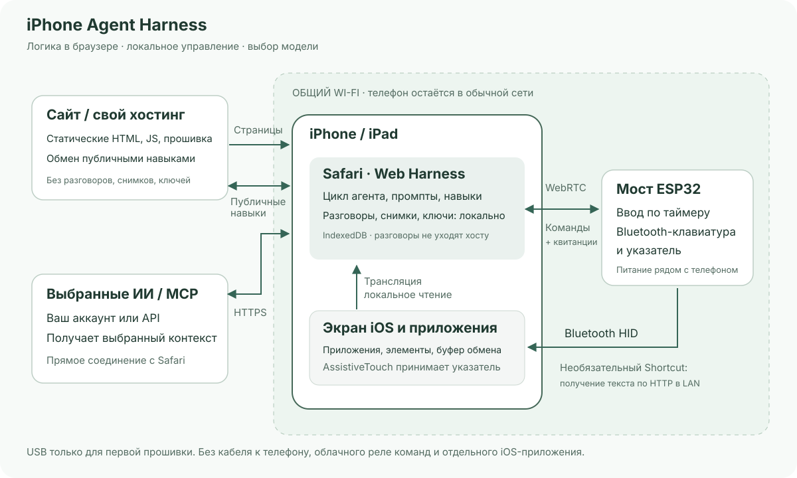

# iPhone Agent Harness

[English](../../README.md) · [简体中文](zh-Hans.md) · [繁體中文](zh-Hant.md) · [日本語](ja.md) · **Русский** · [Deutsch](de.md) · [Français](fr.md) · [Español](es.md)

**ИИ-помощник для iPhone: браузер и ESP32-C3 примерно за 2 доллара США.**

Попросите iPhone прочитать экран, ввести текст, настроить элемент или выполнить короткий сценарий между приложениями. Небольшой ESP32 с питанием обеспечивает Bluetooth-ввод, Safari — диалог и захват экрана.

[Harness](https://igent.cc/) · [Веб-прошивка](https://igent.cc/flash) · [Руководство](../guide/ru.md) · [Навыки](https://igent.cc/skills) · [Архитектура](../architecture/overview.md)

- **Прошивка из браузера.** Готовые образы устанавливаются через Chrome/Edge на компьютере без компилятора, Arduino и сборки приложения.

- **Телефон без проводов.** Настроенный мост можно оставить с питанием на полке в пределах связи. Кабель USB к телефону не нужен.

- **Обычная сеть.** Телефон и мост используют общий LAN Wi-Fi; точка доступа ESP нужна только для первичной настройки. Не нужны приложение, сертификаты, дополнительная вкладка или LAN-релей. При включении трансляции подтвердите обычный запрос доступа к экрану.


Демонстрационное видео / GIF скоро появится.

## Как устроено

Safari передаёт выбранный контекст и экран вашей модели. Harness проверяет план, отправляет его ESP32 через локальный WebRTC, а мост выполняет Bluetooth-ввод. Новое наблюдение подтверждает результат.



[Архитектура](../architecture/overview.md)

## Выбор платы

Простая ESP32-C3 стоимостью примерно **2 доллара США** — лишь пример начального бюджета, не предложение или гарантия цены. Магазин, доставка и исполнение меняют стоимость. Выбирайте профиль реального чипа и USB-кабель для данных.

| Чип | Прошивка | Примечание |
|---|---|---|
| ESP32-C2 | Готовый образ | От 2 МБ; кварц 26/40 МГц автоматически; USB–UART; одно приложение, без OTA |
| ESP32-C3 | Готовый образ | 4 МБ flash, установка браузером |
| ESP32-C5 | Готовый образ | 4 МБ flash; профиль 80 МГц; встроенный USB CDC |
| ESP32-C6 | Готовый образ | 4 МБ flash, установка браузером |
| ESP32-S3 | Готовый образ | 4 МБ flash, установка браузером |
| ESP32 (classic) | Готовый образ | 4 МБ flash, установка браузером |

## Начать работу

Ссылки на все разделы подробного руководства:

1. **[Специальные возможности](../guide/ru.md#accessibility).** Включите AssistiveTouch; полный доступ с клавиатуры необязателен.

2. **[Прошивка](../guide/ru.md#flash).** Выберите чип и образ в установщике на компьютере.

3. **[Wi-Fi](../guide/ru.md#wifi).** Сохраните обычную сеть 2,4 ГГц и подключите телефон к тому же LAN.

4. **[Bluetooth](../guide/ru.md#bluetooth).** Сопряжение с iPhone Agent Bridge в iOS.

5. **[Открыть Harness](../guide/ru.md#open-harness).** Safari iOS/iPadOS 27+, телефон разблокирован.

6. **[Настроить ИИ](../guide/ru.md#models).** Совместимый OpenAI/Anthropic API или вход ChatGPT; получить модели.

7. **[Подключить и проверить](../guide/ru.md#bridge).** Импорт ссылки, выбор готового телефона, необязательный тест цифр.

8. **[Shortcut буфера](../guide/ru.md#clipboard).** Добавьте iPhone Agent Clipboard и дождитесь подтверждения копии.

9. **[Навык из сообщества](../guide/ru.md#install-skills).** Установите нужный пакет из каталога.

10. **[Свой навык](../guide/ru.md#authoring).** Создавайте на ПК/телефоне; владелец — криптоидентичность браузера.

11. **[Публикация](../guide/ru.md#publish).** Явно отправьте публичный пакет и сохраните копию идентичности.

## Диалог сохраняет место чтения

Вопросы, проверяемые планы и действия — в одном разговоре. Заголовок списка переключает архив; смахивание переименовывает, архивирует или восстанавливает/удаляет. Новые ответы не сбивают чтение; «Последние» возвращает вниз. Экспорт включает изображения. Перед завершением ИИ проверяет результат и обычно возвращается в Harness; это меняется в настройках завершения.

12 встроенных навыков помогают наблюдать, планировать, вводить, восстанавливаться и корректировать жесты/часы. Встроенные и загруженные пакеты только для чтения; обновление сохраняет включение. Свои редактируются; публикация связана с браузером, а не UID iOS. MCP подключает выбранные инструменты CORS-совместимых Streamable HTTP-серверов.

## Ваши данные и свой хостинг

Разговоры, ключи, токены и изображения хранятся в браузере. Наш хост не получает ваши разговоры, снимки или ключи моделей: он раздаёт статическое приложение и публичные навыки; выбранный контекст идёт напрямую модели, разрешённый MCP — указанному серверу. Публикуется только выбранный пакет. Перед очисткой/переездом экспортируйте разговоры и отдельно идентичность автора.

Аппаратные функции экспериментальны: жесты, фон, Shortcuts и несколько телефонов требуют проверки на устройстве. Safari может приостановить фон; активный WebRTC-партнёр один. Вход подписки ChatGPT проверяйте в Safari. Стоп доступен, отдельные планы имеют ограничения безопасности.

## Разработка и участие

Можно разместить сайт самостоятельно, выбрать свои модели и API навыков. Приветствуются Issues и PR. Полезными навыками делитесь через сообщество сайта.

Для локальной разработки используйте Node.js 22.13+.

```sh
npm ci
npm test
npm run build
npm run preview
```

[Arduino](../../firmware/IPhoneAutomationHarness/README.md) · [Свой сервер](../architecture/deployment.md) · [Ручные выпуски](../architecture/manual-release.md)

[MIT License](../../LICENSE) · [Third-party notices](../../THIRD_PARTY_NOTICES.md)

## Благодарности

Спасибо [onehumanbeing/esp32-iphone-agent](https://github.com/onehumanbeing/esp32-iphone-agent) за вдохновение. Этот проект использует собственную архитектуру браузера, захвата экрана и Bluetooth-моста.
