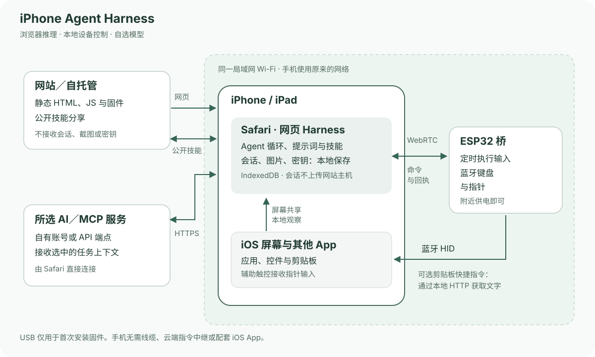

# iPhone Agent Harness

[English](../../README.md) · **简体中文** · [繁體中文](zh-Hant.md) · [日本語](ja.md) · [Русский](ru.md) · [Deutsch](de.md) · [Français](fr.md) · [Español](es.md)

**用浏览器和约 2 美元的 ESP32-C3，给 iPhone 一个 AI 助手。**

用自然语言让 iPhone 完成一件事：读屏、输入文字、调整控件，或跨 App 执行一段流程。小巧的 ESP32 通电后提供蓝牙输入，Safari 负责对话、取屏与 AI 调度。

[打开 Harness](https://igent.cc/) · [浏览器烧录](https://igent.cc/flash) · [完整教程](../guide/zh-Hans.md) · [技能社区](https://igent.cc/skills) · [架构图](../architecture/overview.md)

- **浏览器直接烧录。** 电脑 Chrome 或 Edge 使用预编译固件，不需要安装编译器、Arduino 环境或构建手机 App。

- **手机保持无线。** 配好后让桥在房间角落或架子上持续供电，只要在蓝牙／Wi-Fi 范围内即可，无需 USB 连着手机。

- **使用原来的网络。** 手机和桥连接同一局域网 Wi-Fi，ESP 热点只用于首次配网。无需原生 App、证书安装、辅助标签页或另建局域网中继服务；开始共享时正常确认屏幕共享提示即可。


操作视频／GIF 待补充。

## 它如何工作

Safari 读取手机画面，将选中的上下文发给你选择的 AI。Harness 检查动作计划，通过局域网 WebRTC 直接交给 ESP32，再由蓝牙键鼠操作手机；新的画面观察确认结果。



[架构图](../architecture/overview.md)

## 选择开发板

基础 ESP32-C3 开发板可把约 **2 美元**作为入门成本示例，实际价格取决于商家、运费和板型。按安装器显示的实际芯片选固件，准备可传数据的 USB 线。

| 芯片 | 固件状态 | 说明 |
|---|---|---|
| ESP32-C2 | 提供预编译下载 | 最低 2 MB；26/40 MHz 自动选择；USB 转串口；单应用、无 OTA |
| ESP32-C3 | 提供预编译下载 | 4 MB 闪存；浏览器安装 |
| ESP32-C5 | 提供预编译下载 | 4 MB 闪存；80 MHz 闪存配置；原生 USB CDC |
| ESP32-C6 | 提供预编译下载 | 4 MB 闪存；浏览器安装 |
| ESP32-S3 | 提供预编译下载 | 4 MB 闪存；浏览器安装 |
| ESP32 (classic) | 提供预编译下载 | 4 MB 闪存；浏览器安装 |

## 安装并开始使用

完整教程覆盖全部步骤，下列链接直接跳到对应章节：

1. **[开启辅助功能](../guide/zh-Hans.md#accessibility)。** 开启辅助触控，全键盘控制可保持原设置。

2. **[烧录固件](../guide/zh-Hans.md#flash)。** 电脑打开安装器，选择芯片并安装对应镜像。

3. **[连接 Wi-Fi](../guide/zh-Hans.md#wifi)。** 首次保存常用 2.4 GHz 网络，手机回到同一局域网。

4. **[蓝牙配对](../guide/zh-Hans.md#bluetooth)。** 在 iOS 设置中配对 iPhone Agent Bridge。

5. **[打开 Harness](../guide/zh-Hans.md#open-harness)。** 使用 iOS/iPadOS 27+ Safari，任务期间保持解锁。

6. **[配置 AI](../guide/zh-Hans.md#models)。** 保存 OpenAI／Anthropic 兼容端点与密钥，或按界面登录 ChatGPT，获取并选择模型。

7. **[连接并测试桥](../guide/zh-Hans.md#bridge)。** 导入连接链接，连接桥并选择就绪手机，数字输入测试可选。

8. **[安装剪贴板快捷指令](../guide/zh-Hans.md#clipboard)。** 添加 iPhone Agent Clipboard 处理长文本／多语言，复制确认后再粘贴。

9. **[安装社区技能](../guide/zh-Hans.md#install-skills)。** 浏览公开目录，把需要的技能添加到本浏览器。

10. **[创作自己的技能](../guide/zh-Hans.md#authoring)。** 电脑或手机编写／修改指导内容，归属使用浏览器签名身份。

11. **[发布技能](../guide/zh-Hans.md#publish)。** 明确发布愿意公开的包，并备份创作者身份。

## 会话跟得上任务，也留得住阅读位置

提问、可检查的计划和操作放在同一会话。列表标题可切换会话／归档，左滑改名／归档或恢复／删除。阅读旧消息时新回复不拉走位置，点“回到最新”才回到最新内容。导入导出包含图片。AI 完成前核对结果，默认随后回到 Harness，可在“设置 → 任务完成后”关闭返回。

12 个内置技能涵盖观察、规划、输入、恢复、时钟控件和手势修正。内置及下载技能只读，刷新时检查更新并保留开关。自有技能可编辑，发布身份属于浏览器，不是 iOS UID。可选 MCP 可连接支持浏览器 CORS 的 Streamable HTTP 服务器，使用你选定的工具。

## 数据在自己手里，也能自己托管

会话、密钥、登录信息和截图保存在你的浏览器。我们的主机不接收你的会话、截图或模型密钥，只提供静态网页和公开技能包；选中的消息／图片直接发送给所选模型服务，已授权 MCP 请求发往所配置服务器。发布只上传明确选择的技能包。清数据或换浏览器前，导出重要会话并单独备份创作者身份。

硬件能力仍属实验阶段，手势、后台取屏、快捷指令及多手机需在目标设备检查。Safari 可能暂停后台工作；桥当前仅一个活动 WebRTC 连接，ChatGPT 订阅登录须实际核对 Safari 兼容性。可随时停止，每个动作计划保留安全限制。

## 开发、自托管与贡献

可自行托管网页，配置自己的模型服务，按需部署公开技能 API。欢迎 Issues 和 PR；可复用技能请通过网站社区分享。

本地开发需要 Node.js 22.13 或以上。

```sh
npm ci
npm test
npm run build
npm run preview
```

[Arduino 说明](../../firmware/IPhoneAutomationHarness/README.md) · [自托管](../architecture/deployment.md) · [手动发布](../architecture/manual-release.zh-Hans.md)

[MIT License](../../LICENSE) · [Third-party notices](../../THIRD_PARTY_NOTICES.md)

## 致谢

感谢 [onehumanbeing/esp32-iphone-agent](https://github.com/onehumanbeing/esp32-iphone-agent) 带来的启发。本项目采用独立的浏览器、取屏与蓝牙桥接设计。
