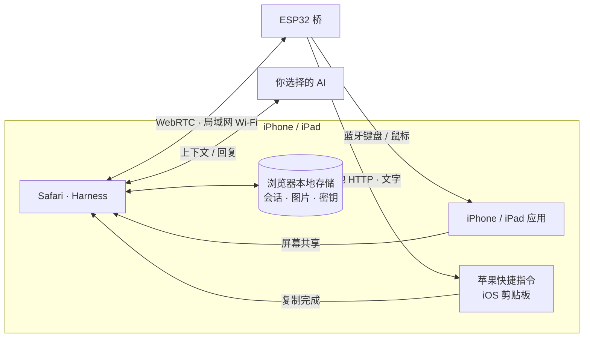

<h1 align="center">iPhone Agent Harness</h1>

<strong>让智能体自动操作你的 iPhone。</strong>

  <a href="../../README.md">English</a> · <strong>简体中文</strong> · <a href="zh-Hant.md">繁體中文</a> · <a href="ja.md">日本語</a> · <a href="ru.md">Русский</a> · <a href="de.md">Deutsch</a> · <a href="fr.md">Français</a> · <a href="es.md">Español</a>

  
  
  
  

  <a href="https://igent.cc/">📱 打开 Harness</a> ·
  <a href="https://igent.cc/flash">⚡ 浏览器烧录</a> ·
  <a href="../guide/zh-Hans.md">📖 完整教程</a> ·
  <a href="https://igent.cc/skills">🧩 技能社区</a> ·
  <a href="../architecture/overview.md">🗺️ 架构图</a>

用自然语言让 iPhone 完成一件事：读屏、输入文字、调整控件，或跨 App 执行一段流程。小巧的 ESP32 通电后提供蓝牙输入，Safari 负责对话、取屏与 AI 调度。

- **浏览器直接烧录。** 在电脑 Chrome 或 Edge 中选择 ESP32 型号，安装对应固件。
- **手机保持无线。** 给桥通电，放在房间角落或架子上，保持在手机的蓝牙范围内。
- **使用日常 Wi-Fi。** 手机与桥连接家里或办公室的同一网络，打开 Safari 就能开始任务。

https://github.com/user-attachments/assets/d72669a6-e150-40d7-ba2f-1d9586d9c2ea

智能体在真实 iPhone 上设置闹钟。

## ⚙️ 工作原理

Safari 读取手机画面，将选中的上下文发给你选择的 AI。Harness 检查动作计划，通过局域网 WebRTC 直接交给 ESP32，再由蓝牙键鼠操作手机；新的画面观察确认结果。

[架构图](../architecture/overview.md)

## 🔌 选择开发板

约 **2 美元**的基础 ESP32-C3 开发板即可入门。在[网页烧录器](https://igent.cc/flash)选择芯片，用 USB 数据线连上电脑即可烧录。

| 芯片 | 支持型号 |
|---|---|
| ESP32-C2 | 最低 2 MB · 自动识别 26/40 MHz 晶振 |
| ESP32-C3 | 全部型号* |
| ESP32-C5 | 全部型号* |
| ESP32-C6 | 全部型号* |
| ESP32-S3 | 全部型号* |
| ESP32 (classic) | 全部型号* |

*C3、C5、C6、S3 和经典 ESP32 的当前固件适用于容量至少 4 MB 的标准 SPI 闪存。

## 🚀 安装并开始使用

完整教程覆盖全部步骤，下列链接直接跳到对应章节：

1. **[开启辅助功能](../guide/zh-Hans.md#accessibility)**

2. **[烧录固件](../guide/zh-Hans.md#flash)**

3. **[连接 Wi-Fi](../guide/zh-Hans.md#wifi)**

4. **[蓝牙配对](../guide/zh-Hans.md#bluetooth)**

5. **[打开 Harness](../guide/zh-Hans.md#open-harness)**

6. **[配置 AI](../guide/zh-Hans.md#models)**

7. **[连接并测试桥](../guide/zh-Hans.md#bridge)**

8. **[安装剪贴板快捷指令](../guide/zh-Hans.md#clipboard)**

9. **[安装社区技能](../guide/zh-Hans.md#install-skills)**

10. **[创作自己的技能](../guide/zh-Hans.md#authoring)**

11. **[发布技能](../guide/zh-Hans.md#publish)**

## 💬 会话、计划与技能

在同一会话里提问、讨论计划或交给智能体执行任务。会话支持重命名、归档、搜索和导出文件。任务运行时也可以翻看历史，再随时回到最新回复。

技能帮助智能体完成常见手机任务，改进点按、输入和滑动。可以从社区添加技能，也可以让 Harness 帮你编写自己的技能。设置里还可以连接 MCP 工具。

以下为 Harness 的真实界面，使用示例数据展示。

<table>
  <tr><th>会话列表</th><th>示例对话</th><th>技能</th></tr>
  <tr>
    <td></td>
    <td></td>
    <td></td>
  </tr>
</table>

## 📋 长文本与多语言输入

桥通过蓝牙键盘完成日常输入和快捷键操作。长文本或多语言文字可以使用 **iPhone Agent Clipboard**：由苹果快捷指令复制，再让智能体粘贴到目标输入框。

浏览器通过局域网 WebRTC 将文字分块发给 ESP32；桥把这些小块接续在同一个 HTTP 响应中交给快捷指令，组成完整文字后放入 iPhone 剪贴板。

[配置剪贴板复制](../guide/zh-Hans.md#clipboard)

## 🔒 数据由你掌握

会话、截图、账号信息和 API 密钥保存在你的浏览器中。选中的消息和图片直接发送给你选择的 AI 服务商，MCP 请求发送给你配置的服务器。网站提供网页，以及你选择公开分享的技能。

## 🤝 参与贡献

欢迎[提交 Issue](https://github.com/cccat6/iphone-agent-harness/issues)反馈问题与建议，也欢迎[提交 PR](https://github.com/cccat6/iphone-agent-harness/pulls)改进项目。自制技能请在[技能社区](https://igent.cc/skills)分享。

[MIT License](../../LICENSE) · [Third-party notices](../../THIRD_PARTY_NOTICES.md)

## 💛 致谢

感谢 [onehumanbeing/esp32-iphone-agent](https://github.com/onehumanbeing/esp32-iphone-agent) 带来的启发。
