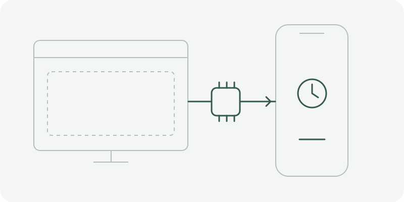

# iPhone Agent Harness

[English](../../README.md) · **简体中文** · [繁體中文](zh-Hant.md) · [日本語](ja.md) · [Русский](ru.md) · [Deutsch](de.md) · [Français](fr.md) · [Español](es.md)

通过浏览器和 ESP32 蓝牙桥，让 AI 跨 App 操作 iPhone 与 iPad 的开源 Harness。

[igent.cc](https://igent.cc) · [GitHub](https://github.com/cccat6/iphone-agent-harness)



演示占位图：浏览器、ESP32 桥和手机。操作视频／GIF 即将补充。

## 五步开始使用

准备 iOS/iPadOS 27 及以上的 Safari、至少 4 MB 闪存的 ESP32/C3/S3/C6 开发板、可传数据的 USB 线、局域网 2.4 GHz Wi-Fi，以及 AI 账号或兼容 API。网页烧录需使用电脑 Chrome 或 Edge。

1. **安装桥接固件.** 在电脑打开烧录页，选择开发板并安装固件，读取设备信息，保留手机连接链接。新板子连接设备设置 Wi-Fi，按页面保存常用网络，再让手机回到该网络。

2. **连接手机.** 打开提供的链接，或在 Harness 获取桥的信息。保存后返回，点连接 ESP32 桥。在 iOS 蓝牙设置配对 iPhone Agent Bridge，开启辅助触控，再选择已就绪手机。新固件的八位数字输入测试是可选检查，全键盘控制开关均可。无需连接码、安装证书或保留额外标签页。

3. **选择 AI.** 在“设置 → 账号或 API”添加端点／密钥并获取模型，或按界面登录 ChatGPT。默认模型可选择或输入，获取到的全部模型仍可切换。新建会话，选择模型及支持的推理强度。

4. **共享并提出任务.** 开始共享屏幕，先试设置测试闹钟等短任务。询问能力会得到说明，请求计划会显示可检查的计划，明确要求操作时才执行。保持手机解锁，首次任务观察实际动作。停止会结束运行，失去共享会暂停，继续时重新请求共享。

5. **检查结果.** AI 应先核对结果再结束，默认随后返回 Harness；若希望停留目标 App，可在“设置 → 任务完成”关闭返回。涉及重要结果前，请自己确认实际画面。

## 日常操作

- 点会话列表标题的选择器切换会话／归档。普通会话左滑可重命名／归档，归档中可重命名／恢复／删除，删除需确认。下拉列表或点搜索按钮搜索。

- 上滑逐页读取旧消息，新回复保留阅读位置，点“最新消息”才回到最新内容。会话菜单导出，“设置”导入；含图片的会话文件上限为 64 MiB。

- 长文本或中英文混排可安装剪贴板教程中的 iPhone Agent Clipboard，点“用快捷指令复制”或前台“复制并继续”。任务等待复制确认，检查目标输入框后再粘贴。

- 12 个内置技能覆盖观察、规划、导航、文字、滚动、拖放、恢复、挑战、创作、时钟控件和手势修正。精确控件支持时直接输入数字，否则小幅修正、等停稳后再观察。

- 电脑或手机都能创作、编辑并发布自己的技能。作者归属使用浏览器生成的加密身份，不是 iOS 设备 UID。换浏览器前导出加密身份备份。内置及下载社区技能只读，刷新时检查更新，保留开关选择；更新失败保留当前版本。

- 可选 MCP 支持多个浏览器可访问的 Streamable HTTP 服务器，逐项选择并授权工具；服务器须支持浏览器 CORS。不启动 stdio 程序，也不提供完整远端 OAuth 托管。

## 数据与边界

会话、图片、API 密钥及登录信息存于当前浏览器；凭据独立于会话导出，无需解锁密码。选中消息／图片会发给所用模型服务。清除站点数据会删除本地资料，请导出重要会话。公开发布技能只上传你明确选择的包。

实验性硬件功能请在观察下使用。手机手势、后台取屏、快捷指令及多手机仍需在自己的设备验收，编译和电脑检查不代表这些结果通过。Safari 可能暂停后台工作。任务默认没有整项时长／步数上限，每个动作计划仍有安全限制。真实 Safari ChatGPT 订阅登录及刷新仍有兼容边界。桥当前仅一个活动 WebRTC 连接，多个已保存浏览器客户端不代表同时控制。最新多客户端注册／导入修复已在源码准备，尚未刷入设备并实测。

## 开发与自托管

需要 Node.js 22.13 或以上。产品分为 apps/web 网页与 firmware/IPhoneAutomationHarness 固件；网页为静态站，可选签名公开技能 API。手机共享屏幕需要 HTTPS。

```sh
npm ci
npm test
npm run build
npm run preview
```

发布由维护者手动触发，普通推送不运行 GitHub Actions。固件复用、发布下载及部署见发布说明。

[手机指南](../acceptance/zh-Hans.md) · [Arduino 说明](../../firmware/IPhoneAutomationHarness/README.md) · [架构](../architecture/overview.md) · [自托管](../architecture/deployment.md) · [手动发布](../architecture/manual-release.zh-Hans.md) · [剪贴板教程](https://igent.cc/shortcuts/clipboard.html)

[MIT License](../../LICENSE) · [Third-party notices](../../THIRD_PARTY_NOTICES.md)
