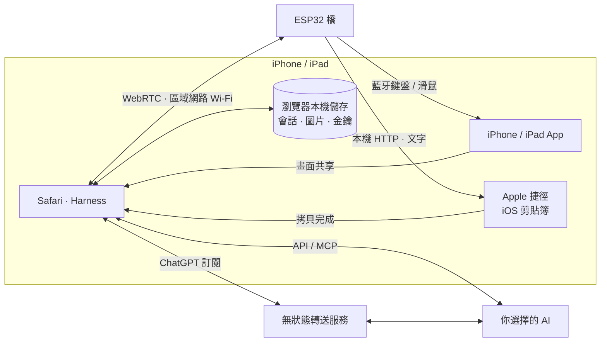

<h1 align="center">iPhone Agent Harness</h1>

<strong>讓智慧體自動操作你的 iPhone。</strong>

  <a href="../../README.md">English</a> · <a href="zh-Hans.md">简体中文</a> · <strong>繁體中文</strong> · <a href="ja.md">日本語</a> · <a href="ru.md">Русский</a> · <a href="de.md">Deutsch</a> · <a href="fr.md">Français</a> · <a href="es.md">Español</a>

  
  
  
  

  <a href="https://igent.cc/">📱 開啟 Harness</a> ·
  <a href="https://igent.cc/flash">⚡ 瀏覽器燒錄</a> ·
  <a href="../guide/zh-Hant.md">📖 完整教學</a> ·
  <a href="https://igent.cc/skills">🧩 技能社群</a> ·
  <a href="../architecture/overview.md">🗺️ 架構圖</a>

用自然語言讓 iPhone 完成一件事：讀屏、輸入文字、調整控件，或跨 App 執行流程。小巧的 ESP32 通電提供藍牙輸入，Safari 負責對話、取屏與 AI 調度。

- **瀏覽器直接燒錄。** 用電腦 Chrome 或 Edge 選擇 ESP32 型號，安裝對應韌體。
- **手機保持無線。** 讓橋持續供電，放在架上或房間角落，保持在手機的藍牙範圍內。
- **使用日常 Wi-Fi。** 手機與橋連接家裡或辦公室的同一網路，開啟 Safari 即可開始任務。

<table>
<tr><th>自動點外送</th><th>設定鬧鐘</th></tr>
<tr>
<td width="50%" align="center">

https://github.com/user-attachments/assets/7601869f-7cc6-445e-b64d-0073a8bf657d

</td>
<td width="50%" align="center">

https://github.com/user-attachments/assets/d72669a6-e150-40d7-ba2f-1d9586d9c2ea

</td>
</tr>
</table>

**AI 自動點外送。** 智慧體操作 iPhone 選擇蜜雪飲品、設定糖冰、進入結帳，片尾展示送到手裡的外送。

## ⚙️ 運作方式

Safari 取得手機畫面，把選定內容傳給你選擇的 AI。Harness 檢查計畫，經區域網路 WebRTC 直接交給 ESP32，以藍牙鍵鼠操作，再用新畫面確認。

[架構圖](../architecture/overview.md)

## 🔌 選擇開發板

不限品牌，晶片與快閃記憶體符合下表即可。**推薦 C6、S3、C3**，選帶 USB 接口與板載天線的開發板。

| 晶片 | 快閃記憶體 | 常見板型／搜尋關鍵字 | 參考價格：中國大陸／AliExpress |
|---|---|---|---|
| **ESP32-C6** | 4 MB+ | `SuperMini` · `Zero` · `DevKitM-1` · `DevKitC-1` · `WROOM-1 N8` | ¥10–15 / US$2–4 |
| **ESP32-S3** | 4 MB+ | `DevKitC-1 N8R2 / N8R8 / N16R8` · `SuperMini` · `Zero` · `WROOM-1 N16R8` | ¥10–25 / US$3–7 |
| **ESP32-C3** | 4 MB+ | `SuperMini` · `MINI` · `Zero` · `DevKitM-1` · `MINI-1 N4` | ¥3–10 / US$2–5 |
| ESP32-C2 | 2 MB 起 · 自動識別 26/40 MHz | 同樣支援 | — |
| ESP32-C5 | 4 MB+ | 同樣支援 | — |
| ESP32 (classic) | 4 MB+ | 同樣支援 | — |

使用標準 SPI 快閃記憶體（DIO）。 搜尋時組合「晶片名＋板型＋开发板」。未列出的板型符合條件也支援，不要求 PSRAM。

## 🚀 安裝與使用

完整教學涵蓋以下步驟，可直接跳至對應章節：

1. **[啟用輔助功能](../guide/zh-Hant.md#accessibility)**

2. **[燒錄韌體](../guide/zh-Hant.md#flash)**

3. **[連接 Wi-Fi](../guide/zh-Hant.md#wifi)**

4. **[藍牙配對](../guide/zh-Hant.md#bluetooth)**

5. **[開啟 Harness](../guide/zh-Hant.md#open-harness)**

6. **[設定 AI](../guide/zh-Hant.md#models)**

7. **[連接與測試橋](../guide/zh-Hant.md#bridge)**

8. **[安裝剪貼簿快捷指令](../guide/zh-Hant.md#clipboard)**

9. **[安裝社群技能](../guide/zh-Hant.md#install-skills)**

10. **[創作技能](../guide/zh-Hant.md#authoring)**

11. **[發布技能](../guide/zh-Hant.md#publish)**

## 💬 會話、計畫與技能

在同一會話中提問、討論計畫，或交給智慧體執行任務。會話支援重新命名、封存、搜尋及匯出檔案。任務執行時也能閱讀歷史，隨時回到最新回覆。

技能協助智慧體完成常見手機任務，改善點按、輸入與滑動。可以從社群新增，也能請 Harness 協助編寫自己的技能。設定中還可連接 MCP 工具。

以下為 Harness 的真實介面，以示例資料展示。

<table>
  <tr><th>會話清單</th><th>示例對話</th><th>技能</th></tr>
  <tr>
    <td></td>
    <td></td>
    <td></td>
  </tr>
</table>

一個 ESP32 橋接器支援兩條獨立的 Harness 連線。兩台手機一起使用時，在各自網頁選擇對應手機，建議分別執行一次連線測試，確認綁定正確。

## 📋 長文字與多語言輸入

橋透過藍牙鍵盤處理日常輸入與快捷鍵。長文字或多語言內容可使用 **iPhone Agent Clipboard**：由 Apple 捷徑拷貝，再由智慧體貼入目標欄位。

瀏覽器透過區域網路 WebRTC 將文字分塊送至 ESP32；橋將這些區塊接續在同一個 HTTP 回應中交給捷徑，組成完整文字後放進 iPhone 剪貼簿。

[設定剪貼簿拷貝](../guide/zh-Hant.md#clipboard)

## 🔒 資料與隱私

對話、截圖與憑證儲存在瀏覽器，一般 API 直連服務商。ChatGPT 訂閱因瀏覽器跨來源限制，經專案的 Cloudflare 服務或自建無狀態服務轉送選定內容、圖片、輸出及短期存取權杖。轉送程式不持續儲存這些資料，也不記錄本文或憑證。

開啟截圖重用後，選定截圖只向 DeepSeek 或 Claude 上傳一次，後續請求使用檔案 ID。服務商端檔案會在一小時後到期，可在對應 API 設定中關閉重用。

## 🤝 參與貢獻

歡迎[提交 Issue](https://github.com/cccat6/iphone-agent-harness/issues)回報問題與建議，或[提交 PR](https://github.com/cccat6/iphone-agent-harness/pulls)改善專案。自製技能請在[技能社群](https://igent.cc/skills)分享。

[MIT License](../../LICENSE) · [Third-party notices](../../THIRD_PARTY_NOTICES.md)

## 💛 致謝

感謝 [onehumanbeing/esp32-iphone-agent](https://github.com/onehumanbeing/esp32-iphone-agent) 的啟發。
