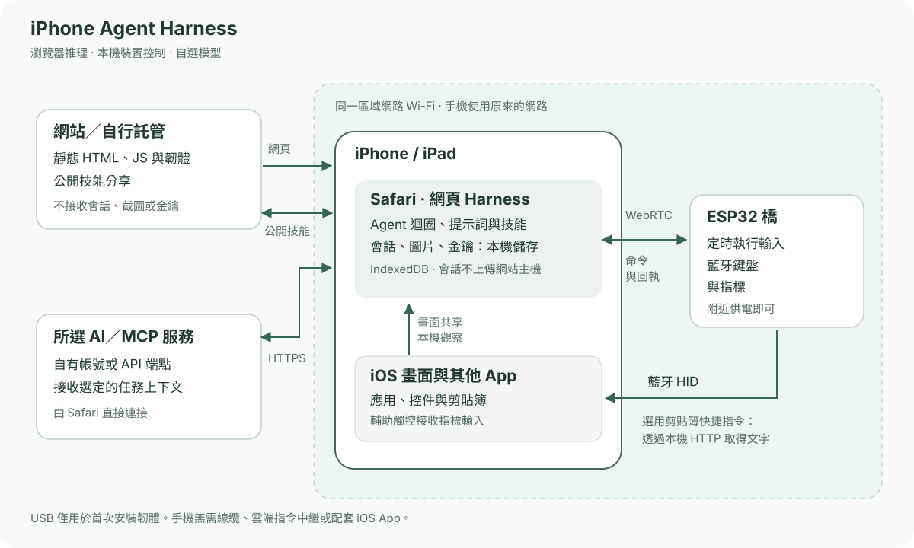

# iPhone Agent Harness

[English](../../README.md) · [简体中文](zh-Hans.md) · **繁體中文** · [日本語](ja.md) · [Русский](ru.md) · [Deutsch](de.md) · [Français](fr.md) · [Español](es.md)

**用瀏覽器與約 2 美元的 ESP32-C3，為 iPhone 加上 AI 助手。**

用自然語言讓 iPhone 完成一件事：讀屏、輸入文字、調整控件，或跨 App 執行流程。小巧的 ESP32 通電提供藍牙輸入，Safari 負責對話、取屏與 AI 調度。

[開啟 Harness](https://igent.cc/) · [瀏覽器燒錄](https://igent.cc/flash) · [完整教學](../guide/zh-Hant.md) · [技能社群](https://igent.cc/skills) · [架構圖](../architecture/overview.md)

- **瀏覽器直接燒錄。** 電腦 Chrome 或 Edge 使用預編譯韌體，無需編譯器、Arduino 環境或建置手機 App。

- **手機保持無線。** 設定後讓橋在架上或房間角落持續供電，在藍牙／Wi-Fi 範圍內即可，不需 USB 連著手機。

- **使用原來的網路。** 手機與橋連同一區域網路 Wi-Fi，ESP 熱點只用於首次設定。無需原生 App、安裝憑證、輔助分頁或另建網路中繼；開始共享時正常確認畫面共享提示即可。


操作影片／GIF 待補充。

## 運作方式

Safari 取得手機畫面，把選定內容傳給你選擇的 AI。Harness 檢查計畫，經區域網路 WebRTC 直接交給 ESP32，以藍牙鍵鼠操作，再用新畫面確認。



[架構圖](../architecture/overview.md)

## 選擇開發板

基礎 ESP32-C3 板可用約 **2 美元**作入門成本示例，不是報價或保證；商家、運費和板型會影響價格。依安裝器的實際晶片選韌體，使用資料 USB 線。

| 晶片 | 韌體狀態 | 說明 |
|---|---|---|
| ESP32-C2 | 提供預編譯下載 | 最低 2 MB；26/40 MHz 自動選擇；USB 轉串列埠；單應用、無 OTA |
| ESP32-C3 | 提供預編譯下載 | 4 MB 快閃記憶體；瀏覽器安裝 |
| ESP32-C5 | 提供預編譯下載 | 4 MB 快閃記憶體；80 MHz 設定；原生 USB CDC |
| ESP32-C6 | 提供預編譯下載 | 4 MB 快閃記憶體；瀏覽器安裝 |
| ESP32-S3 | 提供預編譯下載 | 4 MB 快閃記憶體；瀏覽器安裝 |
| ESP32 (classic) | 提供預編譯下載 | 4 MB 快閃記憶體；瀏覽器安裝 |

## 安裝與使用

完整教學涵蓋以下步驟，可直接跳至對應章節：

1. **[啟用輔助功能](../guide/zh-Hant.md#accessibility)。** 開啟輔助觸控，全鍵盤控制開關皆可。

2. **[燒錄韌體](../guide/zh-Hant.md#flash)。** 電腦開啟安裝器，選晶片安裝對應映像。

3. **[連接 Wi-Fi](../guide/zh-Hant.md#wifi)。** 首次保存常用 2.4 GHz 網路，手機回同一區域網路。

4. **[藍牙配對](../guide/zh-Hant.md#bluetooth)。** iOS 設定配對 iPhone Agent Bridge。

5. **[開啟 Harness](../guide/zh-Hant.md#open-harness)。** 使用 iOS/iPadOS 27+ Safari，任務中保持解鎖。

6. **[設定 AI](../guide/zh-Hant.md#models)。** 保存 OpenAI／Anthropic 相容端點與金鑰，或依介面登入 ChatGPT，取得並選模型。

7. **[連接與測試橋](../guide/zh-Hant.md#bridge)。** 匯入連結，選就緒手機，數字測試為選用。

8. **[安裝剪貼簿快捷指令](../guide/zh-Hant.md#clipboard)。** 加入 iPhone Agent Clipboard，等複製確認後再貼上。

9. **[安裝社群技能](../guide/zh-Hant.md#install-skills)。** 在公開目錄加入需要的技能。

10. **[創作技能](../guide/zh-Hant.md#authoring)。** 電腦或手機編寫／修改，歸屬使用瀏覽器簽章身分。

11. **[發布技能](../guide/zh-Hant.md#publish)。** 明確公開選定套件，並備份創作者身分。

## 會話保留閱讀位置

提問、可檢查計畫及操作在同一會話。列表標題切會話／封存，左滑改名／封存或還原／刪除。讀舊訊息時保留位置，點「回到最新」才回到最新內容。匯出入含圖片。AI 先核對結果，預設隨後返回 Harness，可在「設定 → 任務完成後」關閉返回。

12 個內建技能涵蓋觀察、規劃、輸入、恢復、時鐘與手勢修正。內建／下載技能唯讀，重新整理檢查更新並保留啟用選擇。自有技能可編輯；發布身分屬瀏覽器，不是 iOS UID。選用 MCP 連接支援瀏覽器 CORS 的 Streamable HTTP 工具。

## 資料與自行託管

會話、金鑰、登入資訊和畫面存在你的瀏覽器。我們的主機不接收你的會話、畫面或模型金鑰，只供應靜態網頁及公開技能；選定訊息／圖片直接送模型，授權 MCP 呼叫送至設定的伺服器。發布僅上傳明確選擇的包。清資料或換瀏覽器前匯出重要會話並單獨備份作者身分。

硬體仍屬實驗能力；手勢、背景取屏、快捷指令、多手機需於目標裝置檢查。Safari 可能暫停背景工作；橋目前一個活動 WebRTC 連線，ChatGPT 訂閱登入需確認 Safari 相容性。可隨時停止，每個計畫有安全限制。

## 開發、託管與貢獻

可自行託管網站、設定模型及選用公開技能 API。歡迎 Issues 和 PR；可重用技能請在網站社群分享。

本機開發需要 Node.js 22.13 以上。

```sh
npm ci
npm test
npm run build
npm run preview
```

[Arduino 說明](../../firmware/IPhoneAutomationHarness/README.md) · [自行託管](../architecture/deployment.md) · [手動發布](../architecture/manual-release.md)

[MIT License](../../LICENSE) · [Third-party notices](../../THIRD_PARTY_NOTICES.md)

## 致謝

感謝 [onehumanbeing/esp32-iphone-agent](https://github.com/onehumanbeing/esp32-iphone-agent) 的啟發。本專案採獨立瀏覽器、取屏及藍牙橋接設計。
