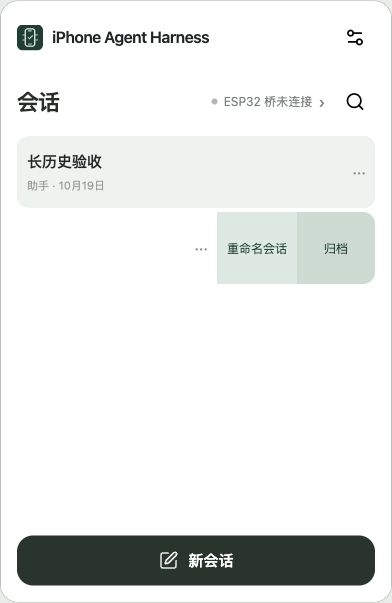

# Continuous task and interaction acceptance — 2026-10-19

## Verified changes

- Normal session rows reveal rename/archive on left swipe. Archived rows reveal rename/unarchive/delete. Swipe reveals controls rather than silently mutating records. Browser-back edge and vertical gestures remain separate; one row opens at a time.
- Optional native keyboard input check no longer gates a successfully associated phone. Refresh and Start are explicit input-test gestures; Connect and background monitoring never send HID. Eight native digits automatically confirm after the final key release. Cancellation invalidates late results and releases input.
- Current credentials are inspected by profile from durable local records. Account visibility is not treated as proof of a saved key. Historical memory-only keys cannot be reconstructed; encrypted legacy records remain intact. A newly saved key is never replaced with a guessed account's credential.
- Default whole-task step/tool/time cutoffs removed. Per-plan bounded duration, cancellation, ownership, and unknown-delivery fences remain. More than 26 executor plans and more than 512 completed receipt segments are covered without relaxing uncertain-action replay protection.
- Gesture correction is a built-in skill. It uses screenshot feedback, reduced correction distances, careful inertia and edge handling, direct numeric entry where available, and short reusable target/orientation-scoped correction notes. Post-action waits differ by operation; explicit picker waits can exceed one second.
- Reading older messages pauses follow. New durable rows remain available without evicting the reader's window; older history can load during a run. Both send/resume finalizers use the current resident snapshot after metadata reads, avoiding late history replacement. Explicit Latest returns to the tail.

## Executed acceptance

- Full web suite: **765 passed**, zero failures (`node --test tests/web/*.test.mjs`). This includes credential reopening, optional binding/cancellation, continuous runtime, gesture settling, swipe actions, reading intent, and both finalizer races.
- Independent runtime/UI rounds found two additional reading races; both reproduced, repaired, and independently revalidated. See [round 1](continuous-runtime-independent-r1-20261019.md) and [round 2](continuous-ui-independent-r2-20261019.md).
- Chrome, production UI in an isolated local browser fixture: dragged a normal row left; renamed it without leaving the list; archived it; opened archived sessions; dragged it left and restored it. Archived deletion is verified through the store/action tests, not applied to user data.
- Chrome, synthetic 80-line streaming reply over an existing 100-message history: manually scrolled up during output. First visible message stayed at history item 83 and scrollTop stayed **2314.5** throughout output and after completion. Latest then displayed line 80 with remaining scroll distance **0**. No model service, phone pixels, or phone input participated.
- Current-source four-profile firmware verification and sealed build inputs passed. Firmware source SHA-256: `d6d8f75211fd14b8aa57d3f5ebf0f32d7fa425fe4f588df263a4eeb62a4b244a`.
- Published Worker deployment: `7ba213c4fed84f2a9e7ee533fcc989f4`. Exact public-file verification is recorded in [site verification](continuous-ui-release-site-20261019.json).

## Physical boundary

The only authorized serial device `/dev/cu.usbmodem1101` was absent. Four firmware images were compiled and prepared for download/online flashing, but **not flashed or physically verified in this pass**. New direct association needs the updated firmware. Older unbound firmware with the exact missing-route response retains its legacy input-test path rather than breaking connection. Actual pointer precision, picker inertia, optional HID test, and the full phone workflow remain phone acceptance items in the [focused checklist](../acceptance/zh-Hans.md). No claim of physical calibration is made from simulated screenshots or host tests.
