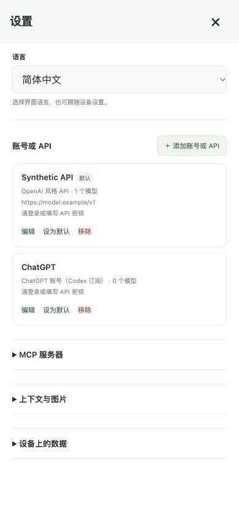
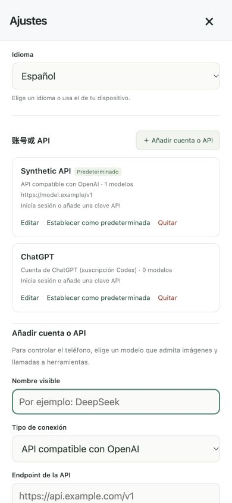
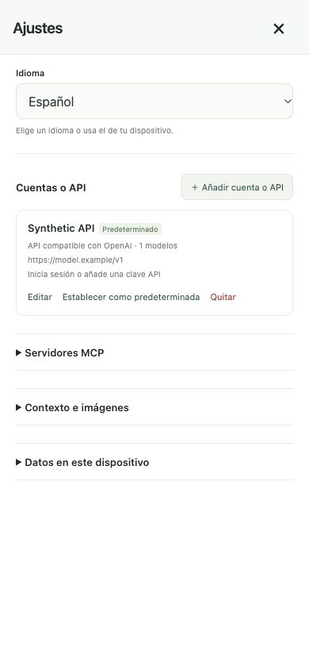
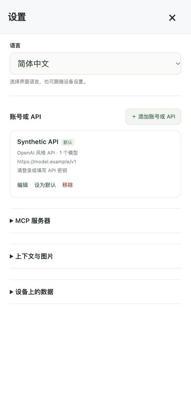
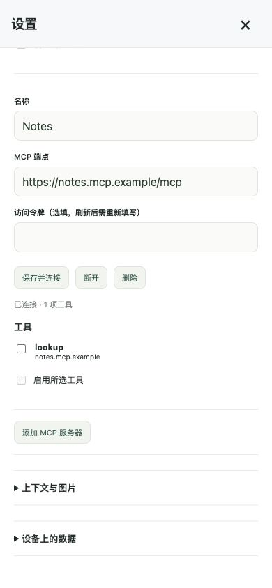

# Independent main-flow review R2

Reviewed 2026-10-18 in native Chrome on macOS, using the production application and native IndexedDB on the disposable localhost fixture origin. **This round is finding-bearing.** Two new UI defects were reproduced, repaired by the main session, and retested successfully. R2 does not count as a fresh no-findings review.

## Findings

### MF-R2-1 — cancelling first ChatGPT login leaves an unsaved account behind (fixed)

Reproduction: Settings → Add account/API → ChatGPT → Start login → Cancel editor, without ever pressing Save → close/reopen Settings. A new ChatGPT card with zero models appeared. Immediately after cancelling, the list still showed only the original API, making the later extra card unexpected. Starting login persisted the profile before authentication; cancelling only removed its editor.

The repaired implementation keeps a provisional account ID in memory until Save and discards provisional credentials when abandoning the editor. Fresh-page retests performed both Cancel editor during the pending request and the panel's X during the pending request. Reopening Settings showed only the original Synthetic API in both cases. The first-login button remains available before Save.

### MF-R2-2 — live locale changes leave the accounts heading in Chinese (fixed)

Reproduction: open Settings in Simplified Chinese, then select English, Traditional Chinese, Japanese, Russian, German, French or Spanish. The accounts heading remained `账号或 API`; nearby buttons and API endpoint labels translated. The heading used a translated string without an explicit translation binding, while the reverse map still contained the retired wording.

The repaired heading has an explicit translation binding. All eight real DOM locale transitions now show the appropriate heading. Before/after snapshots are saved as `locale-snapshots.json` and `locales-fixed.json` in the evidence directory. The API endpoint/form wording was also inspected across all eight languages; no raw translation key was displayed in those form labels.

## Functional journey and current results

1. **Create a session and send a model message — passed.** The fixture created and persisted a session, discovered the synthetic API model, saved its profile, submitted a message and displayed the reply.
2. **Save context/image settings — passed.** Default 750000 passes browser-native validity. Both fixture `requestSubmit()` and a separate native mouse click on Save succeeded. High-quality JPEG selection and 750000 survived closing and fresh document navigation. The UI states original dimensions are retained; the retired target/extractive controls are absent.
3. **Recover from closed database handles — passed in native Chrome.** The fixture explicitly closes IDB handles, then opens Settings, saves context, opens Devices/Skills and creates a session. Existing messages survive. Focused core tests separately cover reconnect concurrency, unexpected close, failed reopen, explicit close, upgrade and aborted writes.
4. **Use Skills/community — passed.** Built-in skills render; the synthetic catalog is requested through the fixed website endpoint. No community endpoint setting is present.
5. **Use two MCP entries and close a long settings panel — passed.** Docs and Notes persist as separate entries. Both were independently reconnected through native clicks after a fresh document load and displayed one tool each. Scrolling to the second entry leaves the heading/X visible; clicking X actually closes the panel. This round does not assert an LLM-to-MCP execution round trip.
6. **Export/import a conversation — passed for application handlers.** The fixture invoked the actual session/list menus, generated a JSON Blob and imported a File/DataTransfer containing the assistant reply. Three session rows remained after independent top-level reload. OS file selection/download delivery are intercepted by the fixture.
7. **Cancel/close first ChatGPT login and resume Settings — fixed and passed**, as described in MF-R2-1. Authentication responses are synthetic, delayed and abort-aware; no real credential or OpenAI authentication request is used.
8. **Switch interface language — fixed and passed**, as described in MF-R2-2.
9. **Narrow brand/header navigation — passed.** At 320/390/430 CSS px, brand white-space is `nowrap`, with right edges 208.92/232.66/246.27 px, inside each viewport. The visible homepage header Harness link was clicked and returned to the session list.

## Independent core review

Inspected `store.js`, `context.js` and the model/overflow loop in `harness.js`. The reconnect retry wraps transaction creation only; started work is not replayed. Native version changes release the old connection and a newer incompatible schema produces a reload error rather than database deletion or RAM fallback. Text compaction uses the current model; the 750k user trigger and internal retention target remain separate. Image-count-only boundaries retain the full text/tool history and change image selection without invoking a summary. Overflow retries are limited to one model attempt after successful compaction, before tool dispatch, and are disabled once streamed text has been emitted.

Executed 31 focused existing tests in `store-lifecycle.test.mjs`, `context.test.mjs` and `context-provider-integration.test.mjs`; all passed. Added and executed two independent tests in `tests/web/independent-main-flow-r2.test.mjs`; both passed:

- A prior model summary followed by eleven screenshot/tool groups retains its checkpoint text/boundary, every tail message ID/text, tool pairing, eight selected image references and stable repeated projection.
- Overflow after already-emitted text causes exactly one model call, zero summary calls and zero tool-start events.

No new core defect was found in this review. These tests use synthetic providers and do not claim real 750k provider stress testing.

## Test-harness limitation and evidence scope

This run repeatedly completed the first 25 main-flow fixture assertions through conversation import, then waited indefinitely for the embedded iframe's second navigation to commit. No application error was reported. Redirecting server logs and replacing the iframe did not resolve it; the speculative iframe change was reverted. The cause remains unconfirmed. An old `build/main-flow-result.json` from the prior round was not treated as current-pass evidence. The remaining reload/persistence, MCP reconnect, narrow brand and header-navigation checks were completed by native actions in a fresh top-level application document. A real top-level reload worked and retained the three session rows.

The fixture additionally intercepts `auth.openai.com` device-code/poll calls for abort-aware cancellation checks. iOS identity is simulated to expose the phone layout. Native Safari lifecycle/background capture, physical phone permissions and HID/device transport are outside this round. No live keys, hardware commands, workflow actions or deployment were used. Screenshots were saved, opened and checked; a transient incorrectly scaled viewport screenshot was rejected and replaced with the accepted full-page capture.

For the next direct native review, run `python3 tests/browser/main-flows-server.py > /tmp/main-flows-review-server.log 2>&1` and open `http://127.0.0.1:18952/apps/web/?fixture=r2-fixed` (the `fixture` query activates only the local server's isolated bootstrap). The initial manual review used `?fixture=r2-manual`. Set the viewport to 390×844 through the browser testing interface. After this round, the cleanup button confirmed `Disposable fixture databases removed.`, the viewport override was reset, the sole reviewer-created tab was closed, and the reviewer-owned server was stopped. Other Chrome tabs were preserved. The final application console query contained no errors or warnings.

## Reviewed final snapshot

| File | SHA-256 |
| --- | --- |
| `apps/web/app.js` | `0a041faece140c2328aa705f8873b2106f1dca1ea409c6978ba5a9b073a9ac76` |
| `apps/web/core/store.js` | `bf3a44cff374b88b8f443497826ff75a0f5cdfaa62ba61040e8dc2f4d06a15fb` |
| `apps/web/core/context.js` | `d6af1cec957ee7cdb527a35f8e80af25c3edd471eec927faf96b9786e8272577` |
| `apps/web/core/harness.js` | `abd1f8932329deb91e66f1c7fd81f54831d88563be850fa3d2c254611f458866` |
| `apps/web/locales/messages.js` | `19dc3fe7ff76c6adbe170904d5a12d1300f7161e2c5c85ddb1194b68af7eec11` |
| `tests/browser/main-flows.html` | `e0d4cce31f5aa18fa28d5aec774e89238072b3ae005ecba53954c1b83c9a4151` |
| `tests/web/independent-main-flow-r2.test.mjs` | `e1e5aab7550de3fcf7a0a95da42332e997eb7f8b3c5aaa21a98a78a4b79afff8` |
