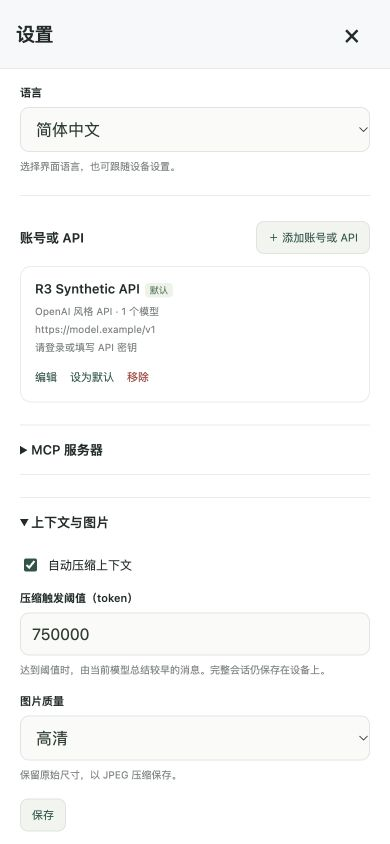
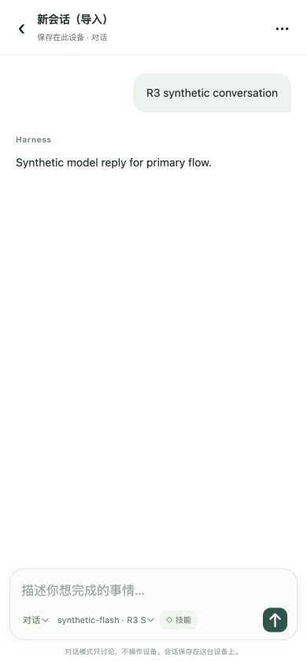

# Independent main-flow review R3

Reviewed 2026-10-18 in native Chrome on macOS. **No new reproducible defect was found in this fresh scoped review.** The reviewer made no production implementation changes. This round exercised the connected primary user journey independently, including the prior repaired behaviors, rather than accepting the earlier reports as proof.

The production app ran directly at `http://127.0.0.1:18952/apps/web/?fixture=r3`, with native DOM, browser form submission and native IndexedDB. The local fixture simulates iOS identification, API models/replies, ChatGPT authentication, community catalog and MCP responses. The viewport was 390 × 844 CSS pixels except for explicit 320/430-width checks.

## Observed primary journey

- Created a new conversation; opened Settings; selected high-quality JPEG and clicked the actual Save button with the default `750000` threshold. A saved message appeared. Reopening and a full document reload retained both values. Retired extractive/target controls were absent.
- Added `R3 Synthetic API`, fetched the returned `synthetic-flash` model, saved the profile and sent a message. Its synthetic reply appeared in the conversation. The saved profile survived reload; its temporary credential correctly did not survive.
- Started a new ChatGPT sign-in and cancelled the editor before Save. Reopening Settings showed only the saved API. Repeated using the panel X during the pending authentication request; again no extra account persisted. No live authentication request was made.
- Switched all eight locales with Settings open, then repeated across the saved API editor. Settings/account headings and account/form fields changed language; no stale Chinese heading or raw translation key was observed. Exact DOM text is retained in `main-flow-r3-evidence/locales.json`.
- Opened ten built-in Skills, then community. The synthetic catalog appeared from `https://igent.cc/api/skills?cursor=&limit=30`; no community URL setting was present.
- Added **two servers with the same display name**, using separate Docs and Notes endpoints. Each connected and displayed its own `lookup` tool description. They had distinct stable IDs, which remained associated with the correct endpoint after full reload.
- Exported the conversation through its menu, then imported it through the list menu. The imported conversation contained both user text and assistant reply and retained them after full reload. The application export/import handlers, JSON Blob and File/DataTransfer were exercised; OS download delivery and file selection were intercepted.
- Closed the fixture's native database handles, then saved Settings, opened Devices and Skills, and created another conversation. Those actions succeeded; the three conversation rows and imported content survived reload. Entry requested storage persistence; the fixture deliberately returned false.
- Scrolled down through both MCP entries. The close control remained at y=12–56 within the 844-pixel viewport and was hit-testable; clicking it closed the panel. At 320/390/430 CSS pixels, brand text remained `nowrap`, with right edges 208.92/232.66/246.27 pixels. The visible homepage header Harness link returned to the session list.





Additional checked screenshots show the [scrolled settings close control](main-flow-r3-evidence/01-scrolled-settings.png) and [homepage header](main-flow-r3-evidence/04-home-header.png).

## Core checks

Inspected the draft-account cleanup, shared database reconnect/transaction boundary and model overflow retry handling. Executed:

```text
node --test tests/web/store-lifecycle.test.mjs tests/web/context.test.mjs tests/web/context-provider-integration.test.mjs tests/web/independent-main-flow-r2.test.mjs
33 passed, 0 failed, 0 skipped
```

These cover connection closure/reopen and failed writes, bounded model compaction, preserved tool groups/text/image projections, prior checkpoint preservation, capacity-triggered compaction, one overflow retry, and refusal to retry after streamed output. The two independent R2 cases were rerun. No new test was necessary for a newly found bug because this round found none. Synthetic large-context tests are not real-provider 750k stress evidence.

## Limits and cleanup

This is a local web/core review, not actual iPhone Safari acceptance. It does not establish physical screen capture, Safari suspension/resume, background scheduling, phone permissions, HID, real-provider authentication, LAN/device transport, or deployment. The Devices panel opened and remained operable, but the concurrently developed device-helper HTTP feature was excluded. No real credentials, phone actions, serial access, firmware flashing, workflow dispatch or deployment were used.

The direct top-level app reload succeeded; this round did not use the earlier stalled iframe reload automation or its old result file. Fixture error arrays were empty before and after reload, and the final browser log query returned no warnings/errors. Two inspection API limitations (read-only DOM method support and an exact-label selector) were resolved with supported native Save/DOM selectors; neither was an application failure.

Screenshots were saved and visually inspected. The reviewer removed only `primary-flow-repair:` databases on this dedicated localhost origin and its `iah.locale` test setting; a subsequent database enumeration showed none remaining. The temporary viewport was reset, only the reviewer-created tab was closed, and the reviewer-owned port-18952 server was stopped. Other tabs and the port-18947 phone probe were preserved.

## Reviewed snapshot

| File | SHA-256 |
| --- | --- |
| `apps/web/app.js` | `0a041faece140c2328aa705f8873b2106f1dca1ea409c6978ba5a9b073a9ac76` |
| `apps/web/styles.css` | `4d92ac017bba403e2f67ed33c77f7ae5ffe246164f412c50c0f6ed860da6fce0` |
| `apps/web/core/store.js` | `bf3a44cff374b88b8f443497826ff75a0f5cdfaa62ba61040e8dc2f4d06a15fb` |
| `apps/web/core/context.js` | `d6af1cec957ee7cdb527a35f8e80af25c3edd471eec927faf96b9786e8272577` |
| `apps/web/core/harness.js` | `abd1f8932329deb91e66f1c7fd81f54831d88563be850fa3d2c254611f458866` |
| `apps/web/locales/messages.js` | `19dc3fe7ff76c6adbe170904d5a12d1300f7161e2c5c85ddb1194b68af7eec11` |
| `tests/browser/main-flows-server.py` | `0ec3807b7df8687a2921a6014667cdaf5f91224792faef418b062e679b4d9fb1` |
| `tests/browser/main-flows.html` | `e0d4cce31f5aa18fa28d5aec774e89238072b3ae005ecba53954c1b83c9a4151` |
