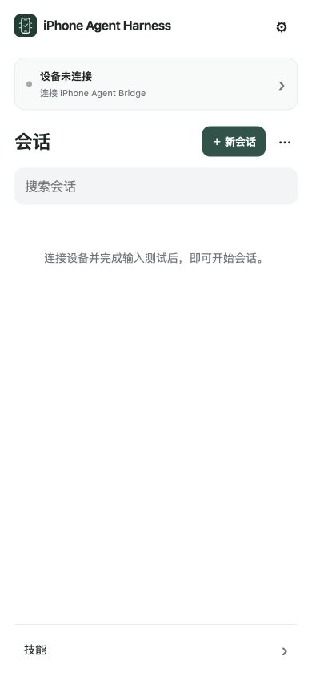
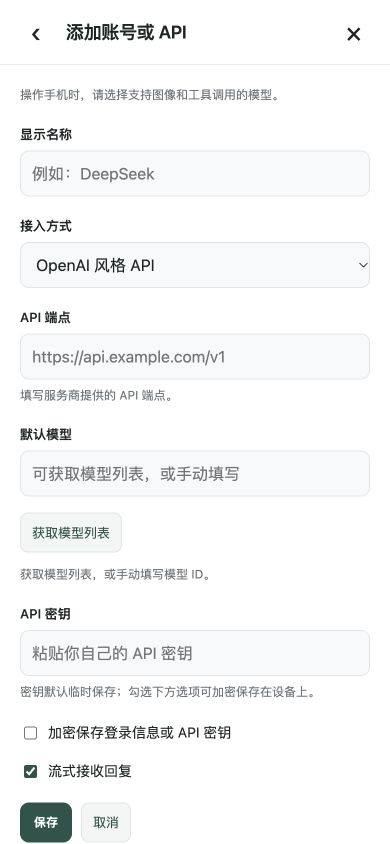

# 手机界面、设备连接与凭据保存修复

本轮对应用户在手机上反馈的配对超时、会话入口、键盘布局、设备操作用词和 MCP 保存问题。网页与固件源码分别交付；没有连接串口或刷写设备。

## 页面流程

| 步骤 | 当前行为 | 本轮检查 |
| --- | --- | --- |
| 1. 打开会话列表 | 顶部显示设备状态，设置放在标题旁；归档和导入收进会话菜单，减少重复标题和底部按钮 | 390×844 的实际浏览器页面已检查 |
| 2. 新建或发送 | 先确认设备当前响应及输入测试；未就绪进入设备设置，已有会话仍可查看 | 独立测试验证无会话创建、无模型请求、无旧会话草稿覆盖 |
| 3. 设置 → 添加账号或 API | 独立页面，有返回和关闭；默认不聚焦输入框，不把长表单插入设置中间 | 浏览器确认初始滚动位置和焦点；取消、重复保存与迟到登录结果回归通过 |
| 4. 搜索或填写表单 | 页面、背景和浏览器主题统一白色；只滚动内容；可视区域缩小后隐藏列表底部入口 | 模拟 430 高度、70 顶部偏移，页面未滚动出白洞，关闭按钮仍在可视区 |
| 5. 连接设备 | 输入测试明确叫“连接测试”；辅助触控放教程；不要求关闭全键盘控制，无声明复选框 | 浏览器确认无设备解锁密码、无 Direct LAN 选项 |
| 6. 添加 MCP | 默认折叠的服务器列表；令牌、工具选择及启用状态保存在本地；刷新恢复 | 新数据库连接、新 MCP 实例和实际浏览器重载检查通过 |

设备连接记录使用独立的浏览器本地凭据记录，不进入普通设置或会话导出。断开设备会取消当前页输入证明；再次连接需要重新完成测试。设备状态每五秒串行检查，回到前台以及新建/发送前也检查。即使录屏仍在运行，断开的设备也不能继续显示为就绪。

MCP 明确断开会保留凭据并停止自动重连，删除才清除该服务器的记录。打开或关闭设置不会取消启动恢复；读取私有记录尚未结束时修改工具，不会用空令牌覆盖保存值。

## 截图

截图来自本轮实际浏览器中的生产界面，手机尺寸与设备身份通过本地测试页模拟。它们不是手机 Safari 的截图。

[调整前会话页](mobile-layout-evidence/01-before-list.png) · [调整前账号表单](mobile-layout-evidence/02-before-provider.png)

[设备设置页面](mobile-layout-evidence/05-device-flow.png) · [模拟键盘几何结果](mobile-layout-evidence/viewport-provider.json)

## 蓝牙源码修复

移除了“网页登记之后两分钟内才允许新手机连接”的隐藏限制，补上晚到的蓝牙身份解析，名称改为 **iPhone Agent Bridge**。独立检查还发现旧手机绑定可能永久占用应用名额；现在只回收离线旧绑定，保护在线手机、正在配对的手机和正在执行的输入，替换后的手机必须重新测试。

固件主机测试、存储失败及掉电恢复测试通过，C3 临时编译通过。候选只在 `build/ble-pairing-repair/`，官网烧录下载仍保留此前发布版本；待用户接回 C3 后再刷写、验证并更新对应发布产物。当前手机上的名称或配对状态没有被远程修改。[固件修复细节](ble-pairing-repair-20261018.md)

## 验收边界

真实 iOS 键盘及系统栏表现仍需手机确认，浏览器的可视区域模拟不能代替它。蓝牙实际配对、全键盘控制开启时的目标 App 行为以及新版录屏/HID 闭环，本轮没有硬件验证。

移除的设备“解锁密码”原指本地凭据加密密码，并非手机锁屏密码。本轮没有实现或宣称自动解锁手机。锁屏后屏幕捕获能否继续未经过本机实测；[屏幕捕获规范](https://w3c.github.io/mediacapture-screen-share/#closed-and-minimized-display-surfaces)允许在捕获来源不可用时暂停或结束轨道，不能据此假定 Safari 锁屏后一定持续取图。

独立检查记录：[R1](mobile-repair-independent-r1.md)、[R2](mobile-repair-independent-r2.md)、[R3](mobile-repair-independent-r3.md)、[R4](mobile-repair-independent-r4.md)、[R5](mobile-repair-independent-r5.md)、[R6](mobile-repair-independent-r6.md)、[R7](mobile-repair-independent-r7.md)。前六轮发现的问题均修复后再运行回归；最后的全新 R7 没有发现新的可复现问题。各报告保留本轮实际检查与未验证范围。

完整网页测试 452 项通过。一次旧测试在并行执行时因固定微任务轮数等待失败，已改为等待实际提交/释放事件，保留五秒失败上限，没有修改运行时代码来掩盖失败。固件主机测试与 C3 临时编译单独验证；没有把旧版官网固件当作这次候选。

网页已通过现有 Cloudflare 连接发布，GitHub Actions 未执行。[线上逐文件结果](mobile-ux-site-verification.json)单独保存。首次发布后读取时两个模块仍返回旧内容，随后直接重新读取已匹配新构建，再对全站重新校验；未把首次不一致记为通过。
